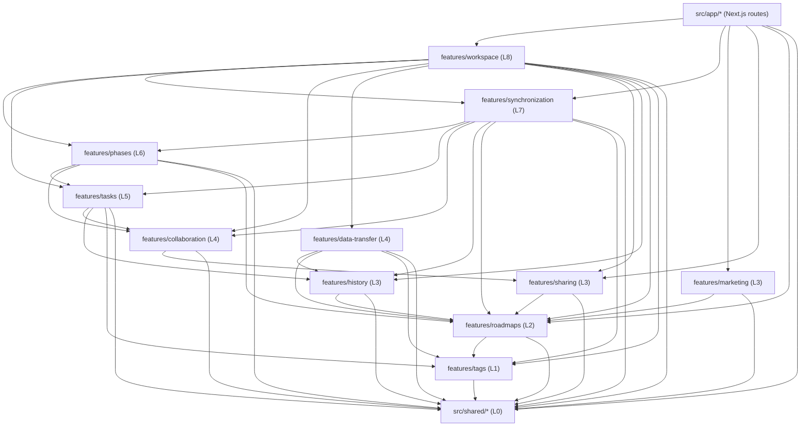
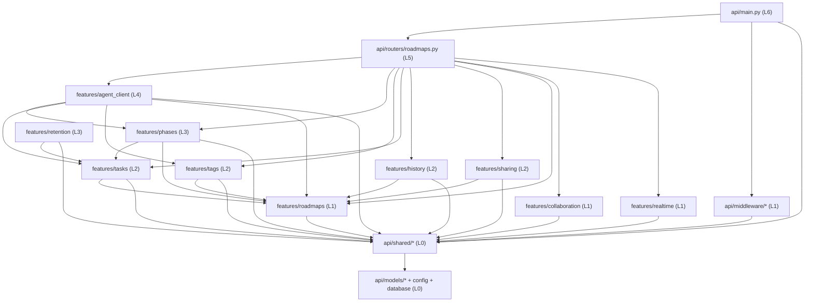

# RoadForge Architecture Modernization Plan

Status: revised architecture plan incorporating independent review feedback (APPROVE WITH REVISIONS). Nothing in this plan has been implemented.
Author role: Head Developer / Architecture Lead, RoadForge (Anvilary Tools).
Evidence date: 2026-11-18.

Conventions used in this document:

- **Verified** means observed directly in source, git, or a command run during this
  review. **Assumption** means inferred and not verified. **Not executed** means a
  validation that could not be run in this environment.
- Paths are repository-relative unless stated otherwise.
- Line numbers refer to current `main` (`d1ed0af4d065428e712e64394cdf9347cbc4f557`). The final modernization baseline SHA will be locked only after **Stage -1 (Pre-refactor reconciliation)** is completed.

---

## 1. Executive summary

### 1.1 Main conclusion

RoadForge does not need a rewrite. The review found a codebase whose layering is
already sound where it matters:

- Backend: no import cycles (verified with an AST import-graph analysis of all 91
  files under `apps/api/src/api`), strict `routers -> services -> models` direction, no
  service imports a router, schemas and models import nothing from services.
- Frontend: no file-level import cycles (verified with a script over all non-test
  `.ts/.tsx` files), exactly one `fetch(` call site in the whole application
  (`services/roadmap-http.ts`), one persistence module (`lib/storage.ts`), and a
  domain-sliced context (`RoadmapDataContext`, `RoadmapSessionContext`,
  `RoadmapLifecycleContext`).
- The collaboration and synchronization design is deliberate and heavily tested
  (server-authoritative writes under a row lock, per-scope write generations on the
  client, fail-closed revocation, bounded SSE streams).

The problems are organizational and about duplicated invariants, not about wrong
foundations. The modernization is therefore a **reorganization plus a small number of
targeted consolidations**, delivered as small, independently validated commits on
`main`.

### 1.2 What is actually wrong (confirmed, ranked)

| # | Finding | Priority |
|---|---|---|
| B1 | The "mutate snapshot, bump `updated_at`, log activity, sync projection, cap activity log, commit, publish event" pipeline is hand-copied in about ten service functions. `updated_at` is the optimistic-concurrency token and is assigned at 13 sites. | High |
| B2 | Router boilerplate is copied per router: `_participant_rate_key` in 11 files, `_OWNER_EDITOR` in 8, 53 inline `rate_limiter.enforce(...)` calls with literal limits. The rate-limit policy cannot be read in one place, and the test harness patches `rate_limiter` on 10 router modules by name. | Medium-High |
| S1 | MCP client follows HTTP redirects with the default `fetch` policy. Verified locally: an invite-join `POST` body (invite token and optional password) is forwarded to a redirect target. No `apiUrl` scheme validation. | Security, Medium |
| B3, B4 | SSE lifecycle (about 110 lines of nested leases, subscriptions, revocation re-checks) lives inside a router. The revocation protocol is split across four modules. Both are security-sensitive and hard to audit. | Medium |
| F2 | `hooks/useRoadmapRealtime.ts` is 1056 lines. About 220 lines are pure, non-exported refresh-request logic that cannot be unit-tested directly. | Medium |
| F5 | Two different `isAuthError` predicates: one checks HTTP status, the other sniffs `'401'`/`'403'` in `error.message`. | Medium |
| F10 | Validation limits are hand-mirrored between `schemas/limits.py` and `lib/roadmap-validation.ts`, with no parity check. | Medium |
| B5 | `services/` is a flat 40-file namespace. `roadmap_helpers.py` (418 lines) is a dumping ground whose underscore-prefixed functions are imported by 8 modules. Compat re-export facades hide real ownership. | Medium |
| F1 | Local-persistence writes (`setRoadmapCache`, `setAuthCache`) originate from about 12 call sites using ad hoc get/spread/set. | Medium |
| F11 | Tooling and tests are path-coupled in ways a naive rename breaks (details in section 4.8). | Medium (migration risk) |

Lower-priority duplication (dialog lifecycle, date formatting, dependency cleanup, a
dead barrel) is catalogued in section 4.

### 1.3 Proposed architecture in one paragraph

Keep `apps/`. After completing pre-refactor reconciliation (Stage -1) and mandatory
baseline runtime verification (Stage 0), rename `apps/web` to `apps/frontend` and
`apps/api` to `apps/backend` as two purely mechanical commits (Stage 1). Inside the
frontend, introduce 11 cohesive feature modules under `src/features/*` (`tags`,
`roadmaps`, `sharing`, `collaboration`, `history`, `tasks`, `phases`, `data-transfer`,
`synchronization`, `marketing`, `workspace`) and shared technical/domain primitives
under `src/shared/*` (`types`, `http`, `storage`, `context`, `domain`, `reorder`, `lib`,
`ui`), forming a verified zero-cycle directed acyclic graph (Section 6). Inside the
backend, introduce 10 domain feature modules under `src/api/features/*` (`roadmaps`,
`tags`, `tasks`, `phases`, `history`, `sharing`, `collaboration`, `realtime`,
`retention`, `agent_client`), top-level router aggregation (`src/api/routers/roadmaps.py`),
and `src/api/shared/*` (`auth`, `security`, `realtime`, `health`, `ids`), forming a
verified zero-cycle backend DAG (Section 7) with `alembic/` and centralized ORM models
(`src/api/models/roadmap.py`) owned by the backend. Keep `packages/roadforge-mcp` as an
independent zero-dependency package. Do **not** create `packages/contracts`,
`packages/core`, `packages/ui`, or a root `tests/` directory.

### 1.4 Deliberate deviations from the suggested target tree

| Suggested | Decision | Reason |
|---|---|---|
| root `tests/{unit,integration,runtime,security,performance,e2e}` | Not created. Tests stay colocated per app. | Frontend has 104 colocated test files, Playwright is bound to the Next dev server, the backend conftest is bound to the app package. A root `tests/` would add path indirection with no ownership benefit. Taxonomy is delivered by naming and Make/CI targets instead (section 13). |
| `packages/contracts` | Not created. | There is one TypeScript consumer of the API (the web app) plus one (the MCP package) that intentionally has zero dependencies. Evidence-based alternatives in section 9. |
| `tooling/` | Keep `tools/` (provisional decision D8). | Pure cosmetic rename touching `package.json`, CI, docs. |
| root `scripts/` | Not created. | App-specific scripts already live in `apps/*/scripts`. No root scripts exist. |
| Python package `api` under `src/api/` | Kept as `api`. | Renaming the import root touches every import, Alembic, Dockerfile, uvicorn target, and test. No benefit. |

### 1.5 Recommended order of work

- **Stage -1 (Pre-refactor reconciliation):** Independently review open dependency PRs, external PR #83, historical development branches, potentially missing functionality, and security fixes. Incorporate any work to preserve into `main` and record the final modernization baseline SHA before structural changes begin.
- **Stage 0 (Mandatory baseline runtime verification):** Provision the exact Node 24, Python 3.12 (`uv`), PostgreSQL 16, Redis 7, Docker, and Playwright Chromium environment and execute all validation gates. No structural or behavioral changes proceed until Stage 0 is verified green.
- **Stage 1 (Mechanical directory migration):** Two purely mechanical commits (`apps/web -> apps/frontend`, then `apps/api -> apps/backend`) updating all build, Docker, Compose, CI, tooling, and doc references with zero logic changes.
- **Stage 2 (Incremental frontend decomposition):** Extract `src/shared/*` in 5 small, independently validated steps (types/lib, HTTP, storage, context slice definitions + stateless domain helpers, UI + keyboard reorder), then extract `src/features/*` in bottom-up topological order (`marketing`, `tags`, `roadmaps`, `sharing`, `collaboration`, `history`, `tasks`, `phases`, `data-transfer`, `synchronization`, `workspace`) with automated DAG enforcement. Behavioral fixes are strictly excluded from Stage 2.
- **Stage 3 (Incremental backend decomposition):** Extract `src/api/shared/*` and centralize rate-limit policies, decompose `roadmap_helpers.py`, extract SSE subscription/authorization lifecycle into `features/realtime/stream_service.py` (while keeping `StreamingResponse` HTTP construction in the router), and move each of the 10 backend features in individual, independently validated commits (`tags`, `collaboration`, `realtime`, `history`, `retention`, `sharing`, `tasks`, `phases`, `roadmaps`, `agent_client`) with AST DAG enforcement.
- **Stage 4 (Independent behavioral corrections, shared helpers, and contract guards):** Land each behavioral or invariant change as its own isolated, separately tested stage/commit: (4A) MCP redirect & URL validation hardening (S1), (4B) frontend hydration `isAuthError` status classification fix (F5), (4C) `storage.updateRoadmapCache` / `updateAuthCache` helper adoption (F1), (4D) incremental adoption of `commit_roadmap_snapshot_mutation` for standard snapshot-mutating endpoints while preserving distinct transaction protocols (B1), (4E) shared date formatter and cross-stack contract guards (F7, F10), and (4F) independent backend lifespan shutdown cleanup for Redis clients and SQLAlchemy engine (B7/D6).
- **Stage 5 (Testing and validation organization):** Add unified `Makefile` test taxonomy targets, wire `test:hero-viewport`, add the two-writer concurrent reorder characterization test, and update contributor/architecture documentation.
- **Stage 6 (Final architecture validation):** Full end-to-end verification across all nine acceptance dimensions.

Commit counts in each stage are planning estimates rather than fixed targets; every step is sized for isolated review and clean revertability on `main`.

---

## 2. Verified repository baseline

### 2.1 Git state (verified)

| Item | Value |
|---|---|
| Path | `/home/alteixeira20/Projects/Anvilary-Tools/RoadForge` |
| `HEAD` | `d1ed0af4d065428e712e64394cdf9347cbc4f557` (matches the expected baseline) |
| Branch | `main` |
| Subject | `Merge pull request #82: promote dev collaboration updates to main` |
| `origin/main` (local ref, not fetched) | same SHA |
| Working tree | clean. Ignored local material: `.agents/`, `.claude/`, `.codex/`, `graphify-out/`, `apps/api/.venv/`, `apps/web/playwright-report/`, `apps/web/test-results/`, `apps/web/tsconfig.tsbuildinfo` |
| Worktrees | only the main working tree |
| Stale refs | Many local and remote branches remain (`dev`, `audit/*`, `work/*`, `worktree-agent-*`, `refactor/*`, `feat/*`, dependabot). Not touched by this plan. |

Observation: `.github/workflows/ci.yml`, `docs-contract.yml`, and `api-locked.yml`
still trigger on pushes to `dev` and on pull requests targeting `dev`. With `main`
authoritative, these `dev` triggers are stale (cleanup is included in Stage 1B and does not delete any branch). Note: `d1ed0af4d065428e712e64394cdf9347cbc4f557` is the current inspected revision; the final modernization baseline SHA will be locked after **Stage -1 (Pre-refactor reconciliation)**.

### 2.2 Toolchain (verified from manifests)

| Area | Versions |
|---|---|
| Node | `.nvmrc` = 24; `engines` `>=22 <27`; pnpm 9.15.9 (`packageManager`) |
| Frontend | Next 15.5.26, React 19, TypeScript 5, Vitest 3, Playwright ~1.62.1, `@axe-core/playwright`, `@dnd-kit/*`, Tailwind 3 (directives loaded in `globals.css`; component styling is predominantly hand-written class-based CSS, see 3.1) |
| Backend | Python 3.12, FastAPI, SQLAlchemy 2 async + asyncpg, Alembic (11 migrations), pydantic 2, redis, hatchling, `uv.lock` plus `UV_VERSION` pin |
| MCP | `@anvilary/roadforge-mcp` 0.1.0, ESM, zero runtime dependencies, Node `>=22 <27`, published via npm (`publishConfig.access: public`) |
| Workspace | `pnpm-workspace.yaml` lists only `apps/*`. `packages/roadforge-mcp` is deliberately outside the pnpm workspace and is validated by `npm run check` in its own CI job. |

### 2.3 Validation actually performed in this review

| Check | Result |
|---|---|
| `git rev-parse HEAD`, `git status`, `git worktree list` | Verified, see 2.1 |
| `node tools/check-doc-links.mjs` | Pass (131 local links in 53 files) |
| `node tools/check-release-contract.mjs` | Pass (RoadForge 0.1.0, Node 24, pnpm 9.15.9) |
| `node tools/check-product-copy.mjs` | Pass (26 surfaces) |
| `node tools/check-no-em-dash.mjs` | Pass (607 tracked text files) |
| `node --test test/*.test.mjs` in `packages/roadforge-mcp` | Pass: 14 tests, 0 failures |
| Local redirect probe against the MCP client (two `127.0.0.1` HTTP servers) | Reproduced the S1 behavior, see section 4.9 |
| AST import-graph analysis (backend) and regex import-graph analysis (frontend) | No cycles; layer findings as cited |
| `node tools/check-issue-forms.mjs` | **Failed for an environmental reason**: the `yaml` devDependency is not installed (no `node_modules`). Not a repository defect. |
| `pnpm --dir apps/web typecheck` | **Not executed**: `node_modules` absent (`tsc: not found`). |
| Frontend lint, Vitest, build, Playwright; `tools/check-web-import-cycles.mjs` | **Not executed**: dependencies not installed. No installs were performed. |
| Backend `pytest`, `ruff`, `alembic check` | **Not executed**: `apps/api/.venv/bin/python` points at a missing `/usr/bin/python3.12`; PostgreSQL on `localhost:5433` is not running; no services were started. |

Consequence: **baseline pass/fail for the frontend and backend suites is unknown.**
Stage 0 must establish it before any code moves.

### 2.4 Validation commands that exist (verified from `Makefile`, `package.json`, CI)

| Purpose | Command | Notes |
|---|---|---|
| Aggregate gate | `make check` | `pnpm check:copy && check:cycles && check:docs && check:issues && lint && typecheck && build` |
| Full release gate | `make release-check` | web unit tests, `make check`, `api-lock`, `api-lint`, `api-test`, `api-check`, `git diff --check` |
| Frontend unit | `pnpm --dir apps/web test` (Vitest, `src/**/*.test.ts(x)`) | CI job `web-unit` |
| Frontend browser (dev server) | `pnpm --dir apps/web test:browser` | CI job `web-browser-smoke` (Postgres + Redis + API) |
| Frontend browser (production build) | `pnpm --dir apps/web test:browser:production` | CI jobs `web-production-smoke`, `web-csp.yml` |
| Performance | `pnpm --dir apps/web benchmark:roadmap[:cpu|:browser]` | Not in CI (assumption: manual) |
| Hero viewport | `pnpm --dir apps/web test:hero-viewport` | No CI, Makefile, or root-script wiring found (verified by search) |
| Backend lock/lint/audit | `make api-lock`, `make api-lint`, `make api-audit` | `api-locked.yml` |
| Backend tests | `make api-test` (starts Postgres via compose, `pytest -q`) | CI `api-test`, `api-locked.yml` |
| Real Redis | `make api-test-real-redis` | runs `tests/test_realtime_revocation.py` against disposable Redis |
| Migration drift | `alembic upgrade head && alembic check` | CI `migration-check`, `make api-check` |
| Containers | `docker build apps/api`, `docker build -f apps/web/Dockerfile .` | CI `container-build` (also asserts non-root users) |
| Deploy config | `make deploy-check` | CI `deployment-config` |
| MCP | `npm run check` in `packages/roadforge-mcp` | CI job `mcp` |

---

## 3. Current architecture inventory

### 3.1 Frontend (`apps/web`)

Size (verified): 317 tracked files under `src/`; about 104 colocated test files
(`__tests__/` directories and `*.test.tsx`); 7 Playwright specs under `e2e/`; 3
performance files under `tests/performance/`; 84 files under `public/`.

**Routing.** Next.js App Router, five routes in `src/app`: `/` (landing plus
`CreateWizard`, via `?create=1`), `/workspace` (`Workspace mode="owner"`), `/shared`
(`Workspace mode="viewer"`), `/join` (`JoinPage`), `/help`. `src/middleware.ts` builds a
per-request CSP nonce from `lib/content-security-policy.ts`. `app/layout.tsx` calls
`await headers()` to force request-time rendering for the nonce and mounts
`StorageWriteFailureBanner` and `RoadmapProvider` around all routes.

**State ownership.**

- `context/RoadmapContext.tsx` (479 lines): `RoadmapProvider` owns roadmap name, phases,
  tag registry, saved flag, server roadmap id, session token, participant id, role,
  password flag, owner name, `updatedAt`, locks, active roadmap id, and dirty-draft
  registry. It exposes three slice contexts plus a legacy combined `useRoadmap()`
  (five consumers: `JoinPage`, `CreateWizard`, `IOModal`, `TagsPanel`,
  `RoadmapSwitcher`).
- The setters inside the provider also write through to `localStorage` (for example
  `setPhases` normalizes progress and then updates the roadmap cache).
- `hooks/useRoadmapHydration.ts` (555 lines) loads from local cache and server, migrates
  legacy keys, reconciles, and exchanges bearer tokens for the HttpOnly cookie marker.
- `hooks/useRoadmapRealtime.ts` (1056 lines) owns SSE connection, ticket exchange,
  reconnect with backoff, event dedupe, scoped refresh requests, lock mirroring,
  and reconciliation using the `lib/realtime-*-merge.ts` family.

**Persistence.** `lib/storage.ts` (403 lines) is the only module that touches
`localStorage`/`sessionStorage` (keys `rf:roadmap:{id}`, `rf:auth:{id}`, `rf:ui:{id}`,
and others, documented in `docs/frontend-foundation.md`). Writes to it come from:
`RoadmapContext` (8 cache writes, 5 auth writes), `useRoadmapHydration` (9 and 6),
`useRoadmapRealtime` (4 and 1), `useSaveFlow`, `lib/join-flow.ts`, `JoinPage`,
`RoadmapSwitcher`, plus UI-state writers (`usePhaseCollapse`, `useExpandedTaskState`).

**API client.** `services/roadmap-http.ts` (183 lines) is the single transport:
`requestJson`, `ApiError`, `ApiConnectionError`, status predicates, base URL,
`BROWSER_SESSION_TOKEN` marker, and cookie session exchange. Domain service files
(`roadmap-crud`, `roadmap-realtime`, `roadmap-locks`, `roadmap-sharing`,
`roadmap-structure`, `roadmap-task-structure`) call it. `services/roadmap.service.ts`
is a compat barrel with zero importers (verified, see F8).

**Auth and session.** Raw bearer tokens are exchanged for a path-scoped HttpOnly
cookie (`POST /api/roadmaps/{id}/session/cookie`); the client persists a non-secret
marker constant and sends `credentials: 'include'`. Roles: `owner`, `editor`,
`viewer`. SSE uses a single-use ticket delivered as a path-scoped cookie.

**Write paths.** Three paths coexist by design:

1. Aggregate saves (`useSaveFlow`, `useAutoSync`): creation, imports, restores,
   fallback.
2. Focused partial writes: task done/claim/field patch (`useTaskDonePatch`,
   `useTaskPatch`, `useTaskClaim`), phase field patch (`usePhasePatch`), roadmap rename
   (`useRoadmapRename`).
3. Focused structure writes: `usePhaseStructureSync`, `useTaskStructureSync`
   (`useTaskStructureOrderingSync`, `useTaskStructureSyncState`). These use per-scope
   generation counters (`nextGeneration`/`ownsGeneration`), a focused-write gate
   (`useFocusedWriteGate`), and per-task readiness promises.

**Drag-and-drop and keyboard.** `@dnd-kit` in `Sortable*Item` components.
`useKeyboardReorder` plus `useKeyboardReorderCoordinator` (provider, 10 component
consumers) coordinate keyboard reorder with an announcer.

**Component organization (verified).** `components/roadmap/` holds 37 files plus
`task-row/` (6) and mixes six concerns: workspace shell, phases, tasks, tags, team,
history (activity and versions), and sync status. `components/share/` mixes sharing
(`ShareModal`, `ShareRoleSection`, `ParticipantRow`, `SaveToServerModal`) with
import/export (`IOModal`, `useImportFlow`, `ImportNotice`, `ImportActions`,
`ImportConflictReviewPanel`). `components/ui/` (12) are real primitives (`Modal`,
`SidePanel`, `AnchoredOverlay`, `ConfirmDialog`, `Toast`, `Icon`, ...).

**Styling.** Plain global CSS: `app/globals.css` `@import`s 40 files from `styles/`
(`tokens.css`, `base.css`, `primitives/`, `workspace/`, `modals/`, `site.css`,
`join.css`) in a deliberate order. A `layer-contract.test.ts` pins the z-index token
ordering. Cascade order is therefore load-bearing (see risk R-F4).

**Dependency shape (verified, regex import graph).** Fan-in leaders: `types/roadmap`
(100), `components/ui/Icon` (44), `services/roadmap-http` (17), `lib/storage` (17).
Fan-out leaders: `Workspace` (35), `TaskRow` (23), `useRoadmapRealtime` (15), `Phase`
(14). Layer inversions: `lib/roadmap-sync-errors.ts -> services/roadmap-http`,
`lib/import-merge/replaceRoadmap.ts -> services/roadmap-crud.service`,
`components/ui/Toast.tsx -> hooks/useToastState` (type only).

**Tests.** Colocated `__tests__` for components, hooks (25), lib (44), services (6);
Playwright specs for accessibility (axe), collaboration (multi-client, quiet),
hydration, CSP, clean-beta smoke; performance specs; a hero viewport `node --test`.
Tests use `vi.mock('@/services/...')` by string path (32 call sites) and three
tests read repo-root fixtures via `../../../../../fixtures/...` and
`.../examples/...`.

### 3.2 Backend (`apps/api`)

Size (verified): 91 files under `src/api` (about 12,400 lines of Python source), 11 Alembic
migrations, 37 integration test files in `tests/` (about 11,700 lines), 7 DB-free unit
files in `unit_tests/`.

**Composition.** `main.py::create_app()` validates startup security and realtime
settings, builds FastAPI (OpenAPI and docs only when `environment == development`),
installs middleware (CORS, body limit, browser-session auth, security headers, safe
access log), and mounts three routers under `/api`: `health`, `browser_sessions`, and
`roadmaps`. `routers/roadmaps.py` concatenates 12 domain routers' `routes` lists in
a tuple order. The lifespan only pings Redis when `realtime_backend == redis`.

**Routers (61 route handlers).** `roadmap_core` (create, join, get, put, delete),
`roadmap_focused` (summary, revision, task search/detail, context), `roadmap_client`
(11 compact mutation routes under `/client/...` for MCP and other agents),
`roadmap_structure` (name, phases), `roadmap_tasks` (patch, done, claim),
`roadmap_task_structure` (create/delete/reorder tasks and subtasks, dependencies),
`roadmap_tags`, `roadmap_versions`, `roadmap_activity`, `roadmap_locks`,
`roadmap_sharing` (links, password, participants, revoke), `roadmap_realtime` (event
ticket, SSE). `unit_tests/test_roadmap_router_composition.py` pins the route
inventory per domain router.

**Services (40 flat files in `services/`).** Roadmap domain: `roadmap_service`,
`roadmap_structure_service`, `phase_structure_service`, `task_structure_service`,
`task_structure_helpers`, `roadmap_task_service`, `roadmap_tag_service`,
`roadmap_helpers`, `roadmap_validation`, `roadmap_concurrency`, `roadmap_query`,
`version_service`, `retention_service`, `focused_read_service`,
`compact_response_service`, `activity_log_limit`. Projection: `projection/` package
(7 modules). Collaboration: `sharing_service`, `roadmap_join_service`, `lock_service`.
Auth and security: `auth_service`, `token_service`, `password_service`,
`session_policy`, `client_ip_service`, `browser_session`, `ticket_service`. Realtime:
`event_bus`, `realtime_stream_limit`, `realtime_startup`. Rate limiting:
`rate_limit_service`. Misc: `id_service`.

**Persistence.** `models/roadmap.py` (363 lines): `Roadmap` (canonical
`snapshot_json` JSONB, `tag_registry_json`, `updated_at`, soft delete), `Participant`
(hashed session token, role, revocation, expiry), share-link tracking, `ActivityLog`,
`RoadmapVersion`, and derivative projection tables (`RoadmapPhase`, `RoadmapTask`,
`RoadmapTaskAssignee`, `RoadmapTaskDependency`). Alembic owns schema; CI runs
`alembic upgrade head` then `alembic check` for drift. The relational projection is
derivative: `sync_roadmap_projection_best_effort` rebuilds it inside a savepoint and
logs on failure, never failing the canonical write.

**Sessions and transactions.** `database.py` builds a module-level async engine and
`get_db()` yields one session per request. Services own commits explicitly (22
`db.commit()` sites in application services plus 1 in projection backfill). Row locks (`SELECT ... FOR UPDATE` via
`fetch_active_roadmap_for_update`) serialize writers; the optimistic token is
`updated_at` equality (`roadmap_concurrency.ensure_roadmap_is_current`).
`require_participant` also commits a throttled `last_seen_at`/expiry touch
(`auth_service.py:110`).

**Authentication and authorization.** `BrowserSessionAuthMiddleware` translates the
path-scoped HttpOnly cookie into an internal `Authorization: Bearer` header (explicit
header wins; unsafe methods require an allowlisted `Origin`). Each router handler
calls `require_participant(db, roadmap_id, authorization, roles)`, which checks token
hash, revocation, soft delete, expiry, and role (fail closed), then enforces a
rate limit.

**Realtime.** `event_bus.py` (599 lines) defines `RealtimeEventBus`,
`MemoryEventBus`, `RedisPubSubEventBus`, subscriptions, the revocation registry
(`MemoryRevocationRegistry`, `RedisRevocationRegistry`) and `forward_subscription`
(the SSE forwarding loop). `ticket_service`, `lock_service`, `rate_limit_service`,
`realtime_stream_limit` each repeat the pattern Protocol plus Memory plus Redis plus
import-time singleton chosen by `settings.realtime_backend`. Redis failure policy:
publish is best-effort (logged, never fails a committed mutation); revocation marking
is fail-closed. Memory mode is single-worker only (Dockerfile refuses multi-worker
without Redis).

**Contracts and errors.** Pydantic schemas split across 14 files with an aggregate
barrel `schemas/roadmap.py` (25 importers). Errors are mostly `HTTPException` with a
string `detail`; conflicts return a typed 409 body (`RoadmapConflictResponse` and a
compact variant). The frontend tolerates three `detail` shapes (string, nested object,
FastAPI validation array).

**Observability.** `SafeAccessLogMiddleware` (method, path, status, no query/headers),
`/api/health/{live,ready}`. No metrics or tracing (assumption: out of scope).

**Scripts.** `api/scripts/backfill_projection.py`, `api/scripts/purge_retention.py`
(run as `python -m api.scripts...`), plus shell helpers for lock, sync, and audit.

### 3.3 MCP package (`packages/roadforge-mcp`)

2,102 lines in total: `bin/roadforge-mcp.mjs`, `src/cli.mjs` (setup, doctor),
`src/config.mjs` (config precedence, repo-local credential refusal, `0700/0600`
permissions), `src/roadforge-client.mjs` (HTTP client and payload normalization),
`src/server.mjs` (stdio MCP server, 16 tools), 3 test files (14 tests, all with a
mocked `fetch`). Authentication: bearer session token from env or the user config file,
or an invite token exchanged through `POST /api/roadmaps/join`. Routes consumed
(verified): `GET /{id}`, `/summary`, `/revision`, `/tasks/search`, `/tasks/{task}`,
`/context`, and the 11 `/client/*` mutations, plus `POST /join`. These routes are a
published compatibility surface (see section 15).

### 3.4 Supporting infrastructure

- **Docker.** `apps/api/Dockerfile` (uv-locked, non-root `roadforge`, worker-safety
  guard in `CMD`), `apps/web/Dockerfile` (3-stage, Next `standalone`, non-root
  `nextjs`, `CMD ["node","apps/web/server.js"]`), root `docker-compose.yml` (postgres,
  redis, api; no web service), `deploy/self-hosted/compose.yaml` (hardened
  read-only containers; tmpfs mount at `/app/apps/web/.next/cache`; build contexts
  `../..` and `../../apps/api`; nginx and cloudflared snippets).
- **CI.** 5 workflows: `ci.yml` (14 jobs: quality gate, mcp, api lint/syntax/migration/
  tests/real-redis, container build, deployment config, JS and API audits, web unit,
  browser dev suite, browser production smoke), `api-locked.yml` (path-filtered on
  `apps/api/**`), `web-csp.yml` (path-filtered on `apps/web/**`), `release-contract.yml`
  (path-filtered on specific files), `docs-contract.yml`. Actions are SHA-pinned.
- **Root tooling.** `tools/*.mjs` (copy, release contract, docs links, issue forms,
  em dash, import cycles).
- **Docs.** README, CONTRIBUTING, SECURITY, GOVERNANCE, `docs/` (about 50 files
  including `architecture/` with 12 design notes, `security/`, runbooks, and
  `agent-handoffs/` historical records).
- **No repository-specific agent instruction file is tracked** (`.agents/`,
  `.claude/`, `.codex/` are ignored local material).

---

## 4. Confirmed architectural problems

Each finding lists: (1) location, (2) current responsibility, (3) confirmed problem,
(4) practical impact, (5) proposed improvement, (6) migration risk, (7) priority.
Items I examined and decided are **not** problems are listed in 4.10 so that nobody
"fixes" them.

### 4.1 Backend: mutation pipeline and transaction ownership

#### B1. The roadmap mutation commit pipeline is copied about ten times (High)

1. **Where:** `services/task_structure_service.py` (`_persist_task_structure_change`,
   the only one extracted into a helper), `roadmap_task_service.py` (4 functions),
   `roadmap_service.py` (`update_roadmap`, `delete_roadmap`),
   `roadmap_structure_service.py` (2), `phase_structure_service.py`,
   `roadmap_tag_service.py`, `version_service.py` (restore),
   `sharing_service.py` (`update_roadmap_password`).
2. **Responsibility:** every authoritative roadmap write must follow one sequence:
   validate against the locked row, replace `snapshot_json`, assign a new
   `updated_at`, add an `ActivityLog`, rebuild the derivative projection in a
   savepoint, enforce the activity-log cap, commit, refresh, then publish
   `roadmap.updated` after the commit.
3. **Problem (verified by grep):** `roadmap.updated_at = ...` is assigned at 13 sites,
   `enforce_activity_log_cap` is called at 19 sites, `event_bus.publish` at 14 roadmap/sharing mutation sites (plus 4 in `lock_service`),
   and `sync_roadmap_projection_best_effort`/`sync_task_projection_best_effort` at
   10. The ordering invariants (commit before publish; projection never fails the
   canonical write; cap before commit) are enforced by convention in each copy. Not
   all copies are identical (single-task projection vs full projection, tags with no
   projection, password with no snapshot change), so a naive helper would change
   behavior.
4. **Impact:** `updated_at` is the optimistic-concurrency token. Any change to
   revision semantics, event ordering, or activity retention requires auditing every
   copy; a missed copy yields a silent consistency bug in a collaboration-critical
   path. Review burden for every new mutation endpoint is high.
5. **Proposal:** Do **not** force all 22 backend `db.commit()` sites into one generic abstraction, and do **not** combine pipeline consolidation with Stage 3 directory moves. Instead, in Stage 4D, first document and characterize the 7 distinct backend transaction variants (Table 7.3), then introduce a focused `commit_roadmap_snapshot_mutation(...)` helper strictly for the standard roadmap-row mutation family (Variants V1-V3: structure, task patch/claim, tag registry, rename, password), migrating one service per commit (`task_structure_service` & `phase_structure_service` first, then `roadmap_structure_service`, `roadmap_task_service`, `roadmap_tag_service`, `sharing_service.update_roadmap_password`). Leave aggregate create/update/restore (which write `RoadmapVersion` snapshots), soft delete (`roadmap.deleted`), fail-closed participant revocation (`_commit_revocation`), share-link rotation/join, retention purge, and auth session touch as distinct, explicit transaction protocols.
6. **Migration risk:** Medium. Mitigated by the existing collaboration, concurrency,
   projection-parity, versions, and conflict tests (section 13), plus a new
   characterization test that records the call order (commit before publish).
7. **Priority:** High. Prerequisite for any later revision-token change (deferred).

#### B8. Authorization helper commits (Low, document only)

1. `services/auth_service.py:110`, `require_participant`.
2. Resolves the participant and, at most once per minute, updates `last_seen_at` and
   `session_expires_at` with a commit.
3. A transaction boundary is hidden inside an authorization helper. Verified that all
   routers call it first, before any other work on the session, so I found no defect.
4. If a future caller used the session before authorizing, the commit would end its
   transaction and release row locks.
5. Document the invariant and add a test asserting that the helper only touches the
   participant touch fields. Do not refactor.
6. Low. 7. Low.

#### B9. Optimistic token is a timestamp (Deferred, not a defect)

`roadmap_concurrency.py` compares client `last_updated_at` to `roadmap.updated_at` for
exact equality (the docstring already records that an integer revision is the intended
future token). The frontend compares ISO timestamps in `lib/server-revision.ts`. This is
a protocol and schema topic and is **out of scope** (section 17).

### 4.2 Backend: routers and shared policy

#### B2. Router boilerplate and scattered rate-limit policy (Medium-High)

1. **Where:** every file in `routers/roadmap_*.py`.
2. **Responsibility:** transport only: parse input, authorize, rate-limit, call a
   service, shape the response.
3. **Problem (verified):** `_participant_rate_key` is defined in 11 router files,
   `_OWNER_EDITOR` in 8, and `rate_limiter.enforce(...)` appears 53 times with literal
   `limit=` and `window_seconds=`. The conftest patches the name `rate_limiter` on
   10 router modules one by one (`tests/conftest.py`, section 7).
4. **Impact:** the answer to "what are all rate limits and who may call what" requires
   reading 12 files. Moving a router breaks the conftest patch list silently
   (a missed module keeps the production limiter and tests become order-dependent).
5. **Proposal:** (a) one `authz` module with the role sets and the participant rate key
   (pure constants and one function); (b) one rate-limit policy table (name to limit
   and window) in the same shared module, keeping every number identical; (c) have the
   conftest reset one shared limiter object instead of patching module attributes (a
   module-level attribute lookup helper makes this a one-line patch). Optional (stage
   3, decision D5): a `Depends(require_role(...))` dependency to replace the repeated
   authorize-then-limit pair, only with a test proving auth still runs before the rate
   limit.
6. **Migration risk:** Low-Medium. Characterized by `tests/test_rate_limits.py`,
   `test_phase1_security.py`, `test_security_hardening.py`.
7. **Priority:** Medium-High (enables the router moves safely).

#### B10. Error envelope has three shapes (Observed, deferred)

`requestJson` parses `detail` as a string, as a nested `{detail, code, conflict}`
object, or as FastAPI's validation array. Preserved as is (API behavior change is out
of scope). Add characterization tests in stage 4 so the shapes cannot change by
accident.

### 4.3 Backend: realtime and revocation

#### B3. SSE lifecycle is implemented inside the router (Medium)

1. `routers/roadmap_realtime.py::get_events`, roughly lines 67-174.
2. Intended responsibility: HTTP transport. Actual: ticket consumption, DB revocation
   check, stream lease acquisition, subscription open, a second revocation check,
   three nested try/finally blocks with release flags, and a bounded generator.
3. Resource and security lifecycle (lease, subscription, DB session, revocation) is
   interleaved with HTTP concerns in one function.
4. Hard to audit and to unit-test without the HTTP stack, in the most security-sensitive
   endpoint. It is nevertheless covered by `tests/test_realtime_revocation.py` (1,606
   lines), `test_realtime_capacity.py`, and `unit_tests/test_realtime_*.py`.
5. Extract an async context manager / lifecycle coordinator `acquire_roadmap_event_stream(...)` in `features/realtime/stream_service.py` that owns ticket verification, pre- and post-subscribe revocation checks, stream lease acquisition, subscription open, and guaranteed cleanup, while **keeping HTTP `StreamingResponse` construction, HTTP headers (`Cache-Control`, `X-Accel-Buffering`), and `delete_cookie` in `features/realtime/router.py`** (Section 7.5). This separates application lifecycle from FastAPI HTTP transport without leaking resources across the generator boundary.
6. Medium. Pure move first, test addition second.
7. Medium.

#### B4. The revocation protocol is split across four modules (Medium)

1. `sharing_service._commit_revocation` and `resolve_realtime_revocation`,
   `auth_service.is_participant_revoked`, the `RevocationRegistry` classes in
   `event_bus.py`, and the SSE router.
2. Together they implement fail-closed participant revocation (mark pending before
   commit, reconcile after, check on every forwarded event).
3. Single protocol, four owners. Docstrings in `event_bus.py` already cross-reference
   `sharing_service.resolve_realtime_revocation`, which is evidence that the split is
   felt. `resolve_realtime_revocation` is used only by the SSE router.
4. A security audit has to read four modules; a refactor can break the protocol from
   outside the file being edited.
5. Place `resolve_realtime_revocation` next to the realtime stream code, keep
   `_commit_revocation` next to participant revocation, keep the registry in the shared
   realtime infrastructure, and add one design note listing the protocol steps and the
   function that owns each (this section of the plan becomes that note). Move only,
   no logic edits.
6. Medium-High (security semantics), mitigated by the real-Redis revocation suite.
7. Medium.

#### B7. Memory/Redis infrastructure is repeated five times and has implicit lifecycle (Low-Medium)

1. `event_bus.py` (599 lines), `lock_service.py` (331), `ticket_service.py` (181),
   `rate_limit_service.py` (208), `realtime_stream_limit.py` (245).
2. Each defines a Protocol, a Memory implementation, a Redis implementation, a
   `_build_*` function that switches on `settings.realtime_backend`, and an import-time
   module singleton.
3. Verified: six independent `redis.Redis.from_url(...)` constructions (these five plus
   `realtime_startup.py`); backend selection duplicated five times; **no shutdown hook
   closes the long-lived Redis clients or disposes the engine** (the lifespan only
   pings Redis at startup). Singletons are built at import time from
   `get_settings()`, which is why tests set environment variables before any `api.*`
   import (`tests/conftest.py` steps 1 to 3).
4. Violates "explicit lifecycle management" (principle 9) but is harmless in a single
   uvicorn process that exits. It makes tests depend on import order.
5. Do **not** introduce a DI container or change the Protocol/Memory/Redis split (two
   real implementations justify the interface). Stage 3 groups the files physically
   under the owning feature or shared package. Optional (decision D6): a lifespan
   shutdown hook that closes the Redis clients and disposes the engine, implemented
   by adding explicit `aclose()` methods and calling them from `_lifespan` (no change
   to construction time).
6. Low for the move, Medium for the lifespan change (needs real-Redis suite).
7. Low-Medium.

### 4.4 Backend: module ownership

#### B5. Flat `services/`, helper dumping ground, private names used as public API (Medium)

1. `services/roadmap_helpers.py` (418 lines) and `services/roadmap_service.py`.
2. `roadmap_helpers` holds snapshot task-patching (`_patch_task_fields_in_snapshot`,
   `_patch_task_done_snapshot`, `_patch_task_claim_snapshot`), progress calculation,
   snapshot-to-DTO mapping, conflict summary building, and `RoadmapConflictError`.
3. Verified: underscore-prefixed functions are imported across modules
   (`_roadmap_response`, `_phases_from_snapshot` by 6 modules; claim and done patchers by
   `retention_service` and `roadmap_task_service`). `roadmap_service.py` re-exports with
   `# noqa: F401` (`join_roadmap`, sharing constants, version helpers): a compat facade
   from an earlier decomposition. `roadmap_service` has fan-out 16, the highest in the
   backend. `schemas/roadmap.py` is a barrel with 25 importers.
4. Ownership is unclear: "private" names are the real API, which makes reviewers treat
   them as unstable; facades hide which module owns what.
5. Rename without underscore while moving into purpose-named modules in the roadmaps
   feature (`snapshot.py`, `responses.py`, `conflicts.py`), keep thin re-export shims
   during the move, delete the shims at the end of stage 3.
6. Low-Medium (mechanical; tests import `_MAX_ROADMAP_VERSIONS` and `_trim_old_versions`
   from `roadmap_service`, so the shim must stay until that test is updated).
7. Medium.

#### B6. Duplicated dependency-cleanup logic (Low-Medium)

`phase_structure_service._remove_dependencies_on_tasks` and
`task_structure_helpers.remove_dependencies_on_tasks` are near-identical (verified by
reading both). The phase variant additionally tolerates non-list `tasks` and non-dict
tasks; the helper assumes `phase["tasks"]` is a list of dicts. Consolidate on the
defensive variant inside `task_structure_helpers`, keep
`tests/test_phase_structure_dependency_cleanup.py` and
`unit_tests/test_task_structure_helpers.py` green, add one test for malformed input.
Risk Low. Priority Low-Medium.

### 4.5 Frontend: state, synchronization, persistence

#### F2. `useRoadmapRealtime.ts` mixes pure reconciliation logic with the lifecycle hook (Medium)

1. `hooks/useRoadmapRealtime.ts` (1,056 lines).
2. Owns the SSE connection lifecycle, reconnect, event dedupe, refresh scheduling, and
   reconciliation.
3. Lines 111-327 define pure, non-exported functions (`createRefreshRequest`,
   `cloneRefreshRequest`, `mergeRefreshRequest`, `hasScopedRefresh`,
   `refreshRequestFromEvent`, `eventDedupeKey`, `taskOrderScopeKey`). They have no
   direct unit tests; the six `useRoadmapRealtime*.test.tsx` files exercise them only
   through the hook.
4. The most correctness-critical client logic is the least directly testable; reviewers
   must read 1,056 lines to change a pure merge rule.
5. Extract those pure functions verbatim to `refresh-request.ts` beside the hook, export
   them, add direct tests. **Keep the hook as the single owner of connection and
   reconciliation lifecycle**; do not split the lifecycle itself into several hooks.
6. Low-Medium (verbatim move, no logic change).
7. Medium.

#### F1. Persistence writes have no single owner of read-modify-write semantics (Medium)

1. `lib/storage.ts` plus its writers listed in 3.1.
2. `storage` is the sole accessor of Web Storage. The "owner" of cache invariants is
   described in `docs/frontend-foundation.md` as `RoadmapContext`.
3. Verified: `RoadmapContext` setters repeat `const rc = storage.getRoadmapCache(id); if
   (rc) storage.setRoadmapCache(id, {...rc, x})` about 13 times; hydration and realtime
   repeat the same pattern. Writes are spread across 7 files; `RoadmapContext` setters
   also normalize (`normalizePhasesProgress`) before persisting.
4. A change to what must be preserved on write (for example a new cache field or a
   failed-write policy) must be repeated at every site. This is the area "Local
   persistence safety" was recently hardened.
5. Add `storage.updateRoadmapCache(id, patch)` and `updateAuthCache(id, patch)` that
   encapsulate get/spread/set with identical semantics, then convert call sites one file
   per commit. **Do not change what is persisted or when.** Existing guards:
   `lib/__tests__/storage.test.ts`, `storageWriteFailure.test.ts`,
   `persistence-migration-safety.test.ts`, `hooks/__tests__/useRoadmapHydration.persistence.test.tsx`.
6. Medium-High (persistence). Only after those tests are confirmed green at baseline.
7. Medium. Gated behind stage 2 completion (stage 4).

#### F3. Legacy combined context (Low)

`useRoadmap()` still serves 5 components while the code and docs say components should
subscribe to slices. Migrate those 5 to slice hooks as their features move (stage 2),
then delete the combined context. Risk: re-render behavior (no performance claim is
made here; no profiling was done).

#### F5. Two `isAuthError` predicates with different semantics (Medium, safe correction)

1. `hooks/useRoadmapHydration.ts:73` and `services/roadmap-http.ts` (`isAuthError`).
2. Both classify authentication failures.
3. The hydration copy tests `error.message.includes('401') || includes('403')`; the
   transport copy checks `ApiError.status`. The hydration copy's positive branch
   (line 382) clears the stored auth cache and resets session state, so a false positive
   silently drops a participant's local credential. `ApiError.message` is
   `API ${status}: ${detail}`, so any non-auth status whose server detail contains the
   digits `401` or `403` would match.
4. Narrow but real: local credential loss on a misclassification, in the code path whose
   purpose is to preserve sessions.
5. Remove the local helper and import the status-based predicate. First check the
   hydration tests and any mocks that throw plain `Error` objects containing 401 or 403
   (not yet checked beyond the one `ApiError(401, ...)` fixture found).
6. Low. 7. Medium. Classified **Safe architectural correction**, to land in **Stage 4B** as its own isolated behavioral commit with dedicated unit test coverage (strictly separated from Stage 2 mechanical moves).

#### F4. Layer inversions (Low-Medium)

`lib/roadmap-sync-errors.ts` imports the HTTP layer, `lib/import-merge/replaceRoadmap.ts`
imports `services/roadmap-crud.service` (a "pure" import-merge library performing
network I/O), and `components/ui/Toast.tsx` imports a type from `hooks/useToastState`.
Resolved as a by-product of the feature layout: error classification moves with the
sync feature, `replaceRoadmap` becomes feature code in data-transfer, `useToastState`
moves beside `Toast` in `shared/ui`. No separate commit unless found trivially safe.

### 4.6 Frontend: UI duplication

#### F6. Dialog lifecycle implemented four times (Low-Medium, optional)

`Modal`, `SidePanel`, `AnchoredOverlay`, and `CreateWizard` each implement
Escape handling, Tab trapping (shared `lib/dialog-focus.ts`) and focus restore.
`CreateWizard` re-implements `Modal`'s logic without the "topmost dialog only" check and
without a portal (verified by reading both). Extract only after reading all four, with
`e2e/accessibility.spec.ts` as the guard. Optional (decision D7).

#### F7. Repeated date formatting (Low)

`ShareModal.formatDate`, `TeamPanel.formatDate`, `VersionsPanel.formatTime` are
identical (`toLocaleString([], {month,day,hour,minute})`); `ActivityPanel`,
`RoadmapSwitcherItem`, `SyncConflictReviewPanel` use three further variants. Extract one
`formatTimestamp` to `shared/lib` for the identical three only. Risk Low. Priority Low.

#### F8. Dead compat barrel and an overloaded service file (Low)

`services/roadmap.service.ts` has zero importers in `src/`, `e2e/`, `tests/` (verified);
delete it (stage 2 preparation). `services/roadmap-crud.service.ts` (501 lines) holds
roadmap CRUD, task patch/claim, versions, and import/export; it splits naturally by
feature (stage 2) because the functions are plain request wrappers with no shared
state.

### 4.7 Cross-stack contracts

#### F10. Hand-mirrored validation limits with no parity check (Medium)

1. `apps/api/src/api/schemas/limits.py` (33 constants) and
   `apps/web/src/lib/roadmap-validation.ts` lines 94-108 (14 mirrored constants).
   `components/roadmap/Workspace.tsx` also hard-codes `ROADMAP_NAME_MAX = 120`;
   `deploy/self-hosted/nginx/roadforge.conf` carries a comment to keep the body limit
   aligned with `limits.py`.
2. Client import validation (`roadmap-validation.ts`, 857 lines) deliberately runs
   offline and must match what the server accepts.
3. Verified: the only link is a comment. No test compares them.
4. Silent drift: an import accepted locally and rejected on first server save, or the
   reverse.
5. Add a parity guard that parses `limits.py` and the TypeScript constants and fails on
   mismatch (no new dependency; see section 9). Do not generate code.
6. Low. 7. Medium. Independent of the restructure.

### 4.8 Tooling and test path coupling

#### F11. A naive rename or move breaks tooling in non-obvious ways (Medium, migration risk)

Verified couplings beyond literal `apps/web` and `apps/api` strings:

- `apps/web/scripts/serve-standalone.mjs` builds the standalone path with
  `path.join(standaloneRoot, 'apps', 'web')` and `path.join('apps','web','server.js')`
  (split literals, invisible to a plain text search for `apps/web`). Next's standalone
  output nests the app under its repository-relative directory, so the Dockerfile
  `CMD ["node","apps/web/server.js"]`, the `COPY` lines, and the compose tmpfs path
  `/app/apps/web/.next/cache` must change together.
- `tools/check-web-import-cycles.mjs` imports TypeScript from
  `../apps/web/node_modules/typescript/lib/typescript.js` and scans `apps/web/src`.
- `tools/check-product-copy.mjs` contains 21 `apps/web/src/...` path literals (it is a
  guard on specific files; moving `Workspace.tsx` etc. in stage 2 breaks it).
- `tools/check-release-contract.mjs` reads `apps/web/package.json`,
  `apps/web/src/app/layout.tsx`, `apps/api/src/api/config.py`.
- `pnpm-lock.yaml` has an importer key `apps/web:`.
- Path-filtered workflows (`api-locked.yml`: `apps/api/**`; `web-csp.yml`:
  `apps/web/**`; `release-contract.yml`) stop triggering silently if their filters are
  not updated in the same commit as the rename. This is the most dangerous failure
  mode of stage 1 because the failure is an absence of checks, not a red check.
- Three tests read repo-root files with five `..` segments
  (`lib/__tests__/roadmap-validation.test.ts`,
  `services/__tests__/roadmap-export-roundtrip.test.ts`). They break if the test files
  move to a different depth (stage 2) even though the rename itself preserves depth.
- 32 `vi.mock('@/services/...')` string paths change with every service file move.
- Backend: `tests/conftest.py` imports 10 router modules by dotted path to patch
  `rate_limiter`; `unit_tests/test_roadmap_router_composition.py` imports the router
  modules by name; `alembic/env.py`, `pyproject.toml` (`packages = ["src/api"]`),
  Dockerfile, and `CMD uvicorn api.main:app` are rename-sensitive only for the
  directory, not for the Python import root.
- Container, service, and image names (`roadforge-web`, `roadforge-api`) are
  operational identifiers used by nginx (`proxy_pass http://roadforge-web:3000`),
  compose, the Makefile, and the deploy README. They must **not** change.

### 4.9 Security and concurrency investigations

#### S1. MCP HTTP redirect handling and API URL validation (Security, verified)

- **Code:** `packages/roadforge-mcp/src/roadforge-client.mjs`, `fetchJson`, and the invite
  exchange in `auth()`. `fetchImpl(url, {method, headers, body, signal})` sets no
  `redirect` option, so the default `redirect: 'follow'` applies. `config.mjs` accepts any
  `ROADFORGE_API_URL`/stored `apiUrl` without checking scheme, host, or user info.
- **Reproduction (executed locally, Node v24.22.0):** two loopback HTTP servers on
  different origins; the first answered `307` with a `Location` on the second.
  - Session-token request (`GET`, `Authorization: Bearer ...`): the redirect target
    received **no** `Authorization` header. The fetch layer strips the credential header
    across origins, so the bearer token did not leak.
  - Invite-join request (`POST /api/roadmaps/join`, body with `token`, `display_name`,
    optional `password`): the redirect target **received the full body**, including the
    invite token and the password.
- **Not tested:** other status codes (301/302 change `POST` to `GET`; 308 behaves like
  307), other Node versions (package supports `>=22 <27`; only 24 was run), HTTPS to HTTP
  downgrade redirects, and same-origin redirects (where `Authorization` is preserved by
  design).
- **Impact:** the secret exposed is a share-link credential (and optional roadmap
  password) at the moment of join, to whatever a misconfigured or compromised proxy,
  typo'd, or attacker-influenced `apiUrl` redirects to. Severity is limited by threat
  model (the operator controls `apiUrl`), but credentials in a request body should
  never follow a redirect, and the cost of the fix is very small. The bearer token
  itself being stripped cross-origin is a platform behavior, not a guarantee the package
  enforces.
- **Classification:** **Independent follow-up (security), recommended before the
  refactor** but not a blocking prerequisite for the directory rename. Changes public
  package behavior, so it needs authorization (decision D1).
- **Proposed fix (controlled):** set `redirect: 'manual'` or `'error'` on every MCP
  request and surface a clear `RoadForgeApiError` ("API redirected; update
  ROADFORGE_API_URL"); reject `apiUrl` with embedded credentials and require `https:`
  except for loopback hosts (`localhost`, `127.0.0.0/8`, `::1`) and an explicit opt-in
  env var for plain HTTP elsewhere. Regression tests with two local `http.createServer`
  instances (no network), covering: no body forwarded on redirect for the join
  exchange, no `Authorization` forwarded, loopback `http` allowed, remote `http`
  rejected, userinfo rejected.
- **Compatibility risk:** users behind an `http -> https` redirecting proxy will now see
  an actionable error instead of silent success. Document in the MCP README and
  CHANGELOG. No server change.
- **Frontend and server note (not examined in depth):** `requestJson` in the web app
  also uses the default redirect policy, but the API origin is build-time configured
  and browsers strip `Authorization` on cross-origin redirects per the Fetch spec.
  Not a finding; revisit only if a redirecting proxy is ever introduced.

#### C1. Concurrent reorder behavior (investigated, no defect confirmed)

What I verified by reading source:

- Server: `reorder_top_level_tasks` and `reorder_subtasks`
  (`task_structure_service.py`) take the roadmap row lock via
  `fetch_active_roadmap_for_update`, re-validate the current snapshot, compute
  `preferred_known_order(current_ids, requested_ids)` (requested ids that still exist
  take the requested relative order; unknown ids keep their positions), and persist
  through `_persist_task_structure_change`. A no-op reorder returns without writing.
- Existing tests that target this: `tests/test_task_structure_concurrency.py` (real
  PostgreSQL, barrier-synchronized concurrent create plus reorder and concurrent
  dependency links), `tests/test_structure_collaboration.py`,
  `tests/test_task_structure_collaboration.py`,
  `tests/test_phase_structure_collaboration.py`. **I did not run them** (no database in
  this environment).
- Client: `useTaskStructureOrderingSync` scopes writes with
  `nextGeneration('phase:{id}:task-order')`/`ownsGeneration`, applies an optimistic local
  order, waits for task-creation readiness, and handles ambiguous failure by falling
  back (`handleAmbiguousFailure`). Keyboard reorder is serialized by
  `useKeyboardReorderCoordinator`.

Observed property (a design choice, not a verified bug): reorder requests carry **no
optimistic-concurrency token**. If two editors reorder the same scope from stale local
state, the writer that acquires the lock last determines the order of all ids it
knows about; the first writer's intent for those ids is overwritten, and clients
converge through the realtime event. Creates and deletes by others are preserved.

Classification: **Independent follow-up / needs product decision**, not part of this
refactor. If desired later: either send the base order in the request and fall back to
merge-on-conflict, or accept last-writer-wins and document it in
`docs/architecture/realtime-feedback-contract.md`. **Further investigation required:**
run the existing concurrency tests at baseline (stage 0) and write one explicit
two-writer reorder characterization test so the current semantics are pinned before any
refactor touches the structure services.

### 4.10 Evaluated and deliberately preserved

These look refactor-worthy but already have clear responsibilities or earn their
complexity. Do not change them in this program.

| Item | Why preserved |
|---|---|
| `services/roadmap-http.ts` single transport | One `fetch`, one error taxonomy; the principal frontend boundary already exists. |
| `lib/storage.ts` as sole Web Storage accessor | Correct boundary; only the callers' write pattern needs tidying (F1). |
| Three slice contexts | Prevents re-render storms; documented in code. |
| `PhaseList` memo boundary and `useTaskStructureSync` three-file split | Already decomposed by responsibility (state, ordering, orchestration). |
| Per-scope write generations, focused-write gate, readiness promises | Core correctness design; any change needs its own design review. |
| `lib/realtime-*-merge.ts` family | Pure, directly tested, single consumer; move, never merge. |
| Backend router-domain split | Already done and pinned by `test_roadmap_router_composition.py`. |
| Protocol plus Memory plus Redis per infrastructure service | Two real implementations each; tested; interface justified. |
| `services/projection/` package | Cohesive, has parity and backfill tooling and runbooks. |
| Fail-closed revocation, bounded SSE streams, best-effort publish | Security and resilience decisions with test coverage. |
| MCP zero-dependency, mock-fetch-tested design | Matches "minimal operational burden" for an independently distributed package. |
| `app/globals.css` ordered `@import` chain | Cascade order is load-bearing; do not colocate or reorder CSS (R-F4). |
| `get_db` yielding a session per request with services owning `commit()` | Consistent and simple; no repository/unit-of-work layer is warranted. |

---

---

## 5. Proposed target architecture

### 5.1 Repository structure

```text
RoadForge/
├── apps/
│   ├── frontend/                   # Renamed from apps/web (Stage 1A)
│   │   ├── public/
│   │   ├── e2e/                    # Playwright browser suites remain colocated
│   │   ├── tests/                  # Frontend performance and viewport checks remain colocated
│   │   ├── scripts/
│   │   │   └── serve-standalone.mjs
│   │   └── src/
│   │       ├── app/                # Next.js App Router entry points and global styles
│   │       ├── features/           # 11 acyclic domain and composition modules (Stage 2)
│   │       │   ├── tags/           # Level 1
│   │       │   ├── roadmaps/       # Level 2
│   │       │   ├── sharing/        # Level 3
│   │       │   ├── history/        # Level 3
│   │       │   ├── collaboration/  # Level 4
│   │       │   ├── tasks/          # Level 5
│   │       │   ├── phases/         # Level 6
│   │       │   ├── data-transfer/  # Level 4
│   │       │   ├── synchronization/# Level 7 (state provider, hydration, SSE, save/conflict)
│   │       │   ├── marketing/      # Level 3 (landing page at /)
│   │       │   └── workspace/      # Level 8 (top-level /workspace and /shared composition)
│   │       ├── shared/             # Cross-feature UI, HTTP, storage, context slices, pure domain
│   │       │   ├── types/
│   │       │   ├── http/
│   │       │   ├── storage/
│   │       │   ├── context/        # React context objects & slice consumer hooks (no feature imports)
│   │       │   ├── domain/         # Stateless cross-feature pure helpers (progress, revision, task-assignment)
│   │       │   ├── reorder/
│   │       │   ├── lib/
│   │       │   └── ui/
│   │       ├── styles/             # Ordered global CSS partials imported by app/globals.css
│   │       └── middleware.ts       # Next.js request-time CSP nonce middleware
│   │
│   └── backend/                    # Renamed from apps/api (Stage 1B)
│       ├── alembic/                # Owned by backend (unchanged)
│       ├── alembic.ini
│       ├── scripts/
│       ├── tests/                  # PostgreSQL/Redis integration & security tests
│       ├── unit_tests/             # Fast DB-free unit and architecture boundary tests
│       └── src/
│           └── api/                # Python package root remains `api` (Decision D2)
│               ├── main.py
│               ├── config.py
│               ├── database.py
│               ├── middleware/
│               ├── models/         # Centralized SQLAlchemy ORM models (Decision D2)
│               ├── routers/
│               │   └── roadmaps.py # Top-level APIRouter aggregator across feature routers
│               ├── scripts/
│               ├── features/       # 10 acyclic domain modules (Stage 3)
│               │   ├── roadmaps/
│               │   ├── tags/
│               │   ├── tasks/
│               │   ├── phases/
│               │   ├── history/
│               │   ├── sharing/
│               │   ├── collaboration/
│               │   ├── realtime/
│               │   ├── retention/
│               │   └── agent_client/
│               └── shared/         # Cross-feature auth, rate limits, event bus, health, IDs
│                   ├── auth/
│                   ├── security/
│                   ├── realtime/
│                   ├── health/
│                   └── ids.py
│
├── packages/
│   └── roadforge-mcp/              # Independently distributed zero-dep stdio MCP package
│
├── tools/                          # Root repository & contract checks (Decision D8)
├── deploy/
│   └── self-hosted/
├── docs/
│   ├── architecture/
│   └── security/
├── examples/
├── fixtures/
└── .github/
    └── workflows/
```

### 5.2 Key structural decisions

1. **Preserve `apps/frontend` and `apps/backend` under `apps/`.** This aligns RoadForge
   with the Anvilary Tools layout while keeping `pnpm-workspace.yaml` (`apps/*`)
   simple and preserving the independent Python environment in `apps/backend`.
2. **Preserve `src/api` as the Python import root inside `apps/backend` and keep ORM
   models centralized in `src/api/models/roadmap.py` (Decision D2).** Every file in
   `apps/backend/src/api`, `tests/`, `unit_tests/`, `alembic/env.py`, and the
   Dockerfile entrypoint (`uvicorn api.main:app`) imports `api.*`. Keeping the package
   name `api` under `apps/backend/src/api` makes Stage 1 100% free of Python import
   changes, and keeping ORM models on one `Base` in `models/roadmap.py` prevents
   Alembic autogenerate or foreign-key registration bugs.
3. **Preserve container, compose service, and image identifiers (`roadforge-web`,
   `roadforge-api`, `roadforge-postgres`, `roadforge-redis`) and package manifest names
   (Decisions D3 & D4).** In `deploy/self-hosted/nginx/roadforge.conf`, upstream routing
   uses `http://roadforge-web:3000` and `http://roadforge-api:7878`. Preserving service
   and manifest names keeps self-hosted deployments and lockfiles stable.
4. **Do not create `packages/core`, `packages/ui`, or `packages/contracts`.**
   - `packages/roadforge-mcp` is an intentionally zero-dependency Node ESM package
     shipped directly to npm (`files: ["bin", "src", "README.md", "LICENSE"]`).
   - `apps/frontend` is the only UI consumer.
   - Cross-stack contract drift is guarded by an automated parity test between
     `limits.py`, `roadmap-validation.ts`, OpenAPI schemas, and MCP normalizers
     (Section 9).
5. **Keep tests colocated with their owning runtime (`apps/frontend` and
   `apps/backend`).** Test taxonomy (`unit`, `integration`, `runtime`, `security`,
   `performance`, `e2e`) is exposed via explicit `Makefile` and `package.json` entry
   points (Section 13).
6. **Keep `src/styles/` imported by `src/app/globals.css` in its exact cascade order.**
   CSS cascade order and z-index layer contracts (`layer-contract.test.ts`) are
   load-bearing and remain untouched.

---

## 6. Frontend module design

### 6.1 Resolving the frontend dependency cycles identified in review

In the initial draft of this plan, placing `RoadmapContext.tsx` (both the React slice
context definitions and `RoadmapProvider`), `partialWriteHelpers.ts`,
`roadmap-sync-errors.ts`, and `server-revision.ts` inside `features/synchronization`
while placing `phase-progress.ts`, `task-assignment.ts`, `task-complexity.ts`,
`task-display.ts`, `github-links.ts`, `task-link-validation.ts`, and
`RoadmapSwitcher.tsx` across `phases`, `tasks`, `roadmaps`, and `sharing` created two
categories of module-level dependency cycles:

1. **Hub-and-spoke cycle through `synchronization`:** `RoadmapProvider` (inside
   `synchronization`) calls `useRoadmapHydration` and `useRoadmapRealtime`, which must
   import domain services and merge/upgrade logic from `roadmaps`, `phases`, `tasks`,
   `tags`, `history`, and `collaboration`. Meanwhile, components and hooks in
   `roadmaps`, `phases`, `tasks`, `tags`, `sharing`, and `data-transfer` imported the
   slice consumer hooks (`useRoadmapData`, `useRoadmapSession`, `useRoadmapLifecycle`)
   and focused-write utilities (`partialWriteHelpers`, `roadmap-sync-errors`,
   `server-revision`) back from `synchronization`.
2. **Peer domain cycles (`phases <-> tasks`, `roadmaps <-> tasks`, `roadmaps <-> sharing`,
   `roadmaps <-> phases`):**
   - `Phase.tsx` renders `TaskRow` (`phases -> tasks`), while `task-structure-merge.ts`
     called `normalizePhasesProgress` (`tasks -> phases`).
   - `roadmap-validation.ts` called `task-link-validation.ts`, `task-assignment.ts`, and
     `task-complexity.ts` (`roadmaps -> tasks`), while `TagInput.tsx` (`tags`) and
     `activity-changes.ts` (`history`) also called `task-assignment.ts`.
   - `RoadmapSwitcher.tsx` (in `roadmaps`) called `joinRoadmap` and `persistJoinResult`
     (in `sharing`), while `JoinPage.tsx` (in `sharing`) called `getRoadmap` and
     `upgradeRoadmapSnapshot` (in `roadmaps`).
   - `useRoadmapRename.ts` (in `roadmaps`) imported `patchServerRoadmapName` from
     `roadmap-structure.service.ts` (in `phases`), while `usePhaseMutations.ts` (in
     `phases`) imported `createDefaultPhase` from `roadmap-factory.ts` (in `roadmaps`).

#### Architectural resolution (zero speculative frameworks or DI containers)

We resolve every cycle by applying three clean ownership adjustments that reflect what
the code actually does:

1. **Separate the React context slice contracts (`src/shared/context/roadmap-context.ts`)
   from the stateful synchronization provider (`src/features/synchronization/components/RoadmapProvider.tsx`).**
   - `src/shared/context/roadmap-context.ts` (~75 lines extracted from
     `RoadmapContext.tsx`) defines only `RoadmapDataContext`, `RoadmapSessionContext`,
     `RoadmapLifecycleContext`, their TypeScript interfaces, and the consumer hooks
     `useRoadmapData()`, `useRoadmapSession()`, and `useRoadmapLifecycle()`. It imports
     **only** `react` and `@/shared/types/roadmap`.
   - `src/features/synchronization/components/RoadmapProvider.tsx` (~400 lines) owns all
     React state, `savedRef`, dirty-draft tracking, `useRoadmapHydration`,
     `useRoadmapRealtime`, and `localStorage` write-through, and provides the three
     contexts from `@/shared/context/roadmap-context`.
   - Result: Domain features (`roadmaps`, `phases`, `tasks`, `tags`, `sharing`,
     `data-transfer`) read state slices from `shared/context`, while `synchronization`
     sits cleanly above the domain features (`synchronization -> {roadmaps, phases, tasks, tags, history, collaboration}`)
     with **zero upward imports** from domain features into `synchronization`.
2. **Place stateless, leaf domain primitives in `src/shared/domain/`.**
   - Ten small, pure, zero-side-effect modules that depend only on `shared/types` and
     `shared/http` are shared vocabulary across multiple features:
     - Focused-write protocol primitives: `partialWriteHelpers.ts`,
       `roadmap-sync-errors.ts`, `server-revision.ts`.
     - Roadmap/phase/task pure value helpers: `phase-progress.ts`,
       `task-assignment.ts`, `task-complexity.ts`, `task-display.ts`,
       `github-links.ts`, `task-link-validation.ts`, and `conflict-types.ts`.
   - Moving these stateless leaf functions into `src/shared/domain/` eliminates
     `tasks -> phases`, `roadmaps -> tasks`, `tags -> tasks`, and `history -> tasks`
     without introducing any interface layers or indirection.
3. **Align `joinRoadmap` + `join-flow.ts` with `features/roadmaps` and
   `patchServerRoadmapName` with `features/roadmaps/services/roadmaps.service.ts`.**
   - `joinRoadmap` (`POST /api/roadmaps/join`) and `persistJoinResult` (`join-flow.ts`)
     bootstrap a roadmap into local storage and are called by both `RoadmapSwitcher`
     (in `features/roadmaps`) and `JoinPage` (in `features/sharing`). Placing
     `joinRoadmap` and `join-flow.ts` in `features/roadmaps` makes `features/sharing -> features/roadmaps`
     strictly one-way.
   - Moving `patchServerRoadmapName` (`PATCH /api/roadmaps/{id}/name`) from
     `roadmap-structure.service.ts` into `features/roadmaps/services/roadmaps.service.ts`
     makes `features/phases -> features/roadmaps` strictly one-way.

### 6.2 Complete frontend dependency graph and acyclicity proof

Every non-test file in `apps/web/src` (171 files after removing the dead
`services/roadmap.service.ts` barrel, plus the split domain service files and
`shared/context/roadmap-context.ts`) was mapped to its target module and analyzed with
Tarjan's strongly connected components algorithm. **Result: 0 cycles (all SCCs have
size 1).**



#### Topological level ordering and outgoing dependency justification

Every arrow in the frontend graph goes strictly from a higher topological level
($L_i$) to a lower topological level ($L_j$ where $i > j$), which constitutes a formal
proof that the graph is a Directed Acyclic Graph (DAG):

| Topological Level | Module | Allowed Outgoing Dependencies (all at strictly lower levels) | Concrete Code Justification (verified file imports) |
|---|---|---|---|
| **Level 0** | `src/shared/*` (`types`, `http`, `storage`, `context`, `domain`, `reorder`, `lib`, `ui`) | None (imports only within `src/shared/*`) | Leaf technical infrastructure, UI primitives, React slice context definitions (`roadmap-context.ts`), and stateless pure helpers (`phase-progress`, `task-assignment`, `task-complexity`, `task-display`, `github-links`, `task-link-validation`, `partialWriteHelpers`, `roadmap-sync-errors`, `server-revision`, `conflict-types`). |
| **Level 1** | `src/features/tags` | `shared/*` (L0) | Owns tag registry mutations (`tag-registry.ts`, `tags.service.ts`) and tag UI (`TagsPanel`, `TagChip`, `TagInput`, `TagEditorFields`, `SortableTagRow`, `useTaskTagDisplayPreferences`). Depends only on `shared/*`. |
| **Level 2** | `src/features/roadmaps` | `features/tags` (L1), `shared/*` (L0) | Owns roadmap CRUD/join (`roadmaps.service.ts`, `join-flow.ts`), `RoadmapSwitcher*`, `CreateWizard`, `useRoadmapRename`, `roadforge-template.ts`, `roadmap-factory.ts`, `roadmap-upgrade.ts`, `roadmap-validation.ts`, `portable-roadmap.ts`. Imports `tag-registry` from `features/tags` (L1) to validate/normalize tag registries on load and import. |
| **Level 3** | `src/features/sharing` | `features/roadmaps` (L2), `shared/*` (L0) | Owns `ShareModal`, `ShareRoleSection`, `ParticipantRow`, `SaveToServerModal`, `JoinPage`, `invite-token.ts`, and `sharing.service.ts` (share links, password, participant listing/revocation). `JoinPage` imports `getRoadmap`, `joinRoadmap`, `persistJoinResult`, and `upgradeRoadmapSnapshot` from `features/roadmaps` (L2). |
| **Level 3** | `src/features/history` | `features/roadmaps` (L2), `shared/*` (L0) | Owns `ActivityPanel`, `VersionsPanel`, `activity-changes.ts`, and `history.service.ts`. `history.service.ts` imports roadmap response normalization (`toRoadmap` / `upgradeRoadmapSnapshot`) from `features/roadmaps` (L2). |
| **Level 3** | `src/features/marketing` | `features/roadmaps` (L2), `shared/*` (L0) | Owns landing page components (`Homepage`, `HeroSection`, `FeaturesSection`, `HowItWorksSection`, `ClosingCTA`, `LandingSectionFrame`, `MiniPreview`, `SiteHeader`). `SiteHeader` renders `RoadmapSwitcher` from `features/roadmaps` (L2). |
| **Level 4** | `src/features/collaboration` | `features/sharing` (L3), `shared/*` (L0) | Owns `TeamPanel`, `useEditLock`, `useWorkspaceParticipants`, `useParticipantRevocation`, and `locks.service.ts`. The participant hooks call `getParticipants` and `revokeParticipant` from `features/sharing` (L3). |
| **Level 4** | `src/features/data-transfer` | `features/history` (L3), `features/roadmaps` (L2), `features/tags` (L1), `shared/*` (L0) | Owns `IOModal`, `ImportActions`, `ImportNotice`, `ImportConflictReviewPanel`, `useImportFlow`, `import-merge/*`, `roadmap-markdown.ts`, `roadmap-generator-template.ts`, and `data-transfer.service.ts`. Imports `createRoadmapCheckpoint` from `features/history` (L3) for pre-replace safety backups, validation/upgrade from `features/roadmaps` (L2), and `tag-registry` from `features/tags` (L1). |
| **Level 5** | `src/features/tasks` | `features/collaboration` (L4), `features/history` (L3), `features/tags` (L1), `shared/*` (L0) | Owns all task components (`TaskRow`, `task-row/*`, `DraftTaskRow`, `SubtaskRow`, `TaskSubtaskList`, `TaskEditForm`, `TaskActionForms`, `TaskDetailMeta`, `MarkdownDescription`, `MarkdownToolbar`, `SortableTaskItem`, `SortableSubtaskItem`), task hooks (`useTaskMutations`, `useTaskPatch`, `useTaskDonePatch`, `useTaskClaim`, `useTaskStructureSync*`, `useExpandedTaskState`, `useIdleEditPause`, `taskMutationHelpers`), task `lib/*`, and `tasks.service.ts`. Imports `useEditLock` from `features/collaboration` (L4), `activity-changes` from `features/history` (L3), and `TagChip`/`TagInput`/`useTaskTagDisplayPreferences`/`tag-registry` from `features/tags` (L1). |
| **Level 6** | `src/features/phases` | `features/tasks` (L5), `features/collaboration` (L4), `features/roadmaps` (L2), `shared/*` (L0) | Owns `PhaseList`, `Phase`, `PhaseHeader`, `PhaseNameEditor`, `PhaseSettingsMenu`, `PhaseSummaryContent`, `SortablePhaseItem`, phase hooks (`usePhaseMutations`, `usePhasePatch`, `usePhaseStructureSync`, `usePhaseNameEditor`, `usePhaseCollapse`), `phase-color.ts`, `phase-structure-merge.ts`, and `phases.service.ts`. Renders `TaskRow`/`DraftTaskRow`/`SortableTaskItem` from `features/tasks` (L5), acquires phase locks via `useEditLock` from `features/collaboration` (L4), and creates default phases via `roadmap-factory` from `features/roadmaps` (L2). |
| **Level 7** | `src/features/synchronization` | `features/phases` (L6), `features/tasks` (L5), `features/collaboration` (L4), `features/history` (L3), `features/roadmaps` (L2), `features/tags` (L1), `shared/*` (L0) | Cohesive state-consistency and lifecycle boundary: owns `RoadmapProvider.tsx`, `useRoadmapHydration.ts`, `useRoadmapRealtime.ts`, `useSaveFlow.ts`, `useAutoSync.ts`, `useFocusedWriteGate.ts`, `SyncConflictReviewPanel.tsx`, `SyncStatusIndicator.tsx`, `refresh-request.ts`, `realtime-*-merge.ts`, `reconnect-backoff.ts`, `sync-status.ts`, and `realtime.service.ts`. Reconciles SSE events and server hydration across `phases` (L6), `tasks` (L5), `collaboration` locks (L4), `history` activity batching (L3), `roadmaps` CRUD/upgrade/template (L2), and `tags` registry (L1), and provides state slices via `shared/context` (L0). |
| **Level 8** | `src/features/workspace` | All domain features (L1-L7) and `shared/*` (L0) | Top-level workspace composition module (`Workspace.tsx`, `WorkspaceHead.tsx`, `WorkspaceToolbar.tsx`, `WorkspaceBanners.tsx`, `WorkspaceModals.tsx`, `useWorkspaceModals.ts`, `useWorkspaceViewModel.ts`, `AppHeader.tsx`). **No feature may import from `features/workspace`.** |
| **Level 9** | `src/app/*` | `features/*` (L1-L8) and `shared/*` (L0) | Next.js App Router pages (`layout.tsx`, `page.tsx`, `workspace/page.tsx`, `shared/page.tsx`, `join/page.tsx`, `help/page.tsx`). |

### 6.3 Detailed frontend feature specifications

1. **`src/features/tags/` (Level 1):**
   - **Components:** `TagsPanel.tsx`, `TagChip.tsx`, `TagInput.tsx`, `TagEditorFields.tsx`, `SortableTagRow.tsx`.
   - **Hooks & Lib:** `useTaskTagDisplayPreferences.ts`, `tag-registry.ts`.
   - **Services:** `tags.service.ts` (`listServerTags`, `createServerTag`, `updateServerTag`, `deleteServerTag`, `reorderServerTags`).
   - **State ownership:** Reads/updates `tagRegistry` and `phases` via `shared/context`; persists tag count preference via `shared/storage`.
2. **`src/features/roadmaps/` (Level 2):**
   - **Components:** `RoadmapSwitcher.tsx`, `RoadmapSwitcherItem.tsx`, `RoadmapSwitcherInviteForm.tsx`, `CreateWizard.tsx`.
   - **Hooks, Data & Lib:** `useRoadmapRename.ts`, `roadforge-template.ts`, `roadmap-factory.ts`, `roadmap-upgrade.ts`, `roadmap-validation.ts`, `portable-roadmap.ts`, `join-flow.ts`.
   - **Services:** `roadmaps.service.ts` (`createRoadmap`, `getRoadmap`, `deleteRoadmap`, `saveToServer`, `patchServerRoadmapName`, `joinRoadmap`, `toRoadmap`).
   - **State ownership:** Switcher overlay/modal state, creation wizard step state; activates/creates roadmaps via `shared/context` and `shared/storage`.
3. **`src/features/sharing/` (Level 3):**
   - **Components:** `ShareModal.tsx`, `ShareRoleSection.tsx`, `ParticipantRow.tsx`, `SaveToServerModal.tsx`, `JoinPage.tsx`.
   - **Lib & Services:** `invite-token.ts`, `sharing.service.ts` (`getShareLinks`, `rotateShareLink`, `revokeShareLink`, `updateRoadmapPassword`, `getParticipants`, `revokeParticipant`).
   - **State ownership:** Share link rotation state, password form state, and `/join` password gate UI.
4. **`src/features/history/` (Level 3):**
   - **Components:** `ActivityPanel.tsx`, `VersionsPanel.tsx`.
   - **Lib & Services:** `activity-changes.ts`, `history.service.ts` (`getRoadmapActivity`, `getRoadmapVersions`, `getRoadmapVersion`, `restoreRoadmapVersion`, `createRoadmapCheckpoint`).
   - **State ownership:** Paginated activity list and version checkpoint preview/restore state.
5. **`src/features/marketing/` (Level 3):**
   - **Components:** `Homepage.tsx`, `HeroSection.tsx`, `FeaturesSection.tsx`, `HowItWorksSection.tsx`, `ClosingCTA.tsx`, `LandingSectionFrame.tsx`, `MiniPreview.tsx`, `SiteHeader.tsx`.
6. **`src/features/collaboration/` (Level 4):**
   - **Components & Hooks:** `TeamPanel.tsx`, `useEditLock.ts`, `useWorkspaceParticipants.ts`, `useParticipantRevocation.ts`.
   - **Services:** `locks.service.ts` (`acquireLock`, `releaseLock`, `getLocks`).
   - **State ownership:** Active edit-lock heartbeat timers and participant directory state.
7. **`src/features/data-transfer/` (Level 4):**
   - **Components & Hooks:** `IOModal.tsx`, `ImportActions.tsx`, `ImportNotice.tsx`, `ImportConflictReviewPanel.tsx`, `useImportFlow.ts`.
   - **Lib & Services:** `import-merge/{types,indexRoadmap,matchRoadmaps,mergeRoadmaps,previewImport,replaceRoadmap}.ts`, `roadmap-markdown.ts`, `roadmap-generator-template.ts`, `data-transfer.service.ts` (`exportRoadmap`, `importRoadmap`).
   - **State ownership:** Import preview, merge conflict report, and export format selection.
8. **`src/features/tasks/` (Level 5):**
   - **Components:** `TaskRow.tsx`, `task-row/{TaskRowHeader,TaskClaimRow,TaskDependencySection,TaskDetailActions,TaskLinksSection,TaskSubtaskSection}.tsx`, `DraftTaskRow.tsx`, `SubtaskRow.tsx`, `TaskSubtaskList.tsx`, `TaskEditForm.tsx`, `TaskActionForms.tsx`, `TaskDetailMeta.tsx`, `MarkdownDescription.tsx`, `MarkdownToolbar.tsx`, `SortableTaskItem.tsx`, `SortableSubtaskItem.tsx`.
   - **Hooks:** `useTaskMutations.ts`, `useTaskPatch.ts`, `useTaskDonePatch.ts`, `useTaskClaim.ts`, `useTaskStructureSync.ts`, `useTaskStructureOrderingSync.ts`, `useTaskStructureSyncState.ts`, `useExpandedTaskState.ts`, `useIdleEditPause.ts`, `taskMutationHelpers.ts`.
   - **Lib & Services:** `task-completion.ts`, `task-creation-readiness.ts`, `task-edit.ts`, `task-filters.ts`, `task-graph.ts`, `task-id.ts`, `task-link-mutations.ts`, `task-structure-merge.ts`, `editor-idle.ts`, `tasks.service.ts` (`patchTask`, `patchTaskDone`, `patchTaskClaim`, `deleteTaskClaim`, `createServerTask`, `deleteServerTask`, `reorderServerTasks`, `reorderServerSubtasks`, `setServerTaskDependency`).
   - **State ownership:** Expanded task disclosure (`rf:ui:{id}`), dirty draft registration, per-task readiness promises, and per-scope task-order write generations.
9. **`src/features/phases/` (Level 6):**
   - **Components:** `PhaseList.tsx`, `Phase.tsx`, `PhaseHeader.tsx`, `PhaseNameEditor.tsx`, `PhaseSettingsMenu.tsx`, `PhaseSummaryContent.tsx`, `SortablePhaseItem.tsx`.
   - **Hooks:** `usePhaseMutations.ts`, `usePhasePatch.ts`, `usePhaseStructureSync.ts`, `usePhaseNameEditor.ts`, `usePhaseCollapse.ts`.
   - **Lib & Services:** `phase-color.ts`, `phase-structure-merge.ts`, `phases.service.ts` (`createServerPhase`, `deleteServerPhase`, `reorderServerPhases`, `patchServerPhase`).
   - **State ownership:** Phase collapse UI state (`rf:ui:{id}`), phase creation readiness barriers, and phase-order write generations.
10. **`src/features/synchronization/` (Level 7):**
    - **Components:** `RoadmapProvider.tsx`, `SyncConflictReviewPanel.tsx`, `SyncStatusIndicator.tsx`.
    - **Hooks:** `useRoadmapHydration.ts`, `useRoadmapRealtime.ts`, `useSaveFlow.ts`, `useAutoSync.ts`, `useFocusedWriteGate.ts`.
    - **Lib & Services:** `refresh-request.ts` (extracted pure functions from `useRoadmapRealtime.ts`, Finding F2), `realtime-phase-structure-merge.ts`, `realtime-structure-merge.ts`, `realtime-task-merge.ts`, `realtime-task-structure-merge.ts`, `reconnect-backoff.ts`, `sync-status.ts`, `realtime.service.ts` (`getEventTicket`, `subscribeToRoadmapEvents`).
    - **State ownership:** Authoritative owner of active React state (`RoadmapProvider`), `savedRef` dirty-draft protection, SSE stream and ticket lifecycle, scoped refresh coalescing, and 409 conflict resolution state.
11. **`src/features/workspace/` (Level 8):**
    - **Components & Hooks:** `Workspace.tsx`, `WorkspaceHead.tsx`, `WorkspaceToolbar.tsx`, `WorkspaceBanners.tsx`, `WorkspaceModals.tsx`, `AppHeader.tsx`, `useWorkspaceModals.ts`, `useWorkspaceViewModel.ts`.

### 6.4 What belongs in `src/shared/` (Level 0)

`src/shared/` is strictly Level 0: it may never import from `src/features/*` or
`src/app/*`.

- **`src/shared/types/`**: `roadmap.ts`, `ui.ts`.
- **`src/shared/http/`**: `roadmap-http.ts`.
- **`src/shared/storage/`**: `storage.ts`.
- **`src/shared/context/`**: `roadmap-context.ts` (the React context objects
  `RoadmapDataContext`, `RoadmapSessionContext`, `RoadmapLifecycleContext`, their value
  types, and the consumer hooks `useRoadmapData`, `useRoadmapSession`,
  `useRoadmapLifecycle`).
- **`src/shared/domain/`**: Stateless pure domain value/protocol helpers shared across
  multiple features: `phase-progress.ts`, `task-assignment.ts`, `task-complexity.ts`,
  `task-display.ts`, `github-links.ts`, `task-link-validation.ts`,
  `partialWriteHelpers.ts`, `roadmap-sync-errors.ts`, `server-revision.ts`,
  `conflict-types.ts`.
- **`src/shared/reorder/`**: `useKeyboardReorder.ts`,
  `useKeyboardReorderCoordinator.tsx`, `KeyboardReorderAnnouncer.tsx`.
- **`src/shared/lib/`**: `color.ts`, `content-security-policy.ts`, `dialog-focus.ts`,
  `format-date.ts` (added in Stage 4E).
- **`src/shared/ui/`**: `AnchoredOverlay.tsx`, `Brand.tsx`, `ColorPickerPopover.tsx`,
  `ColorSwatchButton.tsx`, `ConfirmDialog.tsx`, `EmberBackground.tsx`, `Icon.tsx`,
  `Modal.tsx`, `ProblemReportLink.tsx`, `SidePanel.tsx`,
  `StorageWriteFailureBanner.tsx`, `Toast.tsx`, `useToastState.ts`, `SiteFooter.tsx`.

---

## 7. Backend module design

### 7.1 Resolving the backend dependency cycles identified in review

An independent dependency audit of the initial backend design uncovered two potential
cycles if files were grouped naively into `features/roadmaps` and `features/history`:

1. **`roadmaps <-> history` cycle:**
   - `roadmap_service.py` (`create_roadmap`, `update_roadmap`) calls
     `_create_roadmap_version` and `_should_create_version` (from `version_service.py`)
     and `enforce_activity_log_cap` (from `activity_log_limit.py`).
   - Meanwhile, `version_service.py` (`restore_roadmap_version`,
     `get_roadmap_versions`, `create_roadmap_checkpoint`) calls
     `fetch_active_roadmap_for_update`, `_phases_from_snapshot`, `_roadmap_response`,
     `RoadmapConflictError`, and `sync_roadmap_projection_best_effort` (all in
     `features/roadmaps`).
   - **Resolution:** `features/roadmaps` is the L1 domain foundation. It owns
     `activity_log_limit.py` (22 lines, depends only on `models.roadmap.ActivityLog`
     and `config`) and `version_writer.py` (~65 lines extracted from
     `version_service.py`: `create_roadmap_version`, `should_create_version`,
     `trim_old_versions`, `version_snapshot`, `snapshot_counts`, which depend only on
     `models.roadmap`, `config`, and `shared/ids`). `features/history` (L2) owns the
     version history and activity read/restore/checkpoint endpoints and imports
     `version_writer` and `activity_log_limit` one-way from `features/roadmaps` (L1).
2. **`roadmaps <-> {tasks, phases, tags, ...}` cycle via `roadmap_client.py` and
   `routers/roadmaps.py`:**
   - `routers/roadmap_client.py` (the 11 `/client/*` compact mutation endpoints) calls
     services in `tasks`, `phases`, `tags`, and `roadmaps`.
   - `routers/roadmaps.py` aggregates all 12 domain routers.
   - If `roadmap_client.py` and `routers/roadmaps.py` were placed inside
     `features/roadmaps`, then `features/roadmaps` would import `tasks`, `phases`,
     `tags`, `sharing`, `history`, `collaboration`, and `realtime`, while those
     features import `features/roadmaps` (`queries`, `concurrency`, `validation`,
     `snapshot`, `projection`).
   - **Resolution:** Place `roadmap_client.py` + `compact_response_service.py` in their
     own L4 composition feature `src/api/features/agent_client/` (`router.py`,
     `compact_response_service.py`), and keep top-level router aggregation at
     `src/api/routers/roadmaps.py` (L5). Also move `_SHARE_PREFIXES` (`{"editor":
     "sh_ed_", "viewer": "sh_vw_"}`) to `src/api/shared/auth/session_policy.py` and
     move `POST /join` from `roadmap_core.py` to `src/api/features/sharing/router.py`
     so `features/roadmaps` has **zero** imports from `sharing` or any other L2/L3/L4
     feature.

### 7.2 Complete backend dependency graph and acyclicity proof

Every Python module in `apps/api/src/api` (91 files) was mapped to its target backend
module and verified with Tarjan's SCC algorithm. **Result: 0 cycles.**



#### Topological level table and outgoing dependency justification

| Topological Level | Backend Module | Allowed Outgoing Dependencies | Concrete Code Justification |
|---|---|---|---|
| **Level 0** | `api/config.py`, `api/database.py`, `api/models/*`, `api/shared/{auth,security,realtime,health,ids}` | `api/models/*`, `api/config.py`, `api/database.py` | Centralized SQLAlchemy ORM models (`Roadmap`, `Participant`, `ShareLink`, `ActivityLog`, `RoadmapVersion`, projection tables), shared auth (`require_participant`, `is_participant_revoked`, `SHARE_PREFIXES`), rate-limit policy table, `event_bus` + `RevocationRegistry`, health check, and `generate_id`. |
| **Level 1** | `api/middleware/*` | `api/shared/*`, `api/config.py` | CORS, body limit, browser session cookie-to-Bearer middleware, security headers, safe access log. |
| **Level 1** | `api/features/collaboration` | `api/shared/*`, `api/models/*`, `api/config.py`, `api/database.py` | Owns advisory edit locks (`router.py`, `lock_service.py`, `schemas.py`). Publishes lock events via `shared/realtime/event_bus`. |
| **Level 1** | `api/features/realtime` | `api/shared/*`, `api/models/*`, `api/config.py`, `api/database.py` | Owns SSE ticket issuance, stream lease limits, fast-path revocation resolution (`resolve_realtime_revocation`), and SSE subscription lifecycle (`router.py`, `stream_service.py`, `ticket_service.py`, `stream_limit.py`, `schemas.py`). Uses `is_participant_revoked` from `shared/auth` and `event_bus` from `shared/realtime`. |
| **Level 1** | `api/features/roadmaps` | `api/shared/*`, `api/models/*`, `api/config.py`, `api/database.py` | Core roadmap foundation: `router.py` (create/get/put/delete), `focused_router.py` (summary/revision/search/detail/context), `service.py`, `queries.py` (`fetch_active_roadmap_for_update`), `concurrency.py` (`ensure_roadmap_is_current`), `validation.py`, `snapshot.py`, `conflicts.py`, `version_writer.py`, `activity_log_limit.py`, `mutation_pipeline.py` (added in Stage 4D), `focused_read_service.py`, `projection/*`, and core schemas (`schemas.py`). Zero dependencies on any L2-L4 feature. |
| **Level 2** | `api/features/tags` | `features/roadmaps` (L1), `api/shared/*`, `api/models/*` | Owns canonical tag registry CRUD (`router.py`, `service.py`, `schemas.py`). Imports `fetch_active_roadmap_for_update`, `snapshot` helpers, and `enforce_activity_log_cap` from `features/roadmaps` (L1). |
| **Level 2** | `api/features/tasks` | `features/roadmaps` (L1), `api/shared/*`, `api/models/*` | Owns task patch/done/claim (`router.py`, `service.py`), task structure/subtasks/dependencies (`structure_router.py`, `structure_service.py`, `structure_helpers.py`), `snapshot_patch.py`, and task schemas (`schemas.py`). Imports row lock, validation, snapshot helpers, projection sync, and activity cap from `features/roadmaps` (L1). |
| **Level 2** | `api/features/history` | `features/roadmaps` (L1), `api/shared/*`, `api/models/*` | Owns version list/detail/checkpoint/restore (`versions_router.py`, `version_service.py`) and activity feed (`activity_router.py`, `activity_service.py`), plus history schemas. Imports `fetch_active_roadmap_for_update`, `version_writer`, `conflicts`, `snapshot`, `projection`, and `activity_log_limit` from `features/roadmaps` (L1). |
| **Level 2** | `api/features/sharing` | `features/roadmaps` (L1), `api/shared/*`, `api/models/*` | Owns share links, password management, participant list, fail-closed participant revocation (`_commit_revocation`), and invite join (`router.py` including `POST /join`, `service.py`, `join_service.py`, `schemas.py`). Imports `fetch_active_roadmap_for_update` and `enforce_activity_log_cap` from `features/roadmaps` (L1). |
| **Level 3** | `api/features/phases` | `features/tasks` (L2), `features/roadmaps` (L1), `api/shared/*`, `api/models/*` | Owns phase create/delete/reorder/patch and roadmap rename (`router.py`, `structure_service.py`, `patch_service.py`, `schemas.py`). Imports `remove_dependencies_on_tasks` and `descendant_ids` from `features/tasks/structure_helpers.py` (L2) and row-lock/validation/projection from `features/roadmaps` (L1). |
| **Level 3** | `api/features/retention` | `features/tasks` (L2), `api/shared/*`, `api/models/*` | Owns server data retention and stale task-claim expiration (`service.py`). Imports `patch_task_claim_snapshot` from `features/tasks/snapshot_patch.py` (L2). |
| **Level 4** | `api/features/agent_client` | `features/{phases (L3), tasks (L2), tags (L2), roadmaps (L1)}`, `api/shared/*` | Owns the 11 `/client/*` compact mutation endpoints (`router.py`, `compact_response_service.py`, `schemas.py`). Delegates mutations to `phases`, `tasks`, `tags`, and `roadmaps` services and formats compact responses. |
| **Level 5** | `api/routers/roadmaps.py` | All feature routers (L1-L4) | Top-level `APIRouter` aggregator preserving exact route registration order. |
| **Level 6** | `api/main.py` | `api/routers/roadmaps.py` (L5), `api/middleware/*` (L1), `api/shared/*` (L0) | FastAPI application factory and lifespan hook. |

### 7.3 Characterization of all 22 backend `db.commit()` transaction variants

Per Review Requirement 2, we do **not** force all backend database commits into a single
abstraction. Inspecting all 22 `await db.commit()` sites in `apps/api/src/api/services`
reveals 7 distinct transaction protocols:

| Variant | Protocol description | Exact service call sites (count) | Consolidation decision (Stage 4D) |
|---|---|---|---|
| **V1: Full-projection snapshot mutation** | Row lock (`FOR UPDATE`) -> validate domain -> mutate `snapshot_json` -> `roadmap.updated_at = now` -> `db.add(ActivityLog)` -> `sync_roadmap_projection_best_effort` -> `enforce_activity_log_cap` -> `db.commit()` -> `db.refresh(roadmap)` -> post-commit `event_bus.publish("roadmap.updated")`. | `task_structure_service._persist_task_structure_change` (covers 6 operations), `phase_structure_service._persist_phase_structure_change` (covers 3 operations), `roadmap_structure_service.patch_phase` (1). **(3 commit sites / 10 endpoints)** | **Consolidate into `commit_roadmap_snapshot_mutation(..., projection="full")` in Stage 4D.** These 3 sites are already structurally identical. |
| **V2: Single-task-projection snapshot mutation** | Identical to V1 except projection sync calls `sync_task_projection_best_effort(db, roadmap, task_id, action)`. | `roadmap_task_service.{patch_task, patch_task_done, patch_task_claim, delete_task_claim}`. **(4 commit sites / 4 endpoints)** | **Consolidate into `commit_roadmap_snapshot_mutation(..., projection="task", task_id=task_id)` in Stage 4D** (separate commit after V1). |
| **V3: Metadata / tag-registry roadmap mutation (no projection sync)** | Mutates `roadmap.name`, `roadmap.tag_registry_json`, or `roadmap.password_hash` -> `roadmap.updated_at = now` -> `db.add(ActivityLog)` -> `enforce_activity_log_cap` -> `db.commit()` -> `db.refresh(roadmap)` -> post-commit `event_bus.publish("roadmap.updated")`. | `roadmap_tag_service._commit_tag_mutation` (covers 4 tag endpoints), `roadmap_structure_service.patch_roadmap_name` (1), `sharing_service.update_roadmap_password` (1). **(3 commit sites / 6 endpoints)** | **Consolidate into `commit_roadmap_snapshot_mutation(..., projection="none")` in Stage 4D** (separate commit after V2). |
| **V4: Aggregate version-creating roadmap writes** | Writes `RoadmapVersion` snapshots (`create_roadmap_version` + `trim_old_versions`), conditionally syncs full projection, caps activity log, commits, and (for update/restore) publishes `roadmap.updated`. `create_roadmap` also acquires advisory capacity lock `0x52464F52` and seeds owner participant + 2 share links. `restore_roadmap_version` writes *two* `RoadmapVersion` rows (pre-restore safety checkpoint + restored version). `create_roadmap_checkpoint` writes only `RoadmapVersion` without bumping `roadmap.updated_at` or publishing SSE. | `roadmap_service.{create_roadmap, update_roadmap}`, `version_service.{restore_roadmap_version, create_roadmap_checkpoint}`. **(4 commit sites)** | **Keep explicit and distinct.** Do NOT force into `commit_roadmap_snapshot_mutation`; their version-history and advisory-lock invariants are unique. |
| **V5: Fail-closed participant revocation** | Two-phase coordination with Redis `RevocationRegistry`: `revocations.mark_pending` *before* `db.commit()` (rolls back DB on Redis failure), `enforce_activity_log_cap` + `db.commit()` (clears mark on DB failure), then best-effort `promote_committed` and `event_bus.publish("participant.revoked")`. | `sharing_service._commit_revocation`. **(1 commit site)** | **Keep explicit and untouched.** Security-critical two-phase protocol. |
| **V6: Share-link & participant lifecycle writes (no `roadmap.updated` SSE)** | Mutates `ShareLink` or `Participant` rows, appends `ActivityLog`, caps activity log, commits (no `roadmap.updated_at` bump, no `roadmap.updated` event), or soft-deletes roadmap and publishes `roadmap.deleted`. | `sharing_service.{rotate_share_link, revoke_share_link}`, `roadmap_join_service.join_roadmap`, `roadmap_service.delete_roadmap`. **(4 commit sites)** | **Keep explicit and distinct.** |
| **V7: Infrastructure & maintenance commits** | Throttled participant `last_seen_at` touch during auth (`auth_service.require_participant`), batch retention purge (`retention_service.execute_retention`), and CLI projection backfill (`projection/backfill.py`). | `auth_service.py:110`, `retention_service.py:510`, `projection/backfill.py:43`. **(3 commit sites)** | **Keep explicit and untouched.** |

### 7.4 Backend transport vs. lifecycle ownership for SSE (`features/realtime`)

Per Review Requirement 6, we evaluated whether `features/realtime/stream_service.py`
should return a FastAPI `StreamingResponse` directly or whether the service should own
subscription, authorization, and cleanup while the router owns HTTP response
construction.

**Decision: `stream_service.py` owns subscription, lease, authorization, and cleanup;
`router.py` owns FastAPI `StreamingResponse` construction, headers, and cookie deletion.**

Why this boundary is superior:

1. **Clear layer separation:** Services in `apps/backend/src/api` return domain objects
   or async iterators, never FastAPI `Response`/`StreamingResponse` objects or HTTP
   cookie mutations (`stream_response.delete_cookie(...)`).
2. **Leak-free lifecycle across the generator boundary:** In FastAPI/Starlette, code
   inside a route handler runs *before* `StreamingResponse` begins consuming the async
   generator. If setup succeeds during the request phase, ownership of `stream_lease`
   and `subscription` transfers to the async generator's `try / finally` block; if setup
   fails before the generator is returned, cleanup must run immediately in the setup
   `finally` block, and `await db.close()` must always run before streaming starts so
   the request's database connection is returned to the pool while the SSE stream stays
   open.
3. **Concrete design (`open_authorized_event_stream` in `stream_service.py`):**
   - `await prepare_event_stream(db, roadmap_id, raw_ticket)` in `stream_service.py`:
     1. Consumes the single-use `ticket` via `ticket_service.consume_ticket` (raises
        401 if invalid/expired).
     2. Inside `try ... finally: await db.close()`: checks `is_participant_revoked`,
        acquires `stream_lease = await realtime_stream_registry.acquire(...)` (mapping
        `RealtimeStreamLimitUnavailableError` to 503 and `None` to 429), opens
        `subscription = await event_bus.open_subscription(roadmap_id)`, and re-checks
        `is_participant_revoked` (closing `subscription` and releasing `stream_lease`
        in an inner `finally` if post-subscribe check or setup fails).
     3. Returns an `AuthorizedEventStream` object exposing `stream_chunks() ->
        AsyncIterator[str]` (the `_bounded_stream` generator wrapping
        `forward_subscription` with `_is_still_authorized`, `_is_revoked_fast` calling
        `resolve_realtime_revocation`, and `finally: close subscription + release lease`).
   - `router.py::get_events`:
     1. Extracts `ticket = request.cookies.get(EVENT_TICKET_COOKIE_NAME)`.
     2. Calls `authorized_stream = await prepare_event_stream(db, roadmap_id, ticket)`.
     3. Constructs `StreamingResponse(authorized_stream.stream_chunks(), media_type="text/event-stream", headers={...})`,
        calls `stream_response.delete_cookie(EVENT_TICKET_COOKIE_NAME, ...)`, and
        returns `stream_response`.

This preserves the exact pre-existing fail-closed revocation and lease cleanup semantics
line-for-line while making `prepare_event_stream` and `stream_chunks` directly
unit-testable without an HTTP client.

---

## 8. Shared component strategy

We extract shared modules only where duplication or cross-feature coupling is verified
and the abstraction has a clear contract. Behavioral changes are strictly separated from
Stage 2/Stage 3 directory moves and land in Stage 4 as independent, tested commits.

| Proposed shared module | Current duplication / coupling (verified) | Intended consumers | Public interface | Ownership & dependency direction | Stage & justification |
|---|---|---|---|---|---|
| `apps/frontend/src/shared/context/roadmap-context.ts` | `RoadmapContext.tsx` mixes the 3 React context definitions and consumer hooks (`useRoadmapData`, `useRoadmapSession`, `useRoadmapLifecycle`) with `RoadmapProvider` (which imports hydration and realtime hooks). | All frontend domain features (`tags`, `roadmaps`, `sharing`, `tasks`, `phases`, `data-transfer`, `synchronization`, `workspace`). | `RoadmapDataContext`, `RoadmapSessionContext`, `RoadmapLifecycleContext`, `useRoadmapData()`, `useRoadmapSession()`, `useRoadmapLifecycle()` | Owned by `shared/context` (L0); depends only on `react` and `shared/types`. | **Stage 2.1C (Structural).** Eliminates the hub-and-spoke dependency cycle between `synchronization` and the domain features. |
| `apps/frontend/src/shared/domain/*` | 10 pure, stateless leaf modules (`phase-progress`, `task-assignment`, `task-complexity`, `task-display`, `github-links`, `task-link-validation`, `partialWriteHelpers`, `roadmap-sync-errors`, `server-revision`, `conflict-types`) are imported across `tags`, `roadmaps`, `history`, `tasks`, `phases`, `data-transfer`, and `synchronization`. | `tags`, `roadmaps`, `history`, `tasks`, `phases`, `data-transfer`, `synchronization`, `workspace`. | Pure functions and types (unchanged signatures). | Owned by `shared/domain` (L0); depends only on `shared/types` and `shared/http`. | **Stage 2.1C (Structural).** Eliminates peer cycles (`phases <-> tasks`, `roadmaps <-> tasks`, `tags -> tasks`) without adding interface layers. |
| `apps/frontend/src/shared/http/roadmap-http.ts` (`isAuthError` consolidation) | `useRoadmapHydration.ts:73` defines a local `isAuthError` using substring matching on `error.message` (`'401'` / `'403'`), whereas `roadmap-http.ts:79` checks `ApiError.status` (Finding F5). | `features/synchronization`, `features/collaboration`, `features/sharing`. | `isAuthError(error: unknown): boolean` from `shared/http` | Owned by `shared/http` (L0). | **Stage 4B (Independent behavioral fix).** Prevents false-positive local auth cache wipes on non-auth errors whose message text contains `"401"` or `"403"`. |
| `apps/frontend/src/shared/storage/storage.ts` (`updateRoadmapCache`, `updateAuthCache`) | 13+ call sites in `RoadmapProvider.tsx`, `useRoadmapHydration.ts`, and `useRoadmapRealtime.ts` hand-roll `const rc = storage.getRoadmapCache(id); if (rc) storage.setRoadmapCache(id, { ...rc, ...patch })` (Finding F1). | `features/synchronization`, `features/roadmaps`, `features/sharing`. | `storage.updateRoadmapCache(id, patchOrUpdater): boolean`, `storage.updateAuthCache(id, patchOrUpdater): boolean` | Owned by `shared/storage` (L0); depends only on `shared/types`. | **Stage 4C (Independent helper adoption).** Centralizes read-modify-write cache safety in `storage.ts`. |
| `apps/frontend/src/shared/lib/format-date.ts` | `ShareModal.tsx:115`, `TeamPanel.tsx:35`, and `VersionsPanel.tsx:57` define identical `toLocaleString([], { month: 'short', day: 'numeric', hour: '2-digit', minute: '2-digit' })` helpers (Finding F7). | `features/sharing`, `features/collaboration`, `features/history`. | `formatShortDateTime(iso: string \| null \| undefined, fallback?: string): string` | Owned by `shared/lib` (L0); zero dependencies. | **Stage 4E (Deduplication).** Eliminates 3 identical copies without forcing distinct date formats into a leaky abstraction. |
| `apps/backend/src/api/shared/security/rate_limit_service.py` (policy + key helper) | `_participant_rate_key` is copied in 11 router files; `_OWNER_EDITOR` in 8; 53 inline `rate_limiter.enforce` calls hardcode limits across 12 routers; `conftest.py` patches 10 router modules (Finding B2). | All backend feature routers and `tests/conftest.py`. | `participant_rate_key(participant_id, roadmap_id)`, `RATE_LIMIT_POLICIES`, `enforce_rate_limit(policy_name, key)` | Owned by `shared/security` (L0). | **Stage 3.1 (Shared policy extraction).** Makes the rate-limit table auditable in one file and removes fragile 10-module monkeypatching in `conftest.py` while keeping explicit route authorization (Decision D5). |
| `apps/backend/src/api/features/tasks/structure_helpers.py` (`remove_dependencies_on_tasks`) | `phase_structure_service.py:60` and `task_structure_helpers.py:123` contain near-identical dependency-scrubbing loops (Finding B6). | `features/phases` (L3, on phase delete) and `features/tasks` (L2, on task delete). | `remove_dependencies_on_tasks(phases, deleted_task_ids) -> tuple[list[PhaseDict], int]` | Owned by `features/tasks` (L2). | **Stage 3.2 (Helper consolidation).** Eliminates duplicated graph cleanup logic while keeping the defensive non-list/non-dict guards from `phase_structure_service`. |
| `apps/backend/src/api/features/roadmaps/mutation_pipeline.py` | 10 service endpoints across Variants V1, V2, and V3 repeat the snapshot/metadata mutation commit sequence (`updated_at` bump, `ActivityLog` append, optional projection savepoint, activity cap, commit, refresh, post-commit SSE `roadmap.updated` publish) (Finding B1). | `features/tasks` (L2), `features/phases` (L3), `features/tags` (L2), `features/sharing` (L2, password update). | `async def commit_roadmap_snapshot_mutation(db, roadmap, participant, *, action, activity, projection="full"\|"task"\|"none", task_id=None, event_payload=None) -> RoadmapResponse` | Owned by `features/roadmaps` (L1); depends on `shared/realtime` (L0) and `models` (L0). | **Stage 4D (Incremental behavioral/invariant consolidation).** Adopted one variant family per commit (V1 -> V2 -> V3) while leaving Variants V4-V7 explicit and distinct. |

**Explicitly rejected extractions:**

- Do **not** extract a generic `useAsyncQuery` or `useMutation` hook library.
- Do **not** merge `CreateWizard` into `Modal.tsx` (Decision D7).

---

## 9. Contracts and MCP boundaries

### 9.1 Evaluation: Do we need `packages/contracts` or OpenAPI code generation?

**Decision: Do NOT introduce `packages/contracts` and do NOT add an OpenAPI code
generator.**

1. **Zero-dependency MCP distribution requirement:** `packages/roadforge-mcp` is an
   independently published npm package (`private: false`, zero `dependencies`, zero
   build step, pure `.mjs`). Coupling it to a workspace TypeScript package would break
   standalone `npm pack` / `npx` execution or require adding a build/bundling pipeline.
2. **Offline client validation requires executable rules, not just static types:**
   `roadmap-validation.ts` (857 lines) performs deterministic repair, prototype-pollution
   checks, legacy phase-array upgrade, and tag/dependency graph validation offline in
   the browser before any API call is made.
3. **Existing OpenAPI contract tests already run in pytest:**
   `apps/api/tests/test_focused_client_api.py:223`
   (`test_client_openapi_contract_is_unambiguous_and_typed`) already inspects
   `/openapi.json` directly against FastAPI's live schema.

### 9.2 Practical contract hardening without new packages (Stage 4E)

1. **Cross-stack validation limits parity check (`tools/check-contract-limits.mjs`):**
   A zero-dependency Node script added to `make check` that parses the integer constants
   in `apps/backend/src/api/features/roadmaps/schemas.py` (or `limits.py`) and asserts
   exact equality with the mirrored constants in
   `apps/frontend/src/features/roadmaps/lib/roadmap-validation.ts`,
   `Workspace.tsx` (`ROADMAP_NAME_MAX`), and `deploy/self-hosted/nginx/roadforge.conf`
   (`client_max_body_size 5m` vs `REQUEST_BODY_MAX_BYTES = 5 * 1024 * 1024`) (Finding
   F10).
2. **MCP route and payload contract test (`apps/backend/unit_tests/test_mcp_route_contract.py`):**
   A fast DB-free unit test that parses the route templates used by
   `packages/roadforge-mcp/src/roadforge-client.mjs` (`/summary`, `/revision`,
   `/tasks/search`, `/tasks/{id}`, `/context`, `/join`, and the 11 `/client/*` routes)
   and asserts that every route and HTTP method is registered on FastAPI's
   `app.openapi()` with the expected response schema keys.

### 9.3 MCP security boundary hardening (Finding S1, Stage 4A, Decision D1)

`packages/roadforge-mcp` remains at `packages/roadforge-mcp` with zero structural
changes. Per Provisional Decision D1 and Review Requirement 5, its HTTP redirect and URL
validation hardening is executed as an independent, explicitly validated behavioral
stage (Stage 4A) with compatibility verification:

- Pass `redirect: 'manual'` (or `'error'`) in `fetchJson()` in
  `packages/roadforge-mcp/src/roadforge-client.mjs` and reject any `3xx` redirect
  response with an actionable `RoadForgeApiError` (`"RoadForge API returned an HTTP redirect (${status}); configure ROADFORGE_API_URL to point directly to the final HTTPS endpoint"`).
- Validate `apiUrl` in `config.mjs` / `roadforge-client.mjs`: require `https:` or
  `http:`, reject embedded URL credentials (`url.username || url.password`), and require
  `https:` for non-loopback hosts unless `ROADFORGE_ALLOW_INSECURE_HTTP=1` is explicitly
  set.

---

## 10. Current-to-target directory mapping

### 10.1 Top-level application directories (Stage 1)

| Current path | Target path | Stage | Notes |
|---|---|---|---|
| `apps/web/` | `apps/frontend/` | Stage 1A | Mechanical `git mv apps/web apps/frontend` |
| `apps/api/` | `apps/backend/` | Stage 1B | Mechanical `git mv apps/api apps/backend` |
| `packages/roadforge-mcp/` | `packages/roadforge-mcp/` | Unchanged | Preserve publishable package path |
| `tools/` | `tools/` | Unchanged | Keep `tools/` (Decision D8) |
| `deploy/self-hosted/` | `deploy/self-hosted/` | Stage 1A/1B | Update build contexts & Dockerfile paths inside `compose.yaml`; preserve service names `roadforge-web` and `roadforge-api` (Decision D3) |

### 10.2 Frontend source mapping (`apps/frontend/src/`, Stage 2)

| Current path (`apps/web/src/...`) | Target path (`apps/frontend/src/...`) | Topological Level & Stage |
|---|---|---|
| `app/layout.tsx`, `app/page.tsx`, `app/globals.css`, `app/workspace/page.tsx`, `app/shared/page.tsx`, `app/join/page.tsx`, `app/help/page.tsx`, `app/help/page.test.tsx` | `app/...` (same relative paths) | L9 (App Router entry points) |
| `middleware.ts` | `middleware.ts` | L9 (imports `@/shared/lib/content-security-policy`) |
| `styles/**` (40 CSS files) | `styles/**` (unchanged) | CSS cascade order preserved |
| `types/{roadmap,ui}.ts` | `shared/types/{roadmap,ui}.ts` | L0 (Stage 2.1A) |
| `lib/{color,content-security-policy,dialog-focus}.ts` (+ tests) | `shared/lib/*` | L0 (Stage 2.1A) |
| `services/roadmap-http.ts` (+ tests) | `shared/http/roadmap-http.ts` | L0 (Stage 2.1B) |
| `lib/storage.ts` (+ `storage.test.ts`, `storageWriteFailure.test.ts`, `persistence-migration-safety.test.ts`) | `shared/storage/storage.ts` | L0 (Stage 2.1B) |
| Slice context definitions & consumer hooks (`RoadmapDataContext`, `RoadmapSessionContext`, `RoadmapLifecycleContext`, `useRoadmapData`, `useRoadmapSession`, `useRoadmapLifecycle`) extracted from `context/RoadmapContext.tsx` | `shared/context/roadmap-context.ts` | L0 (Stage 2.1C) |
| `lib/{phase-progress,task-assignment,task-complexity,task-display,github-links,task-link-validation,roadmap-sync-errors,server-revision}.ts`, `hooks/partialWriteHelpers.ts`, `lib/import-merge/conflict-types.ts` (+ tests) | `shared/domain/*` | L0 (Stage 2.1C) |
| `components/ui/*` (12 components + `__tests__`), `hooks/useToastState.ts` (+ test), `components/layout/SiteFooter.tsx` (+ test) | `shared/ui/*` | L0 (Stage 2.1D) |
| `hooks/useKeyboardReorder.ts`, `hooks/useKeyboardReorderCoordinator.tsx`, `components/roadmap/KeyboardReorderAnnouncer.tsx` (+ tests) | `shared/reorder/*` | L0 (Stage 2.1E) |
| `components/roadmap/{TagsPanel,TagChip,TagInput,TagEditorFields,SortableTagRow}.tsx`, `hooks/useTaskTagDisplayPreferences.ts`, `lib/tag-registry.ts`, tag CRUD functions from `services/roadmap-crud.service.ts` (+ tests) | `features/tags/{components,hooks,lib,services}/*` | L1 (Stage 2.2) |
| `components/roadmap/RoadmapSwitcher*.tsx`, `components/wizard/CreateWizard.tsx`, `hooks/useRoadmapRename.ts`, `data/roadforge-template.ts`, `lib/{roadmap-factory,roadmap-upgrade,roadmap-validation,portable-roadmap,join-flow}.ts`, core CRUD + `patchServerRoadmapName` + `joinRoadmap` (+ tests) | `features/roadmaps/{components,hooks,data,lib,services}/*` | L2 (Stage 2.3) |
| `components/home/*`, `components/layout/SiteHeader.tsx` (+ tests) | `features/marketing/components/*` | L3 (Stage 2.4) |
| `components/share/{ShareModal,ShareRoleSection,ParticipantRow,SaveToServerModal}.tsx`, `components/join/JoinPage.tsx`, `lib/invite-token.ts`, `services/roadmap-sharing.service.ts` (excluding `joinRoadmap`) (+ tests) | `features/sharing/{components,lib,services}/*` | L3 (Stage 2.5) |
| `components/roadmap/{ActivityPanel,VersionsPanel}.tsx`, `lib/activity-changes.ts`, version functions from `roadmap-crud.service.ts` + `getRoadmapActivity` from `roadmap-realtime.service.ts` (+ tests) | `features/history/{components,lib,services}/*` | L3 (Stage 2.6) |
| `components/roadmap/TeamPanel.tsx`, `hooks/{useEditLock,useWorkspaceParticipants,useParticipantRevocation}.ts`, `services/roadmap-locks.service.ts` (+ tests) | `features/collaboration/{components,hooks,services}/*` | L4 (Stage 2.7) |
| `components/share/{IOModal,ImportActions,ImportNotice,ImportConflictReviewPanel,useImportFlow}.tsx`, `lib/import-merge/{types,indexRoadmap,matchRoadmaps,mergeRoadmaps,previewImport,replaceRoadmap}.ts`, `lib/{roadmap-markdown,roadmap-generator-template}.ts`, `exportRoadmap` + `importRoadmap` from `roadmap-crud.service.ts` (+ tests) | `features/data-transfer/{components,hooks,lib,services}/*` | L4 (Stage 2.8) |
| `components/roadmap/{TaskRow,DraftTaskRow,SubtaskRow,TaskSubtaskList,TaskEditForm,TaskActionForms,TaskDetailMeta,MarkdownDescription,MarkdownToolbar,SortableTaskItem,SortableSubtaskItem}.tsx`, `components/roadmap/task-row/*`, `hooks/{useTaskMutations,useTaskPatch,useTaskDonePatch,useTaskClaim,useTaskStructureSync,useTaskStructureOrderingSync,useTaskStructureSyncState,useExpandedTaskState,useIdleEditPause,taskMutationHelpers}.ts`, `lib/{task-completion,task-creation-readiness,task-edit,task-filters,task-graph,task-id,task-link-mutations,task-structure-merge,editor-idle}.ts`, `services/roadmap-task-structure.service.ts` + task patch/done/claim from `roadmap-crud.service.ts` (+ tests) | `features/tasks/{components,hooks,lib,services}/*` | L5 (Stage 2.9) |
| `components/roadmap/{PhaseList,Phase,PhaseHeader,PhaseNameEditor,PhaseSettingsMenu,PhaseSummaryContent,SortablePhaseItem}.tsx`, `hooks/{usePhaseMutations,usePhasePatch,usePhaseStructureSync,usePhaseNameEditor,usePhaseCollapse}.ts`, `lib/{phase-color,phase-structure-merge}.ts`, `services/roadmap-structure.service.ts` (phase endpoints) (+ tests) | `features/phases/{components,hooks,lib,services}/*` | L6 (Stage 2.10) |
| `RoadmapProvider` (from `context/RoadmapContext.tsx`), `hooks/{useRoadmapHydration,useRoadmapRealtime,useSaveFlow,useAutoSync,useFocusedWriteGate}.ts`, `components/roadmap/{SyncConflictReviewPanel,SyncStatusIndicator}.tsx`, `lib/{realtime-*,reconnect-backoff,sync-status}.ts`, pure `refresh-request.ts` (extracted from `useRoadmapRealtime.ts`), `services/roadmap-realtime.service.ts` (SSE ticket & subscription) (+ tests) | `features/synchronization/{components,hooks,lib,services}/*` | L7 (Stage 2.11) |
| `components/roadmap/{Workspace,WorkspaceHead,WorkspaceToolbar,WorkspaceBanners,WorkspaceModals}.tsx`, `components/layout/AppHeader.tsx`, `hooks/{useWorkspaceModals,useWorkspaceViewModel}.ts` (+ tests) | `features/workspace/{components,hooks}/*` | L8 (Stage 2.12) |
| `services/roadmap.service.ts` | *(deleted in Stage 2.1B)* | Verified zero importers (Finding F8) |

### 10.3 Backend source mapping (`apps/backend/src/api/`, Stage 3)

| Current path (`apps/api/src/api/...`) | Target path (`apps/backend/src/api/...`) | Topological Level & Stage |
|---|---|---|
| `config.py`, `database.py`, `models/{base,roadmap}.py`, `scripts/*` | Same paths under `apps/backend/src/api/` | L0 (Centralized ORM models preserved per Decision D2) |
| `routers/browser_sessions.py`, `services/{auth_service,browser_session,password_service,token_service,session_policy}.py` | `shared/auth/{browser_session_router,auth_service,browser_session,password_service,token_service,session_policy}.py` | L0 (Stage 3.1; includes `OWNER_ONLY`, `OWNER_EDITOR`, `ALL_ROLES`, `SHARE_PREFIXES`) |
| `services/{rate_limit_service,client_ip_service}.py` | `shared/security/{rate_limit_service,client_ip_service}.py` | L0 (Stage 3.1; includes `participant_rate_key` & `RATE_LIMIT_POLICIES`) |
| `services/{event_bus,realtime_startup}.py` | `shared/realtime/{event_bus,startup}.py` | L0 (Stage 3.1) |
| `routers/health.py`, `schemas/common.py` | `shared/health/{router,schemas}.py` | L0 (Stage 3.1) |
| `services/id_service.py` | `shared/ids.py` | L0 (Stage 3.1) |
| `middleware/*` | `middleware/*` (unchanged) | L1 |
| `routers/roadmap_locks.py`, `services/lock_service.py`, `schemas/locks.py` | `features/collaboration/{router,lock_service,schemas}.py` | L1 (Stage 3.4) |
| `routers/roadmap_realtime.py`, `services/{ticket_service,realtime_stream_limit}.py`, `sharing_service.resolve_realtime_revocation`, `schemas/events.py` | `features/realtime/{router,stream_service,ticket_service,stream_limit,schemas}.py` | L1 (Stage 3.5; `stream_service.py` owns `prepare_event_stream` & `resolve_realtime_revocation`; `router.py` owns `StreamingResponse`) |
| `routers/roadmap_core.py` (excluding `POST /join`), `routers/roadmap_focused.py`, `services/{roadmap_service,roadmap_query,roadmap_concurrency,roadmap_validation,focused_read_service,activity_log_limit}.py`, `version_writer.py` (extracted from `version_service.py`), `snapshot.py` + `conflicts.py` (split from `roadmap_helpers.py`), `services/projection/*`, `schemas/{roadmap_core,conflicts,focused,shared,limits,validators}.py` | `features/roadmaps/{router,focused_router,service,queries,concurrency,validation,snapshot,conflicts,version_writer,activity_log_limit,focused_read_service,schemas}.py` + `features/roadmaps/projection/*` | L1 (Stage 3.2 & 3.11; `mutation_pipeline.py` added in Stage 4D) |
| `routers/roadmap_tags.py`, `services/roadmap_tag_service.py`, `schemas/tags.py` | `features/tags/{router,service,schemas}.py` | L2 (Stage 3.3) |
| `routers/roadmap_versions.py`, `routers/roadmap_activity.py`, `services/version_service.py`, `get_activity_logs` (from `roadmap_service.py`), `schemas/{versions,activity}.py` | `features/history/{versions_router,activity_router,version_service,activity_service,schemas}.py` | L2 (Stage 3.6) |
| `routers/roadmap_sharing.py` (+ `POST /join` from `roadmap_core.py`), `services/{sharing_service,roadmap_join_service}.py`, `schemas/{sharing,join}.py` | `features/sharing/{router,service,join_service,schemas}.py` | L2 (Stage 3.8) |
| `routers/roadmap_tasks.py`, `routers/roadmap_task_structure.py`, `services/{roadmap_task_service,task_structure_service,task_structure_helpers}.py`, `snapshot_patch.py` (task patchers from `roadmap_helpers.py`), `schemas/{tasks,task_structure}.py` | `features/tasks/{router,structure_router,service,structure_service,structure_helpers,snapshot_patch,schemas}.py` | L2 (Stage 3.9) |
| `routers/roadmap_structure.py`, `services/{phase_structure_service,roadmap_structure_service}.py`, `schemas/collaboration.py` | `features/phases/{router,structure_service,patch_service,schemas}.py` | L3 (Stage 3.10) |
| `services/retention_service.py` | `features/retention/service.py` | L3 (Stage 3.7) |
| `routers/roadmap_client.py`, `services/compact_response_service.py` | `features/agent_client/{router,compact_response_service}.py` | L4 (Stage 3.12) |
| `routers/roadmaps.py` | `routers/roadmaps.py` (top-level route aggregator across `features/*/router.py`) | L5 (Stage 3.12) |
| `main.py` | `main.py` | L6 |

---

## 11. Dependency and ownership rules

### 11.1 Frontend boundary rules (`apps/frontend/src`)

Every module is assigned a strict topological level $L \in \{0, \dots, 9\}$ (defined in
Section 6.2):

- $L_0$: `shared/*` (`types`, `http`, `storage`, `context`, `domain`, `reorder`, `lib`, `ui`)
- $L_1$: `features/tags`
- $L_2$: `features/roadmaps`
- $L_3$: `features/sharing`, `features/history`, `features/marketing`
- $L_4$: `features/collaboration`, `features/data-transfer`
- $L_5$: `features/tasks`
- $L_6$: `features/phases`
- $L_7$: `features/synchronization`
- $L_8$: `features/workspace`
- $L_9$: `app/*`, `middleware.ts`

**Enforced invariants (checked automatically by `tools/check-web-import-cycles.mjs`):**

1. **Zero file-level or module-level import cycles.**
2. **Strict downward topological imports ($L_i \to L_j \implies i > j$):** A feature at
   level $L_i$ may only import from its own files or from modules at strictly lower
   levels $L_j$ ($j < i$) according to the allowlist in Table 6.2.
3. **`shared/*` ($L_0$) isolation:** `src/shared/*` may never import from
   `src/features/*` or `src/app/*`.
4. **Peer isolation at identical levels:** Features at the same level (e.g., `sharing`,
   `history`, `marketing` at $L_3$; `collaboration`, `data-transfer` at $L_4$) may never
   import from one another.
5. **Top-level composition isolation:** No feature may import from
   `features/synchronization` ($L_7$) except `features/workspace` ($L_8$) and `app/*`
   ($L_9$). No feature may import from `features/workspace` ($L_8$) or
   `features/marketing` ($L_3$).

### 11.2 Backend boundary rules (`apps/backend/src/api`)

Every backend package is assigned a strict topological level $L \in \{0, \dots, 6\}$
(defined in Section 7.2):

- $L_0$: `config.py`, `database.py`, `models/*`, `shared/{auth,security,realtime,health,ids}`
- $L_1$: `middleware/*`, `features/collaboration`, `features/realtime`, `features/roadmaps`
- $L_2$: `features/tags`, `features/tasks`, `features/history`, `features/sharing`
- $L_3$: `features/phases`, `features/retention`
- $L_4$: `features/agent_client`
- $L_5$: `routers/roadmaps.py`
- $L_6$: `main.py`

**Enforced invariants (checked automatically by
`apps/backend/unit_tests/test_architecture_boundaries.py`):**

1. **Zero file-level or feature-level Python import cycles.**
2. **Strict downward topological imports ($L_i \to L_j \implies i > j$):** Every
   cross-package `api.*` import must match the allowed lower-level dependencies in Table
   7.2. In particular:
   - `features/roadmaps` ($L_1$) must never import from `features/{tags,tasks,history,sharing,phases,retention,agent_client}`.
   - `shared/*`, `models/*`, and `middleware/*` must never import from `features/*`.
3. **Service/router layer separation:** No service, schema, or model file may import any
   `*router.py` module, and no service may construct or return a FastAPI
   `Response`/`StreamingResponse`.
4. **Transaction ownership:** No `*router.py` file may call `db.commit()` or
   `db.rollback()`.

---

## 12. Incremental implementation roadmap

Each stage is designed to be executed directly on `main` as small, independently
validated operations. Per Review Requirements 2 and 5:

- Mechanical directory moves (Stages 1, 2, 3) are **strictly separated** from behavioral
  or invariant changes (Stage 4).
- Commit counts are planning estimates to guide granularity, not fixed architectural
  quotas.

---

### Stage -1: Pre-refactor reconciliation (Mandatory Prerequisite)

- **Objective:** Ensure that `main` incorporates all desired fixes, features, and
  security updates from outstanding repository work before any structural modernization
  begins, and lock the final modernization baseline SHA.
- **Scope:** Independent maintainer/engineering review of:
  1. Open dependency PRs (Dependabot PRs for GitHub Actions, npm, and pip).
  2. External PR #83.
  3. Historical development and feature/fix branches (local and `origin/*` refs listed
     in Section 2.1).
  4. Potentially missing functionality or unmerged corrective commits.
  5. Relevant security fixes.
- **Exact affected modules or paths:** Determined by the reconciliation review (no GitHub
  queries or branch mutations are performed during this planning phase).
- **Intended changes:** Land any approved PRs or cherry-picked commits onto `main`,
  archive or document rejected branches, and record the resulting `HEAD` commit SHA of
  `main` as the **Authoritative Modernization Baseline SHA**.
- **Dependencies:** Explicit maintainer review and authorization.
- **Risks:** Starting structural moves before reconciling open PRs or branches would
  cause severe merge conflicts across renamed paths (`apps/web -> apps/frontend`,
  `apps/api -> apps/backend`).
- **Required tests:** Whatever validation suites apply to the reconciled changes,
  followed by Stage 0 full baseline verification.
- **Acceptance criteria:** All desired work from PR #83, open dependency PRs, and
  historical branches is either merged to `main` or explicitly deferred/closed; final
  baseline SHA is recorded.
- **Expected deliverable:** Reconciled `main` branch and locked baseline SHA.
- **Conditions for proceeding to next stage:** Maintainer sign-off that pre-refactor
  reconciliation is complete and `main` is frozen for Stage 0 verification.

---

### Stage 0: Mandatory baseline runtime verification gate

- **Objective:** Provision the complete local verification environment and execute every
  frontend, backend, PostgreSQL, Redis, Docker, MCP, and Playwright validation suite on
  the locked Stage -1 baseline SHA. **No structural or behavioral changes may begin
  until every check in Stage 0 has actually executed and passed.**
- **Scope:** Environment provisioning and read-only validation execution (zero tracked
  source modifications).
- **Required toolchain and service versions:**
  - **Node.js:** v24.x (`.nvmrc` = `24`, `engines: ">=22 <27"`).
  - **pnpm:** `9.15.9` via Corepack (`corepack enable`).
  - **Python:** `3.12.x` (`apps/api/.python-version` / `requires-python = ">=3.12"`).
  - **uv:** version pinned in `apps/api/UV_VERSION` (`0.11.13`).
  - **Docker & Docker Compose:** Docker Engine with Compose v2, running:
    - PostgreSQL 16 (`postgres:16-alpine` on host port `5433`, databases `roadforge` and
      `roadforge_test`).
    - Redis 7 (`redis:7-alpine`, plus disposable `roadforge-test-redis` container on
      host port `6390` for `make api-test-real-redis`).
  - **Playwright browsers:** Chromium installed via
    `pnpm --dir apps/web exec playwright install --with-deps chromium`.
- **Exact provisioning and verification commands (in execution order):**
  1. **Verify clean git state at locked baseline SHA:**
     `git status --short` (must be empty) and `git rev-parse HEAD`.
  2. **Provision JavaScript workspace:**
     `corepack enable && pnpm install --frozen-lockfile`
  3. **Execute root & frontend static/build gates:**
     `make check` (runs `pnpm check:copy`, `pnpm check:cycles`, `pnpm check:docs`,
     `pnpm check:issues`, `pnpm lint`, `pnpm typecheck`, `pnpm build`).
  4. **Execute frontend unit and viewport suites:**
     `make web-test` (`pnpm --dir apps/web test`) and
     `pnpm --dir apps/web test:hero-viewport`.
  5. **Execute MCP package gate:**
     `cd packages/roadforge-mcp && npm run check` (syntax check, 14 unit tests,
     `npm pack --dry-run`).
  6. **Provision Python 3.12 locked virtual environment and verify lock/lint/audit:**
     `make api-lock && make api-lint && make api-audit`
  7. **Start PostgreSQL and verify Alembic migrations and schema drift:**
     `make api-up && make api-migrate && make api-check` (`alembic upgrade head` and
     `alembic check`).
  8. **Execute backend PostgreSQL integration & unit test suites:**
     `make api-test` (runs all 37 integration suites in `apps/api/tests` and 7 unit
     suites in `apps/api/unit_tests`).
  9. **Execute real-Redis multi-worker revocation suite:**
     `make api-test-real-redis` (runs `tests/test_realtime_revocation.py` against a real
     Redis 7 container on port `6390`).
  10. **Execute Playwright development and production browser suites:**
      - Start backend API with Redis realtime backend (or via `make start`), then run
        `pnpm --dir apps/web test:browser` (all 6 dev specs including
        `multi-client-collaboration.spec.ts`, `quiet-collaboration.spec.ts`,
        `accessibility.spec.ts`, `hydration.spec.ts`, `clean-beta-smoke.spec.ts`).
      - Run `pnpm --dir apps/web test:browser:production` (builds standalone production
        bundle, boots `scripts/serve-standalone.mjs`, and runs production hydration +
        `csp.spec.ts`).
  11. **Execute Docker production container builds and deployment config validation:**
      - `docker build -t roadforge-api:baseline apps/api`
      - `docker build -f apps/web/Dockerfile -t roadforge-web:baseline .`
      - Verify non-root container users (`roadforge` and `nextjs`).
      - `make deploy-check` and `make audit`.
- **Expected runtime evidence to record:**
  - Exact command exit codes, test counts, and durations for Vitest, pytest, real-Redis
    revocation, MCP tests, Playwright dev/prod runs, `alembic check`, and Docker builds.
- **Failure handling:**
  - If any failure is caused by local toolchain/service misconfiguration (e.g., missing
    Python 3.12 or stopped Docker daemon), fix the host environment without modifying
    tracked repo files.
  - If a genuine baseline test failure is discovered in tracked code, **stop
    immediately**, report the failing test and root cause, and resolve it as part of
    Stage -1 before starting Stage 1.
- **Acceptance criteria:** Every command in steps 1-11 exits 0 on the locked baseline
  SHA with zero untracked/modified repository files.
- **Conditions for proceeding to next stage:** Complete Stage 0 evidence log recorded and
  all suites verified green.

---

### Stage 1: Mechanical directory migration (`apps/web -> apps/frontend`, `apps/api -> apps/backend`)

- **Objective:** Rename `apps/web` to `apps/frontend` and `apps/api` to `apps/backend`
  in two purely mechanical commits (Decision D3), preserving package manifest names
  (`@anvilary/roadforge-web`, `roadforge-api`, Decision D4) and Docker Compose service
  names (`roadforge-web`, `roadforge-api`, Decision D3). Zero application logic changes.
- **Scope:**
  - **Stage 1A (Commit 1A - Frontend directory rename `apps/web -> apps/frontend`):**
    - `git mv apps/web apps/frontend`
    - Update `package.json` (`--dir apps/frontend` in 6 scripts) and refresh
      `pnpm-lock.yaml` importer key (`apps/web:` -> `apps/frontend:`).
    - Update `apps/frontend/Dockerfile` (7 path references, including
      `CMD ["node", "apps/frontend/server.js"]`).
    - Update `apps/frontend/scripts/serve-standalone.mjs` (`path.join(standaloneRoot,
      'apps', 'frontend')` and `path.join('apps', 'frontend', 'server.js')`).
    - Update `deploy/self-hosted/compose.yaml` (`dockerfile: apps/frontend/Dockerfile`
      and tmpfs `/app/apps/frontend/.next/cache:...`).
    - Update `Makefile` (5 `apps/web` references), `.gitignore` (2 `apps/web`
      references), `.env.example`.
    - Update `tools/check-product-copy.mjs` (21 `apps/web/src/...` paths),
      `tools/check-release-contract.mjs` (`apps/frontend/package.json`,
      `apps/frontend/src/app/layout.tsx`), and `tools/check-web-import-cycles.mjs`
      (`../apps/frontend/node_modules/typescript/...`, `apps/frontend/src`).
    - Update `.github/workflows/{ci,web-csp,release-contract}.yml` and
      `.github/dependabot.yml` (`apps/web` -> `apps/frontend`).
    - Update code comments and living documentation references to `apps/web`.
  - **Stage 1B (Commit 1B - Backend directory rename `apps/api -> apps/backend`):**
    - `git mv apps/api apps/backend`
    - Update `docker-compose.yml` (`context: ./apps/backend`) and
      `deploy/self-hosted/compose.yaml` (`context: ../../apps/backend`).
    - Update `Makefile` (9 `apps/api` references), `.gitignore` (`apps/backend/.venv/`),
      `.env.example`, `deploy/self-hosted/nginx/roadforge.conf` (comment).
    - Update `tools/check-release-contract.mjs` (`apps/backend/src/api/config.py`).
    - Update `.github/workflows/{ci,api-locked,release-contract,docs-contract}.yml`
      (`apps/api` -> `apps/backend`, and remove obsolete `dev` branch from
      `push`/`pull_request` triggers) and `.github/dependabot.yml` (`/apps/backend`).
    - Update code comments and living documentation references to `apps/api`.
- **Dependencies:** Stage 0 complete.
- **Risks:** Next.js standalone path nesting (`apps/frontend/server.js`) and CI workflow
  path filters (mitigated by testing `test:browser:production` and `docker build`
  immediately after Commit 1A and Commit 1B).
- **Required tests (after Commit 1A and after Commit 1B):**
  - `make release-check`
  - `pnpm --dir apps/frontend test:browser:production` and
    `pnpm --dir apps/frontend test:browser`
  - `docker build -f apps/frontend/Dockerfile -t roadforge-web:stage1 .`
  - `docker build -t roadforge-api:stage1 apps/backend`
  - `make deploy-check`
  - `git grep -n "apps/web\|apps/api" -- ':!docs/agent-handoffs' ':!docs/architecture/anvilary-modernization-plan.md'` (must return 0 matches).
- **Acceptance criteria:** Zero references to `apps/web` or `apps/api` outside historical
  handoffs and this plan; all Stage 0 suites pass from the new paths.
- **Expected deliverable:** 2 purely mechanical commits on `main`.
- **Conditions for proceeding to next stage:** All Stage 1 validation gates pass.

---

### Stage 2: Incremental frontend decomposition (`apps/frontend/src/`)

- **Objective:** Decompose `apps/frontend/src` into `src/shared/*` (Level 0) and
  `src/features/*` (Levels 1-8) following the bottom-up topological order proven in
  Section 6.2. **Strictly mechanical/structural: zero behavioral changes** (the
  hydration `isAuthError` fix is deferred to Stage 4B).
- **Scope:**
  - **Stage 2.1: Incremental extraction of `src/shared/*` (Level 0) in 5 sub-steps:**
    - **Step 2.1A (`shared/types` & `shared/lib`):** Move `types/{roadmap,ui}.ts` ->
      `src/shared/types/{roadmap,ui}.ts` and
      `lib/{color,content-security-policy,dialog-focus}.ts` (+ tests) ->
      `src/shared/lib/*`. Update imports and run `pnpm typecheck && pnpm test`.
    - **Step 2.1B (`shared/http`, `shared/storage` & dead barrel removal):** Delete the
      unused `services/roadmap.service.ts` barrel (verified 0 importers, Finding F8).
      Move `services/roadmap-http.ts` (+ tests) -> `src/shared/http/roadmap-http.ts`
      and `lib/storage.ts` (+ 3 storage test suites) -> `src/shared/storage/storage.ts`.
      Update imports and `vi.mock` paths; run `pnpm typecheck && pnpm test`.
    - **Step 2.1C (`shared/context` & `shared/domain` cycle-breakers):**
      - Extract the React context definitions and consumer hooks (`RoadmapDataContext`,
        `RoadmapSessionContext`, `RoadmapLifecycleContext`, `useRoadmapData`,
        `useRoadmapSession`, `useRoadmapLifecycle`) from `context/RoadmapContext.tsx`
        into `src/shared/context/roadmap-context.ts` (importing only `react` and
        `@/shared/types/roadmap`). `context/RoadmapContext.tsx` re-exports them while
        retaining `RoadmapProvider`.
      - Move the 10 stateless leaf domain helpers (`phase-progress.ts`,
        `task-assignment.ts`, `task-complexity.ts`, `task-display.ts`,
        `github-links.ts`, `task-link-validation.ts`, `partialWriteHelpers.ts`,
        `roadmap-sync-errors.ts`, `server-revision.ts`, `conflict-types.ts` + tests)
        into `src/shared/domain/*`.
      - Run `pnpm check:cycles && pnpm typecheck && pnpm test`.
    - **Step 2.1D (`shared/ui`):** Move `components/ui/*` (12 primitives + tests),
      `hooks/useToastState.ts` (+ test), and `components/layout/SiteFooter.tsx` (+ test)
      into `src/shared/ui/*`. Update `tools/check-product-copy.mjs`. Run
      `pnpm check:copy && pnpm typecheck && pnpm test`.
    - **Step 2.1E (`shared/reorder`):** Move `hooks/useKeyboardReorder.ts`,
      `hooks/useKeyboardReorderCoordinator.tsx`, and
      `components/roadmap/KeyboardReorderAnnouncer.tsx` (+ tests) into
      `src/shared/reorder/*`. Run `pnpm typecheck && pnpm test`.
  - **Stage 2.2 (`features/tags` - Level 1):**
    - Move `TagsPanel.tsx`, `TagChip.tsx`, `TagInput.tsx`, `TagEditorFields.tsx`,
      `SortableTagRow.tsx`, `useTaskTagDisplayPreferences.ts`, `lib/tag-registry.ts` (+
      tests) into `src/features/tags/*`.
    - Extract `listServerTags`, `createServerTag`, `updateServerTag`, `deleteServerTag`,
      `reorderServerTags` from `roadmap-crud.service.ts` into
      `src/features/tags/services/tags.service.ts`.
    - Switch `TagsPanel` from combined `useRoadmap()` to slice hooks from
      `@/shared/context/roadmap-context`.
  - **Stage 2.3 (`features/roadmaps` - Level 2):**
    - Move `RoadmapSwitcher*.tsx`, `CreateWizard.tsx`, `useRoadmapRename.ts`,
      `data/roadforge-template.ts`,
      `lib/{roadmap-factory,roadmap-upgrade,roadmap-validation,portable-roadmap,join-flow}.ts`
      (+ tests) into `src/features/roadmaps/*`.
    - Extract `createRoadmap`, `getRoadmap`, `deleteRoadmap`, `saveToServer`, `toRoadmap`
      (from `roadmap-crud.service.ts`), `patchServerRoadmapName` (from
      `roadmap-structure.service.ts`), and `joinRoadmap` (from
      `roadmap-sharing.service.ts`) into
      `src/features/roadmaps/services/roadmaps.service.ts`.
    - Update fixture paths in `roadmap-validation.test.ts` to resolve via
      `process.cwd()` so test directory depth does not break fixture reads.
    - Switch `CreateWizard` and `RoadmapSwitcher` to slice hooks from
      `@/shared/context/roadmap-context`.
  - **Stage 2.4 (`features/marketing` - Level 3):**
    - Move `components/home/*` and `components/layout/SiteHeader.tsx` (+ tests) into
      `src/features/marketing/components/*`. Update `src/app/page.tsx` and
      `tools/check-product-copy.mjs`.
  - **Stage 2.5 (`features/sharing` - Level 3):**
    - Move `ShareModal.tsx`, `ShareRoleSection.tsx`, `ParticipantRow.tsx`,
      `SaveToServerModal.tsx`, `JoinPage.tsx`, `lib/invite-token.ts`, and
      `services/roadmap-sharing.service.ts` (+ tests) into `src/features/sharing/*`.
    - Update `src/app/join/page.tsx` and `tools/check-product-copy.mjs`. Switch
      `JoinPage` to slice hooks.
  - **Stage 2.6 (`features/history` - Level 3):**
    - Move `ActivityPanel.tsx`, `VersionsPanel.tsx`, `lib/activity-changes.ts` (+ tests)
      into `src/features/history/*`.
    - Extract `getRoadmapVersions`, `getRoadmapVersion`, `restoreRoadmapVersion`,
      `createRoadmapCheckpoint` (from `roadmap-crud.service.ts`) and
      `getRoadmapActivity` (from `roadmap-realtime.service.ts`) into
      `src/features/history/services/history.service.ts`.
  - **Stage 2.7 (`features/collaboration` - Level 4):**
    - Move `TeamPanel.tsx`, `useEditLock.ts`, `useWorkspaceParticipants.ts`,
      `useParticipantRevocation.ts`, and `services/roadmap-locks.service.ts` (+ tests)
      into `src/features/collaboration/*`.
  - **Stage 2.8 (`features/data-transfer` - Level 4):**
    - Move `IOModal.tsx`, `ImportActions.tsx`, `ImportNotice.tsx`,
      `ImportConflictReviewPanel.tsx`, `useImportFlow.ts`, `lib/import-merge/*`,
      `lib/{roadmap-markdown,roadmap-generator-template}.ts` (+ tests) into
      `src/features/data-transfer/*`.
    - Extract `exportRoadmap` and `importRoadmap` from `roadmap-crud.service.ts` into
      `src/features/data-transfer/services/data-transfer.service.ts` (and update
      `roadmap-export-roundtrip.test.ts` fixture path). Switch `IOModal` to slice hooks.
  - **Stage 2.9 (`features/tasks` - Level 5):**
    - Move all task components (`TaskRow.tsx`, `task-row/*`, `DraftTaskRow.tsx`,
      `SubtaskRow.tsx`, `TaskSubtaskList.tsx`, `TaskEditForm.tsx`,
      `TaskActionForms.tsx`, `TaskDetailMeta.tsx`, `MarkdownDescription.tsx`,
      `MarkdownToolbar.tsx`, `SortableTaskItem.tsx`, `SortableSubtaskItem.tsx`), task
      hooks (`useTaskMutations.ts`, `useTaskPatch.ts`, `useTaskDonePatch.ts`,
      `useTaskClaim.ts`, `useTaskStructureSync*.ts`, `useExpandedTaskState.ts`,
      `useIdleEditPause.ts`, `taskMutationHelpers.ts`), task `lib/*`, and
      `services/roadmap-task-structure.service.ts` + task patch/done/claim functions
      from `roadmap-crud.service.ts` into `src/features/tasks/*` (deleting the now-empty
      `roadmap-crud.service.ts`).
  - **Stage 2.10 (`features/phases` - Level 6):**
    - Move `PhaseList.tsx`, `Phase.tsx`, `PhaseHeader.tsx`, `PhaseNameEditor.tsx`,
      `PhaseSettingsMenu.tsx`, `PhaseSummaryContent.tsx`, `SortablePhaseItem.tsx`, phase
      hooks (`usePhaseMutations.ts`, `usePhasePatch.ts`, `usePhaseStructureSync.ts`,
      `usePhaseNameEditor.ts`, `usePhaseCollapse.ts`), `lib/{phase-color,phase-structure-merge}.ts`,
      and `services/roadmap-structure.service.ts` (+ tests) into
      `src/features/phases/*`.
  - **Stage 2.11 (`features/synchronization` - Level 7):**
    - Extract pure functions (`createRefreshRequest`, `cloneRefreshRequest`,
      `mergeRefreshRequest`, `hasScopedRefresh`, `refreshRequestFromEvent`,
      `eventDedupeKey`, `taskOrderScopeKey`) verbatim from `useRoadmapRealtime.ts` into
      `src/features/synchronization/lib/refresh-request.ts` with direct unit tests
      (`refresh-request.test.ts`, Finding F2).
    - Move `RoadmapProvider.tsx` (from `context/RoadmapContext.tsx`, removing the unused
      legacy combined `useRoadmap()`), `useRoadmapHydration.ts`,
      `useRoadmapRealtime.ts`, `useSaveFlow.ts`, `useAutoSync.ts`,
      `useFocusedWriteGate.ts`, `SyncConflictReviewPanel.tsx`,
      `SyncStatusIndicator.tsx`, `lib/{realtime-*,reconnect-backoff,sync-status}.ts`,
      and `services/roadmap-realtime.service.ts` into
      `src/features/synchronization/*`. Update `src/app/layout.tsx`.
  - **Stage 2.12 (`features/workspace` - Level 8 + automated topological DAG enforcement):**
    - Move `Workspace.tsx`, `WorkspaceHead.tsx`, `WorkspaceToolbar.tsx`,
      `WorkspaceBanners.tsx`, `WorkspaceModals.tsx`, `components/layout/AppHeader.tsx`,
      `useWorkspaceModals.ts`, and `useWorkspaceViewModel.ts` (+ tests) into
      `src/features/workspace/*`. Update `src/app/workspace/page.tsx`,
      `src/app/shared/page.tsx`, and `tools/check-product-copy.mjs`.
    - Upgrade `tools/check-web-import-cycles.mjs` to enforce the Section 6.2 / 11.1
      topological level DAG (`L_i -> L_j` only when `i > j` and target is in allowlist).
- **Dependencies:** Stage 1 complete.
- **Required tests (after every step in Stage 2):**
  - `pnpm check:copy && pnpm check:cycles && pnpm lint && pnpm typecheck && pnpm test`
  - After Stage 2.12: `pnpm build`, `pnpm --dir apps/frontend test:browser`, and
    `pnpm --dir apps/frontend test:browser:production`.
- **Acceptance criteria:** Legacy `src/{components,hooks,lib,services,context,data,types}`
  directories are gone; `pnpm check:cycles` proves the frontend feature graph is
  acyclic and respects topological levels $L_0 \dots L_9$; all Vitest and Playwright
  suites pass.

---

### Stage 3: Incremental backend decomposition (`apps/backend/src/api/`)

- **Objective:** Reorganize `apps/backend/src/api` into `src/api/shared/*` (Level 0) and
  `src/api/features/*` (Levels 1-4) one feature at a time in bottom-up topological order
  (Section 7.2). **Strictly structural and mechanical: mutation commit pipeline
  consolidation is separated into Stage 4D, and lifespan shutdown cleanup into Stage
  4F.**
- **Scope:**
  - **Stage 3.1 (`api/shared/*` foundation & centralized rate-limit policy table - Level 0):**
    - Move `auth_service.py` (adding `OWNER_ONLY`, `OWNER_EDITOR`, `ALL_ROLES`),
      `browser_session.py`, `routers/browser_sessions.py`, `password_service.py`,
      `token_service.py`, and `session_policy.py` (adding `SHARE_PREFIXES`,
      `ROLE_ORDER`, `ROLE_LABELS`) into `src/api/shared/auth/`.
    - Move `rate_limit_service.py` (adding `participant_rate_key`,
      `RATE_LIMIT_POLICIES`, and a single resettable `rate_limiter` instance) and
      `client_ip_service.py` into `src/api/shared/security/`, while keeping route
      authorization and rate-limit calls explicit in routers (Decision D5). Update
      `tests/conftest.py` to reset the single shared `rate_limiter`.
    - Move `event_bus.py` and `realtime_startup.py` into `src/api/shared/realtime/`,
      `routers/health.py` + `schemas/common.py` into `src/api/shared/health/`, and
      `id_service.py` into `src/api/shared/ids.py`.
    - Keep re-export shims at old `api.services.*` paths until Stage 3.12.
  - **Stage 3.2 (Decompose `roadmap_helpers.py`, extract `version_writer.py`, and deduplicate `remove_dependencies_on_tasks` - Findings B5 & B6):**
    - Consolidate `_remove_dependencies_on_tasks` in `phase_structure_service.py` into
      `task_structure_helpers.remove_dependencies_on_tasks` (preserving defensive
      non-list/non-dict guards).
    - Split `services/roadmap_helpers.py` into `features/roadmaps/snapshot.py`,
      `features/roadmaps/conflicts.py`, and `features/tasks/snapshot_patch.py` with
      public function names (re-exporting old underscore names from
      `roadmap_helpers.py` during transition).
    - Extract `version_writer.py` (`create_roadmap_version`, `should_create_version`,
      `trim_old_versions`, `version_snapshot`, `snapshot_counts`) and move
      `activity_log_limit.py` into `features/roadmaps/` so `features/roadmaps` (L1) has
      zero imports from `features/history` (L2).
  - **Stage 3.3 (Move `features/tags` - Level 2):**
    - Move `routers/roadmap_tags.py`, `services/roadmap_tag_service.py`, and
      `schemas/tags.py` into `src/api/features/tags/{router,service,schemas}.py`.
  - **Stage 3.4 (Move `features/collaboration` - Level 1):**
    - Move `routers/roadmap_locks.py`, `services/lock_service.py`, and
      `schemas/locks.py` into
      `src/api/features/collaboration/{router,lock_service,schemas}.py`.
  - **Stage 3.5 (Move `features/realtime` & separate SSE lifecycle from HTTP transport - Level 1, Findings B3 & B4):**
    - Move `services/ticket_service.py`, `services/realtime_stream_limit.py`, and
      `schemas/events.py` into
      `src/api/features/realtime/{ticket_service,stream_limit,schemas}.py`.
    - Create `src/api/features/realtime/stream_service.py` containing
      `resolve_realtime_revocation` (moved from `sharing_service.py`) and
      `prepare_event_stream(db, roadmap_id, raw_ticket) -> AuthorizedEventStream`
      (Section 7.4).
    - Move `routers/roadmap_realtime.py` to `src/api/features/realtime/router.py`, where
      `get_events` calls `await prepare_event_stream(...)`, constructs the FastAPI
      `StreamingResponse`, and deletes the ticket cookie.
    - Validate immediately with `make api-test` and `make api-test-real-redis`.
  - **Stage 3.6 (Move `features/history` - Level 2):**
    - Move `routers/roadmap_versions.py`, `routers/roadmap_activity.py`,
      `services/version_service.py`, `get_activity_logs` (from `roadmap_service.py`),
      and `schemas/{versions,activity}.py` into
      `src/api/features/history/{versions_router,activity_router,version_service,activity_service,schemas}.py`.
  - **Stage 3.7 (Move `features/retention` - Level 3):**
    - Move `services/retention_service.py` into `src/api/features/retention/service.py`
      and update `src/api/scripts/purge_retention.py`.
  - **Stage 3.8 (Move `features/sharing` - Level 2):**
    - Move `routers/roadmap_sharing.py` (plus `POST /join` from `roadmap_core.py`),
      `services/sharing_service.py`, `services/roadmap_join_service.py`, and
      `schemas/{sharing,join}.py` into
      `src/api/features/sharing/{router,service,join_service,schemas}.py`.
  - **Stage 3.9 (Move `features/tasks` - Level 2):**
    - Move `routers/roadmap_tasks.py`, `routers/roadmap_task_structure.py`,
      `services/roadmap_task_service.py`, `services/task_structure_service.py`,
      `services/task_structure_helpers.py`, and `schemas/{tasks,task_structure}.py` into
      `src/api/features/tasks/{router,structure_router,service,structure_service,structure_helpers,snapshot_patch,schemas}.py`.
    - Update `tests/test_task_structure_concurrency.py` router import path.
  - **Stage 3.10 (Move `features/phases` - Level 3):**
    - Move `routers/roadmap_structure.py`, `services/phase_structure_service.py`,
      `services/roadmap_structure_service.py`, and `schemas/collaboration.py` into
      `src/api/features/phases/{router,structure_service,patch_service,schemas}.py`.
  - **Stage 3.11 (Move `features/roadmaps` - Level 1):**
    - Move `routers/roadmap_core.py`, `routers/roadmap_focused.py`,
      `services/roadmap_service.py`, `services/roadmap_query.py`,
      `services/roadmap_concurrency.py`, `services/roadmap_validation.py`,
      `services/focused_read_service.py`, `services/projection/*`, and
      `schemas/{roadmap_core,conflicts,focused,shared,limits,validators}.py` into
      `src/api/features/roadmaps/`. Update `src/api/scripts/backfill_projection.py`.
  - **Stage 3.12 (Move `features/agent_client` - Level 4, remove transitional shims & enforce backend AST DAG):**
    - Move `routers/roadmap_client.py` and `services/compact_response_service.py` into
      `src/api/features/agent_client/{router,compact_response_service}.py`.
    - Update `src/api/routers/roadmaps.py` (Level 5 route aggregator) and
      `src/api/main.py` (Level 6).
    - Update remaining internal and test imports, remove transitional shims in
      `src/api/services/` and `src/api/schemas/`, and add
      `apps/backend/unit_tests/test_architecture_boundaries.py` enforcing the Section
      7.2 / 11.2 topological DAG and router/service boundaries.
- **Dependencies:** Stage 1 complete.
- **Required tests (after every step in Stage 3):**
  - `make api-lint && make api-test-fast`
  - After Stage 3.5 and Stage 3.12: `make api-test-real-redis` and `make api-check`.
- **Acceptance criteria:** All 37 integration suites and 8+ unit suites pass;
  `test_architecture_boundaries.py` proves 0 cycles and strict $L_0 \dots L_6$
  compliance; `test_roadmap_router_composition.py` confirms all 61 routes and OpenAPI
  schemas are unchanged; `alembic check` reports zero drift.

---

### Stage 4: Independent behavioral corrections, mutation pipeline consolidation, and contract guards

Per Review Requirements 2, 5, and 7, every behavioral fix or invariant consolidation
below is executed as its own isolated, separately validated sub-stage with dedicated
unit/integration tests and clean revertability.

#### Stage 4A: MCP HTTP redirect and `apiUrl` validation hardening (Finding S1, Decision D1)

- **Objective:** Prevent `packages/roadforge-mcp` from forwarding invite tokens,
  passwords, or bearer requests across HTTP redirects and reject unsafe `apiUrl` values.
- **Exact affected paths:** `packages/roadforge-mcp/src/{roadforge-client,config}.mjs`,
  `packages/roadforge-mcp/test/{config,server}.test.mjs`,
  `packages/roadforge-mcp/README.md`, `docs/mcp.md`.
- **Intended changes:**
  1. Set `redirect: 'manual'` (or `'error'`) in `fetchJson()` and throw an actionable
     `RoadForgeApiError` on any `3xx` redirect status.
  2. Validate `apiUrl`: require valid `http:` or `https:` URL, reject embedded
     `username`/`password`, and require `https:` for non-loopback hosts unless
     `ROADFORGE_ALLOW_INSECURE_HTTP=1`.
  3. Add two-server loopback redirect regression tests in `test/server.test.mjs` for
     both `POST /api/roadmaps/join` and authenticated requests, plus compatibility tests
     for loopback `http://localhost:7878` and `http://127.0.0.1:7878`.
- **Required tests & acceptance criteria:** `cd packages/roadforge-mcp && npm run check`
  and `node tools/check-doc-links.mjs` pass.

#### Stage 4B: Frontend hydration `isAuthError` classification fix (Finding F5)

- **Objective:** Replace the message-substring `isAuthError` helper in
  `useRoadmapHydration.ts` with the HTTP-status-based `isAuthError` from
  `src/shared/http/roadmap-http.ts`.
- **Exact affected paths:**
  `apps/frontend/src/features/synchronization/hooks/useRoadmapHydration.ts` and
  `apps/frontend/src/features/synchronization/hooks/__tests__/useRoadmapHydration.persistence.test.tsx`.
- **Intended changes:** Remove the local substring check (`error.message.includes('401')
  || error.message.includes('403')`), import `isAuthError` from
  `@/shared/http/roadmap-http`, and add a regression test proving that a non-auth error
  (e.g., 500 or network error whose detail text contains `"401"` or `"403"`) does **not**
  wipe the stored auth cache, while actual `ApiError(401, ...)` and `ApiError(403, ...)`
  responses still clear the stale credential.
- **Required tests & acceptance criteria:** `pnpm --dir apps/frontend test` and
  `pnpm --dir apps/frontend typecheck` pass.

#### Stage 4C: Storage atomic update helper adoption (Finding F1)

- **Objective:** Add `storage.updateRoadmapCache(id, patchOrUpdater)` and
  `storage.updateAuthCache(id, patchOrUpdater)` to `src/shared/storage/storage.ts` and
  adopt them across the get-spread-set call sites without changing persistence keys or
  timing.
- **Exact affected paths:** `apps/frontend/src/shared/storage/storage.ts` (+
  `storage.test.ts`),
  `apps/frontend/src/features/synchronization/{components/RoadmapProvider.tsx,hooks/useRoadmapHydration.ts,hooks/useRoadmapRealtime.ts}`.
- **Required tests & acceptance criteria:** `storage.test.ts`,
  `storageWriteFailure.test.ts`, `persistence-migration-safety.test.ts`,
  `useRoadmapHydration.persistence.test.tsx`, and Playwright `e2e/hydration.spec.ts`
  pass.

#### Stage 4D: Incremental backend snapshot-mutation pipeline consolidation (Finding B1)

- **Objective:** Consolidate only the standard roadmap-row mutation family (Variants V1,
  V2, V3 from Table 7.3) into `commit_roadmap_snapshot_mutation` in three incremental
  commits, leaving Variants V4-V7 explicit and distinct.
- **Exact affected paths:**
  - **Commit 4D.1 (Introduce helper + characterization test + migrate Variant V1 - full projection):**
    Create `apps/backend/src/api/features/roadmaps/mutation_pipeline.py` with
    `commit_roadmap_snapshot_mutation(...)` and unit tests in
    `unit_tests/test_mutation_pipeline.py` asserting exact operation ordering
    (`updated_at` bump -> `db.add(activity)` -> savepoint projection sync ->
    `enforce_activity_log_cap` -> `db.commit()` -> `db.refresh(roadmap)` -> post-commit
    `event_bus.publish`). Migrate Variant V1 sites:
    `features/tasks/structure_service.py`, `features/phases/structure_service.py`, and
    `features/phases/patch_service.py` (`patch_phase`).
  - **Commit 4D.2 (Migrate Variant V2 - single-task projection):**
    Migrate the 4 functions in `features/tasks/service.py` (`patch_task`,
    `patch_task_done`, `patch_task_claim`, `delete_task_claim`) using
    `projection="task", task_id=task_id`.
  - **Commit 4D.3 (Migrate Variant V3 - metadata/tag mutations without projection rebuild):**
    Migrate `features/tags/service.py` (`_commit_tag_mutation`),
    `features/phases/patch_service.py` (`patch_roadmap_name`), and
    `features/sharing/service.py` (`update_roadmap_password`) using
    `projection="none"`.
- **Required tests & acceptance criteria (run after each commit 4D.1, 4D.2, 4D.3):**
  `make api-lint && make api-test` (specifically verifying
  `test_task_structure_concurrency.py`, `test_roadmap_projection_parity.py`,
  `test_task_patch.py`, `test_tag_registry.py`, `test_roadmap_password.py`, and
  `test_mutation_pipeline.py`).

#### Stage 4E: Shared date formatter and cross-stack contract guards (Findings F7 & F10)

- **Objective:** Extract `formatShortDateTime` (`src/shared/lib/format-date.ts`), add
  `tools/check-contract-limits.mjs`, and add
  `apps/backend/unit_tests/test_mcp_route_contract.py`.
- **Exact affected paths:** `apps/frontend/src/shared/lib/format-date.ts` (+ test),
  `ShareModal.tsx`, `TeamPanel.tsx`, `VersionsPanel.tsx`,
  `tools/check-contract-limits.mjs`, `package.json`, `Makefile`,
  `apps/backend/unit_tests/test_mcp_route_contract.py`.
- **Required tests & acceptance criteria:** `make check`, `make web-test`, and
  `make api-test-fast` pass.

#### Stage 4F: Backend resource lifecycle shutdown cleanup (Finding B7, Decision D6)

- **Objective:** Add explicit shutdown resource cleanup (`aclose()` on Redis-backed
  realtime/rate-limit/lock/ticket/stream-limit clients when initialized, and
  `await engine.dispose()`) in `apps/backend/src/api/main.py::_lifespan` as an
  independent, separately validated change.
- **Exact affected paths:** `apps/backend/src/api/main.py`,
  `apps/backend/src/api/shared/{realtime/event_bus.py,security/rate_limit_service.py}`,
  `apps/backend/src/api/features/{collaboration/lock_service.py,realtime/ticket_service.py,realtime/stream_limit.py}`,
  and `apps/backend/unit_tests/test_realtime_services.py`.
- **Intended changes:** Add an idempotent `async def aclose(self) -> None` to each
  protocol/implementation and invoke a shutdown cleanup helper in the `finally:` block
  of `_lifespan` in `main.py`, ensuring existing test fixtures that reuse the process
  remain unaffected.
- **Required tests & acceptance criteria:** `make api-test`, `make api-test-real-redis`,
  and a new lifespan teardown unit test in `unit_tests/test_realtime_services.py` pass.

---

### Stage 5: Testing and validation organization

- **Objective:** Expose the six Anvilary test categories (`unit`, `integration`,
  `runtime`, `security`, `performance`, `e2e`) through `Makefile` targets, wire
  `test:hero-viewport` into `make web-test`, add the two-writer concurrent reorder
  characterization test (Investigation C1), and update architecture and contributor
  documentation.
- **Exact affected paths:** `Makefile`,
  `apps/backend/tests/test_task_structure_concurrency.py`, `docs/contributor-guide.md`,
  `docs/backend-smoke-tests.md`, `docs/architecture/overview.md`,
  `docs/frontend-foundation.md`.
- **Required tests & acceptance criteria:** All `make test-{unit,integration,runtime,security,performance,e2e}`
  targets and `node tools/check-doc-links.mjs` exit 0.

---

### Stage 6: Final architecture validation

- **Objective:** Execute the complete end-to-end verification matrix (Section 13.2) across
  all runtimes, containers, and browser suites.
- **Scope:** Read-only verification gate; zero code changes.

---

## 13. Validation and acceptance criteria

### 13.1 Test organization taxonomy (preserving colocation)

Rather than moving test files into a root `tests/` directory (which breaks Next.js/Vitest
colocation and Python virtualenv boundaries), `Makefile` maps the six Anvilary test
categories to their owning suites:

| Category | Command (`Makefile` target) | Underlying suites executed |
|---|---|---|
| **Unit** | `make test-unit` | Frontend colocated Vitest suites (`pnpm --dir apps/frontend test`), Frontend hero viewport test (`pnpm --dir apps/frontend test:hero-viewport`), MCP unit tests (`cd packages/roadforge-mcp && npm test`), Backend DB-free unit tests (`pytest unit_tests`). |
| **Integration** | `make test-integration` | Backend PostgreSQL integration tests (`pytest tests`), plus OpenAPI & migration drift check (`make api-check`). |
| **Runtime** | `make test-runtime` | Real-Redis multi-worker revocation suite (`make api-test-real-redis`), real-PostgreSQL row-lock concurrency suite (`pytest tests/test_task_structure_concurrency.py`), and production Next.js standalone hydration smoke (`pnpm --dir apps/frontend test:browser:production`). |
| **Security** | `make test-security` | Backend security suites (`pytest tests/test_phase1_security.py tests/test_security_hardening.py tests/test_security_resource_limits.py tests/test_browser_session_security.py tests/test_rate_limits.py tests/test_body_limit.py tests/test_auth_and_share_links.py`), Playwright CSP enforcement suite (`playwright test e2e/csp.spec.ts --config playwright.production.config.ts`), MCP credential/redirect tests, and `make audit`. |
| **Performance** | `make test-performance` | CPU and browser performance benchmarks (`pnpm --dir apps/frontend benchmark:roadmap`). |
| **E2E** | `make test-e2e` | Full Playwright browser suite against live FastAPI + PostgreSQL + Redis (`pnpm --dir apps/frontend test:browser`: `accessibility.spec.ts`, `clean-beta-smoke.spec.ts`, `hydration.spec.ts`, `multi-client-collaboration.spec.ts`, `quiet-collaboration.spec.ts`). |

### 13.2 Stage 6 final acceptance criteria

Passing CI alone is not sufficient. Stage 6 requires objective verification of all nine
dimensions:

1. **Functional parity:** All 104+ frontend Vitest suites, 37 backend integration suites,
   9+ backend unit suites (including `test_architecture_boundaries.py`,
   `test_mutation_pipeline.py`, and `test_mcp_route_contract.py`), 14+ MCP tests, and 7
   Playwright browser specs pass.
2. **Security:**
   - CSP nonce headers and report/enforce modes pass `e2e/csp.spec.ts`.
   - Path-scoped `HttpOnly; SameSite=Strict` session cookies and CSRF `Origin` checks
     pass `test_browser_session_security.py`.
   - Participant and share-link revocation fail closed across real Redis
     (`make api-test-real-redis`).
   - MCP client refuses redirects and rejects repository-local credential files
     (Stage 4A).
   - `make audit` (`pnpm audit` + `audit-locked-runtime.sh`) reports zero unpatched
     vulnerabilities.
3. **Type safety & acyclic architecture boundaries:**
   - `pnpm --dir apps/frontend typecheck` (`tsc --noEmit` with `strict: true`) exits 0.
   - `pnpm check:cycles` confirms zero file cycles, zero module cycles, and strict
     topological level compliance ($L_0 \dots L_9$, Table 6.2).
   - `pytest unit_tests/test_architecture_boundaries.py` confirms zero Python import
     cycles, strict topological level compliance ($L_0 \dots L_6$, Table 7.2), zero
     `services -> routers` imports, and zero `StreamingResponse` constructions in
     services.
4. **API & MCP compatibility:**
   - `unit_tests/test_roadmap_router_composition.py` confirms all 61 routes match their
     pre-migration path, method, and response model.
   - `unit_tests/test_mcp_route_contract.py` and `tests/test_focused_client_api.py`
     confirm `/openapi.json` and all MCP client routes are unchanged.
   - `cd packages/roadforge-mcp && npm run check` (including `npm pack --dry-run`) passes.
5. **Persistence safety:**
   - Browser `localStorage`/`sessionStorage` key compatibility (`rf:roadmap:{id}`,
     `rf:auth:{id}`, `rf:ui:{id}`, legacy flat-key migration, quota failure banner)
     passes `persistence-migration-safety.test.ts`, `storageWriteFailure.test.ts`, and
     `e2e/hydration.spec.ts`.
   - PostgreSQL snapshot-to-projection parity and backfill pass
     `test_roadmap_projection_parity.py`, `test_roadmap_projection_roundtrip.py`, and
     `test_snapshot_mutation_integrity.py`.
   - `alembic upgrade head && alembic check` reports zero schema or migration drift.
6. **Realtime consistency:**
   - `e2e/multi-client-collaboration.spec.ts` and `e2e/quiet-collaboration.spec.ts`
     pass against live FastAPI + PostgreSQL + Redis.
   - All 6 `useRoadmapRealtime*.test.tsx` suites and `refresh-request.test.ts` pass.
7. **Performance regressions:**
   - `pnpm --dir apps/frontend benchmark:roadmap:cpu` and
     `benchmark:roadmap:browser` complete within their configured thresholds.
8. **Deployment & container compatibility:**
   - `docker build -t roadforge-api:verify apps/backend` and
     `docker build -f apps/frontend/Dockerfile -t roadforge-web:verify .` succeed.
   - Both images run as non-root (`roadforge` and `nextjs` respectively).
   - `make deploy-check` (`docker compose --env-file deploy/self-hosted/.env.example -f deploy/self-hosted/compose.yaml config -q`) exits 0.
9. **Documentation & repository contract accuracy:**
   - `node tools/check-doc-links.mjs`, `node tools/check-product-copy.mjs`,
     `node tools/check-release-contract.mjs`, `node tools/check-no-em-dash.mjs`,
     `node tools/check-issue-forms.mjs`, and `node tools/check-contract-limits.mjs` all
     exit 0.

---

## 14. Risk assessment

| ID | Area | Risk description | Classification | Likelihood | Impact | Mitigation |
|---|---|---|---|---|---|---|
| R-0 | Stage -1 Unreconciled branches / PRs | Starting path renames before reconciling PR #83, open Dependabot PRs, or historical branches causes unnecessary path-rename merge conflicts. | Process prerequisite | Medium | High | Complete Stage -1 reconciliation and lock the baseline SHA before Stage 0 and Stage 1. |
| R-1 | Stage 1 Next.js standalone & Docker | Next.js `output: 'standalone'` nests `server.js` under `.next/standalone/apps/<dir>/server.js`. Renaming `apps/web` to `apps/frontend` changes the standalone internal path, affecting `apps/frontend/Dockerfile`, `serve-standalone.mjs`, and `deploy/self-hosted/compose.yaml` tmpfs mount (`/app/apps/frontend/.next/cache`). | Mechanical + Behavioral build check | High (if missed) | High (broken prod container & E2E) | Update `Dockerfile`, `serve-standalone.mjs`, and `compose.yaml` in Stage 1A; run `test:browser:production` and `docker build` immediately. |
| R-2 | Stage 1 CI path filters | `.github/workflows/{web-csp,api-locked,release-contract}.yml` filter on `apps/web/**` and `apps/api/**`. Stale filters silently skip CI jobs on push/PR. | Mechanical | Medium | High (silent loss of CI gates) | Update all `.github/workflows/*.yml` and `.github/dependabot.yml` in the same commit as each `git mv`. |
| R-3 | Stage 2 Vitest `vi.mock` paths & relative fixture paths | 32 `vi.mock('@/services/...')` calls in frontend tests use string literals, and 3 tests use `../../../../../fixtures/...`. Moving services or test depth breaks mocks or fixture reads. | Mechanical | High | Medium (test failures) | Resolve fixture paths from `process.cwd()`; update `vi.mock` specifiers in the same commit that moves each service file; run `vitest run` on every commit. |
| R-4 | Stage 2 CSS cascade & layer ordering | `app/globals.css` imports 40 CSS partials in strict cascade order; `layer-contract.test.ts` reads `src/styles/tokens.css`. Colocating or reordering CSS would cause subtle visual/z-index regressions. | Behavioral | Low (mitigated by design) | Medium | Keep `src/styles/**` untouched in its current path and import order. |
| R-5 | Stage 4B & 4C Local browser persistence & hydration | Modifying `isAuthError` in `useRoadmapHydration.ts` or adopting `storage.updateRoadmapCache` could alter session-cache retention or `rf:roadmap:{id}` writes. | Behavioral | Low-Medium | Critical (user data loss) | Keep Stage 2 purely mechanical; isolate `isAuthError` in Stage 4B and `storage.updateRoadmapCache` in Stage 4C with dedicated persistence and hydration regression tests. |
| R-6 | Stage 2.11 & 3.5 Realtime SSE reconciliation & revocation | Extracting `refresh-request.ts` or moving SSE setup into `prepare_event_stream` in `stream_service.py` could alter dirty-draft protection (`savedRef`), lease cleanup, or fail-closed revocation timing. | Behavioral / Structural boundary | Medium | Critical (data overwrite or auth leak) | Keep `RoadmapProvider` and `useRoadmapRealtime` lifecycle intact (extracting only pure functions to `refresh-request.ts`); in `stream_service.py`, keep `StreamingResponse` in `router.py` and preserve the exact `try / finally` lease/subscription cleanup; validate with `make api-test-real-redis` and `e2e/multi-client-collaboration.spec.ts`. |
| R-7 | Stage 4D Snapshot mutation commit pipeline consolidation (Finding B1) | Consolidating Variants V1, V2, and V3 into `commit_roadmap_snapshot_mutation` could alter when projection sync runs (`full` vs `task` vs `none`) or when `updated_at` is bumped. | Behavioral | Medium | High (conflict or projection drift) | Exclude Variants V4-V7; migrate V1, V2, and V3 in three separate commits in Stage 4D after Stage 3 moves are complete; run `test_roadmap_projection_parity.py`, `test_roadmap_conflicts.py`, and `test_task_structure_concurrency.py` after each commit. |
| R-8 | Stage 3 Test monkeypatching (`conftest.py`, concurrency tests) | `tests/conftest.py` patches `rate_limiter` on 10 router modules; `test_task_structure_concurrency.py` wraps service functions on `api.routers.roadmap_task_structure`. | Behavioral (test harness) | Medium | Medium | Centralize `rate_limiter` reset in Stage 3.1 before moving routers; update concurrency test target imports in Stage 3.9. |
| R-9 | MCP consumer & self-hosted deployment compatibility | External MCP clients (`@anvilary/roadforge-mcp`) and self-hosted nginx configs depend on `/api/roadmaps/*` routes and Docker service names `roadforge-web` / `roadforge-api`. | Operational compatibility | Low (preserved by rule) | High | Do not change any `/api/*` route, JSON field, or Docker Compose service/container name; enforce via `test_mcp_route_contract.py` and `make deploy-check`. |

---

## 15. Compatibility and rollback strategy

### 15.1 Compatibility guarantees preserved across all stages

1. **Browser storage backward compatibility:** All `localStorage` and `sessionStorage`
   keys (`rf:displayName`, `rf:lastRoadmapId`, `rf:roadmap:{id}`, `rf:auth:{id}`,
   `rf:activeRoadmapId`, `rf:ui:{id}`, and legacy flat-key migration) remain 100%
   unchanged. Existing user roadmaps and active browser sessions survive the upgrade
   without re-login or data migration.
2. **Database & Alembic backward compatibility:** Zero database schema changes and zero
   new Alembic revisions are introduced by this modernization. Existing PostgreSQL
   volumes, `roadmaps.snapshot_json` payloads, `tag_registry_json`, and derivative
   projection tables work without migration or backfill.
3. **HTTP API & SSE wire compatibility:** All 61 FastAPI routes, request/response JSON
   schemas, HTTP status codes, cookie names/paths (`roadforge_session`,
   `roadforge_event_ticket`), and SSE event names (`roadmap.updated`, `lock.acquired`,
   `lock.released`, `participant.revoked`, `roadmap.deleted`) remain identical.
4. **MCP package compatibility:** `@anvilary/roadforge-mcp` remains at
   `packages/roadforge-mcp` with the same CLI binary (`roadforge-mcp`), tool names,
   input schemas, and `~/.config/roadforge/mcp.json` format.
5. **Self-hosted deployment compatibility:** `deploy/self-hosted/compose.yaml` preserves
   service names (`roadforge-web`, `roadforge-api`, `roadforge-postgres`,
   `roadforge-redis`), ports (`3000`, `7878`), and environment variable names in
   `.env.example`.

### 15.2 Rollback and recovery strategy

Because work lands on `main` in small, self-contained commits, separates mechanical moves
from behavioral changes, and introduces **no database migrations or browser storage
format changes**, rollback is stateless and immediate at every boundary:

- **Per-commit rollback (Stages 2, 3, 4A-4F, 5):** Any individual commit can be reverted
  cleanly with `git revert <sha>` without affecting persisted browser data or PostgreSQL
  state. In particular, because every behavioral change (Stages 4A through 4F) is
  isolated from directory moves (Stages 1-3), any behavioral change can be reverted in a
  single `git revert` without undoing any directory or module reorganization.
- **Stage 1 directory rename rollback:** Because Stage 1A (`apps/web -> apps/frontend`)
  and Stage 1B (`apps/api -> apps/backend`) contain zero application logic edits,
  reverting Commit 1B and Commit 1A restores the original directory tree cleanly.
- **Transitional re-export shims during Stage 3:** While moving backend services and
  schemas across Stages 3.1-3.11, thin re-export shims in the old module paths allow
  each feature move to be committed and tested independently; shims are deleted in
  Stage 3.12 only after all internal and test imports point to `api.features.*` and
  `api.shared.*`.

---

## 16. Recommended implementation sequence

Execute the modernization in this exact stage order on `main` (commit counts are
planning estimates, not fixed quotas):

1. **Stage -1 (Pre-refactor reconciliation):** Independently review open dependency PRs,
   external PR #83, historical branches, potentially missing functionality, and security
   fixes; merge desired work to `main` and record the locked modernization baseline SHA.
2. **Stage 0 (Mandatory baseline verification gate, 0 commits):** Provision Node 24,
   pnpm 9.15.9, Python 3.12 (`uv`), Docker PostgreSQL 16 + Redis 7, and Playwright
   Chromium; run all 11 baseline verification steps and record runtime evidence.
3. **Stage 1 (Mechanical directory migration, 2 commits):**
   - Stage 1A: `git mv apps/web apps/frontend` + manifests, lockfile, Dockerfile,
     `serve-standalone.mjs`, `compose.yaml`, `Makefile`, `tools/*.mjs`, CI workflows,
     Dependabot, `.gitignore`, and docs.
   - Stage 1B: `git mv apps/api apps/backend` + Compose files, `Makefile`,
     `tools/check-release-contract.mjs`, CI workflows (including removing stale `dev`
     branch triggers), Dependabot, `.gitignore`, and docs.
4. **Stage 2 (Incremental frontend decomposition, ~16 mechanical commits in topological order):**
   - Stage 2.1A: `src/shared/types` and `src/shared/lib`
   - Stage 2.1B: `src/shared/http`, `src/shared/storage`, delete dead `roadmap.service.ts`
   - Stage 2.1C: `src/shared/context/roadmap-context.ts` and `src/shared/domain/*`
   - Stage 2.1D: `src/shared/ui/*`
   - Stage 2.1E: `src/shared/reorder/*`
   - Stage 2.2: `src/features/tags` ($L_1$)
   - Stage 2.3: `src/features/roadmaps` ($L_2$)
   - Stage 2.4: `src/features/marketing` ($L_3$)
   - Stage 2.5: `src/features/sharing` ($L_3$)
   - Stage 2.6: `src/features/history` ($L_3$)
   - Stage 2.7: `src/features/collaboration` ($L_4$)
   - Stage 2.8: `src/features/data-transfer` ($L_4$)
   - Stage 2.9: `src/features/tasks` ($L_5$)
   - Stage 2.10: `src/features/phases` ($L_6$)
   - Stage 2.11: `src/features/synchronization` ($L_7$, including verbatim extraction of
     pure `refresh-request.ts` and removal of legacy combined `useRoadmap()`)
   - Stage 2.12: `src/features/workspace` ($L_8$) + topological level DAG enforcement in
     `tools/check-web-import-cycles.mjs`.
5. **Stage 3 (Incremental backend decomposition, ~12 mechanical/structural commits in topological order):**
   - Stage 3.1: `src/api/shared/{auth,security,realtime,health,ids}` ($L_0$) + centralized
     rate-limit policy table and single `conftest.py` reset.
   - Stage 3.2: Decompose `roadmap_helpers.py` into `snapshot.py`, `conflicts.py`, and
     `tasks/snapshot_patch.py`; extract `version_writer.py`; consolidate
     `remove_dependencies_on_tasks`.
   - Stage 3.3: `src/api/features/tags` ($L_2$)
   - Stage 3.4: `src/api/features/collaboration` ($L_1$)
   - Stage 3.5: `src/api/features/realtime` ($L_1$, with `stream_service.py` owning
     `prepare_event_stream` & `resolve_realtime_revocation`, and `router.py` owning
     FastAPI `StreamingResponse`).
   - Stage 3.6: `src/api/features/history` ($L_2$)
   - Stage 3.7: `src/api/features/retention` ($L_3$)
   - Stage 3.8: `src/api/features/sharing` ($L_2$, including `POST /join`)
   - Stage 3.9: `src/api/features/tasks` ($L_2$)
   - Stage 3.10: `src/api/features/phases` ($L_3$)
   - Stage 3.11: `src/api/features/roadmaps` ($L_1$, including `projection/`)
   - Stage 3.12: `src/api/features/agent_client` ($L_4$), `src/api/routers/roadmaps.py`
     ($L_5$), remove transitional shims, and add
     `unit_tests/test_architecture_boundaries.py`.
6. **Stage 4 (Independent behavioral fixes, helper adoption, and contract guards, ~8 isolated commits):**
   - Stage 4A: MCP redirect and `apiUrl` validation hardening (Finding S1, Decision D1).
   - Stage 4B: Frontend hydration `isAuthError` status classification fix (Finding F5).
   - Stage 4C: Frontend `storage.updateRoadmapCache` / `updateAuthCache` helper adoption
     (Finding F1).
   - Stage 4D.1: Introduce `commit_roadmap_snapshot_mutation` + unit test + migrate
     Variant V1 (full-projection structure mutations).
   - Stage 4D.2: Migrate Variant V2 (`features/tasks/service.py` single-task projection
     mutations).
   - Stage 4D.3: Migrate Variant V3 (tag registry, roadmap rename, password metadata
     mutations).
   - Stage 4E: Shared `formatShortDateTime` helper (Finding F7),
     `tools/check-contract-limits.mjs` (Finding F10), and
     `unit_tests/test_mcp_route_contract.py`.
   - Stage 4F: Independent backend lifespan shutdown cleanup (`aclose()` on Redis
     clients and `engine.dispose()`, Finding B7 / Decision D6).
7. **Stage 5 (Testing and validation organization, 1-2 commits):** Add `Makefile` test
   taxonomy targets, wire `test:hero-viewport`, add two-writer concurrent reorder
   characterization test, and update contributor/architecture documentation.
8. **Stage 6 (Final architecture validation, 0 commits):** Execute full Section 13.2
   verification checklist.

---

## 17. Explicitly deferred work

In accordance with scope control (Section 10 of the mission prompt), the following items
are **explicitly excluded** from this modernization and must not be mixed into the
implementation commits:

1. **Integer revision tokens / optimistic concurrency protocol redesign (Finding B9):**
   Replacing `updated_at` timestamp equality (`ensure_roadmap_is_current`) with a
   monotonic integer revision requires a database migration, API schema changes, and
   client/MCP updates.
2. **Optimistic concurrency tokens on task/phase reorder endpoints (Investigation C1):**
   Changing `PUT /phases/{id}/tasks/order`, `PUT /tasks/{id}/subtasks/order`, or
   `PUT /phases/order` to require `last_updated_at` and return 409 on concurrent reorder
   is a public API and UX contract change.
3. **Derivative relational projection read-cutover:** `roadmaps.snapshot_json` remains
   the canonical write/read store.
4. **Error response envelope redesign (Finding B10):** Changing FastAPI error payloads
   across endpoints would break existing client error parsers.
5. **CreateWizard dialog consolidation into `Modal.tsx` (Finding F6, Decision D7):**
   Deferred to avoid DOM/CSS regressions in `styles/modals/create-wizard.css`.
6. **New frontend state-management, data-fetching, or UI libraries:** No Redux, Zustand,
   TanStack Query, or component library additions.
7. **CSS architecture migration:** No conversion of `src/styles/**/*.css` to CSS Modules
   or utility-class rewrites.
8. **Dependency major-version upgrades:** Handled separately during or after Stage -1
   reconciliation, never mixed into structural refactoring commits.

---

## 18. Architectural decision register

All eight architectural decisions from the initial review have been provisionally
resolved per Review Requirement 7 and are reflected consistently across Sections 1-17:

| ID | Decision topic | Provisional decision (Binding for implementation) | Where reflected in plan |
|---|---|---|---|
| **D1** | **MCP HTTP redirect and `apiUrl` hardening** | **Approved in principle, subject to compatibility validation.** Executed as an independent behavioral change (Stage 4A) with loopback `http://localhost:7878` and `http://127.0.0.1:7878` compatibility tests and two-server redirect regression tests. | Sections 4.9, 9.3, 12 (Stage 4A), 16 |
| **D2** | **Backend Python package root name (`src/api`) and ORM models location (`src/api/models/roadmap.py`)** | **Keep `src/api` as the Python package name inside `apps/backend/src/api/` and keep ORM models centralized in `src/api/models/roadmap.py`.** | Sections 1.3, 5.1, 5.2, 7.2, 10.3, 11.2, 12 (Stage 3) |
| **D3** | **Stage 1 commit granularity & Docker Compose service names** | **Use two mechanical directory migration commits** (Stage 1A: `apps/web -> apps/frontend`; Stage 1B: `apps/api -> apps/backend`) and **preserve Docker Compose service/container names (`roadforge-web`, `roadforge-api`)**. | Sections 1.5, 5.2, 10.1, 12 (Stage 1), 15.1, 16 |
| **D4** | **Package manifest names (`@anvilary/roadforge-web`, `roadforge-api`)** | **Preserve `"name": "@anvilary/roadforge-web"` in `apps/frontend/package.json` and `name = "roadforge-api"` in `apps/backend/pyproject.toml`.** | Sections 5.2, 12 (Stage 1), 15.1 |
| **D5** | **Backend router auth/rate-limit consolidation style (Finding B2)** | **Centralize role sets (`OWNER_ONLY`, `OWNER_EDITOR`, `ALL_ROLES`), `participant_rate_key`, and `RATE_LIMIT_POLICIES` in `api/shared/`, while keeping route authorization (`require_participant`) and rate-limit calls explicit in route bodies.** | Sections 4.2, 7.2, 8, 12 (Stage 3.1) |
| **D6** | **FastAPI lifespan shutdown hook for Redis clients and SQLAlchemy engine (Finding B7)** | **Treat shutdown lifecycle improvements (`aclose()` on Redis clients and `engine.dispose()`) as an independent, separately validated change (Stage 4F).** | Sections 1.5, 4.3, 12 (Stage 4F), 16 |
| **D7** | **`CreateWizard` dialog focus/Escape consolidation (Finding F6)** | **Defer `CreateWizard` dialog consolidation.** Preserve `CreateWizard.tsx` DOM structure and `styles/modals/create-wizard.css`. | Sections 4.6, 8, 17 |
| **D8** | **Root `tools/` directory name** | **Keep the existing `tools/` directory.** | Sections 1.4, 5.1, 10.1 |
