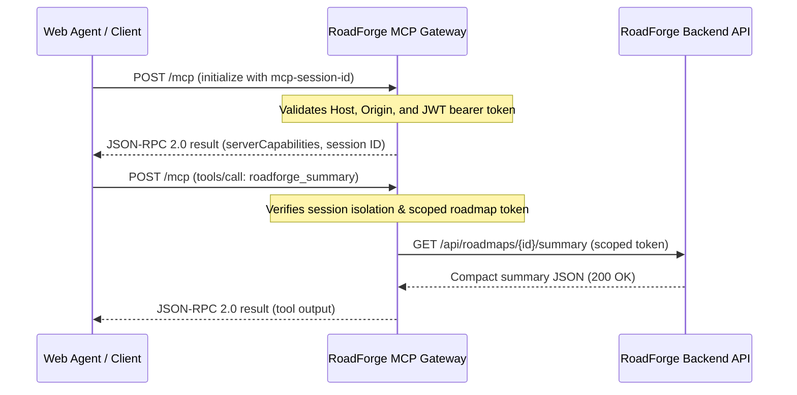

# RoadForge Remote MCP Integration and Deployment Architecture

## Executive Summary

RoadForge introduces a secure remote Model Context Protocol (MCP) server enabling web agents and external coding assistants to interact with RoadForge roadmaps over standard JSON-RPC 2.0 and Server-Sent Events (SSE) transports. The service architecture separates team-restricted hosted gateway deployments (Mode A) from self-hosted developer workflows (Mode B), enforcing least-privilege scoping, cryptographic authentication, session isolation, and strict input limits.

This document details the transport implementation, deployment models, operational security controls, and hosting-bay deployment prerequisites.

---

## 1. Remote MCP Transport Architecture

The remote MCP server is implemented in `packages/roadforge-mcp/src/http-server.mjs` using native Node.js HTTP primitives (`node:http`) and cryptographic standards (`node:crypto`) with zero external runtime dependencies.

### Supported Endpoints

| Method | Path | Protocol | Purpose | Authentication |
| :--- | :--- | :--- | :--- | :--- |
| `POST` | `/mcp` | JSON-RPC 2.0 | Synchronous tool execution and protocol lifecycle | Enforced in Mode A (JWT); Token enforced in Mode B outside loopback |
| `GET` | `/mcp` or `/sse` | Server-Sent Events | Streaming protocol responses and notifications | Enforced in Mode A (JWT); Token enforced in Mode B outside loopback |
| `GET` | `/health` | HTTP JSON | Uptime, server version, mode, and protocol check | Public (unauthenticated, strict headers) |

### Protocol Flow



---

## 2. Deployment Modes and Security Controls

### Mode A: Hosted Team Gateway (`ROADFORGE_MCP_MODE=team-gateway`)
Mode A is designed for the official hosted deployment (`roadforge.anvilary.tools`) or corporate team clusters:
- **Standards-Compliant Authentication**: Rejects requests lacking a valid signed team JSON Web Token (`Authorization: Bearer <jwt>`) with `HTTP 401 Unauthorized`. Single shared secrets are rejected as an incomplete team-membership model.
- **Verifiable User Identity**: Enforces standard claims (`sub` or `email`, active `exp`/`nbf`, matching `aud`) and team membership roles.
- **Revocable Authorization**: Validates incoming tokens against operator-managed revocation sets (`ROADFORGE_MCP_REVOKED_TOKENS`) for individual token IDs (`jti`) or subject IDs (`sub`).
- **Fixed Upstream API Origin**: The RoadForge API origin is strictly fixed by the operator via `ROADFORGE_API_URL` (e.g. `http://roadforge-api:7878`). Caller attempts to override the upstream origin via `x-roadforge-api-url` are rejected with `HTTP 400 Bad Request` to eliminate SSRF and credential forwarding.
- **Independent Roadmap Authorization**: Clients supply per-request scoping headers (`x-roadforge-roadmap-id` and `x-roadforge-session-token`). The gateway does not expose master production roadmap credentials to clients; upstream API enforces role permissions independently.
- **Protocol Session Isolation**: Isolates initialization and execution state per client using unique `mcp-session-id` identifiers. Cross-client initialization leaks are prevented.
- **DNS-Rebinding Protection**: Validates the `Host` header against `ROADFORGE_MCP_ALLOWED_HOSTS`. Untrusted hosts are rejected with `HTTP 400 Bad Request`.
- **HTTP Origin and CORS Defense**: Validates incoming `Origin` headers against `ROADFORGE_MCP_ALLOWED_ORIGINS`. Untrusted origins receive `HTTP 403 Forbidden`. The server never emits permissive `Access-Control-Allow-Origin: *` headers.
- **Content-Type Enforcement**: Rejects non-JSON POST requests with `HTTP 415 Unsupported Media Type`.
- **Hardened Payload Limits**: Enforces a strict 1 MB maximum payload size to prevent denial-of-service memory exhaustion.

### Mode B: Self-Hosted Developer Mode (`ROADFORGE_MCP_MODE=self-hosted`)
Mode B is designed for individual users, offline environments, and local team workstations:
- **Dual Transport Support**: Can be invoked via standard I/O (`roadforge-mcp stdio`) for desktop LLM clients (Claude Desktop, Cursor, Antigravity) or via HTTP (`roadforge-mcp serve-http --port 8787`) for local network agents.
- **Loopback Safety**: Unauthenticated HTTP access is permitted only when strictly bound to loopback interfaces (`127.0.0.1`, `localhost`, `::1`).
- **Protection Beyond Loopback**: Binding beyond loopback (e.g. `0.0.0.0` or a public IP) strictly requires `ROADFORGE_MCP_AUTH_TOKEN`. Unauthenticated external exposure is blocked.
- **Zero Cloud Dependency**: Operates entirely against local file exports or a self-hosted RoadForge API instance.

---

## 3. CLI Command Surface

The MCP package exposes direct commands via `roadforge-mcp` (or `npx @anvilary/roadforge-mcp`):

```bash
# Standard I/O mode (default for local desktop agents)
roadforge-mcp

# Streamable HTTP/SSE mode (default port 8787 on loopback)
roadforge-mcp serve-http --port 8787 --host 127.0.0.1

# Hosted team gateway invocation with verified JWT secret
ROADFORGE_MCP_MODE=team-gateway \
ROADFORGE_MCP_JWT_SECRET=production-signing-secret \
ROADFORGE_API_URL=http://roadforge-api:7878 \
ROADFORGE_MCP_ALLOWED_HOSTS=mcp.roadforge.anvilary.tools,roadforge-mcp \
ROADFORGE_MCP_ALLOWED_ORIGINS=https://roadforge.anvilary.tools \
node packages/roadforge-mcp/src/cli.mjs serve-http --port 8787 --host 0.0.0.0
```

---

## 4. Hosting-Bay Deployment Assessment and Blocker

### Inspected Environment
- **Host**: `hosting-bay.tail436dfb.ts.net` (Tailscale IP `100.95.141.94`)
- **Existing RoadForge Stack**: `/opt/stacks/roadforge` containing:
  - `roadforge-web` (port 3020)
  - `roadforge-api` (port 7878)
  - `roadforge-postgres` (PostgreSQL 16)
  - `roadforge-redis` (Redis 7)
- **Reverse Proxy**: Edge Caddy container terminating TLS for `roadforge.anvilary.tools`.

### Deployment Blockers Identified

1. **DNS Delegation Missing**:
   ```bash
   dig +short mcp.roadforge.anvilary.tools
   # Result: NXDOMAIN (DNS record does not exist)
   ```
   The DNS zone for `anvilary.tools` is managed upstream in Cloudflare and cannot be updated from within the hosting-bay virtual machine. Deploying without valid DNS breaks public routing and automatic TLS certificates.

2. **Identity Provider Integration Pending**:
   The Anvilary-hosted MCP gateway requires verifiable user identity and revocable authorization integrated with the team identity provider (Cloudflare Access / Anvilary SSO OIDC). External IdP credentials and public signing keys are currently unavailable in the hosting-bay environment.

Per project release instructions:
> *"If trusted identity-provider integration requires an unavailable external credential or user authorization, document the blocker and leave the gateway undeployed."*

Per release safety guidelines, the gateway is left undeployed until both DNS records and external IdP credentials are provisioned.

---

## 5. Hosting-Bay Production Deployment Specification

Once the Cloudflare DNS record `mcp.roadforge.anvilary.tools` -> `hosting-bay` and team IdP signing credentials are provisioned, deploy the remote MCP container using the following configuration:

### Dockerfile Path and Container Build

- **Dockerfile Path**: `packages/roadforge-mcp/Dockerfile`
- **Execution User**: Non-root `mcp` (uid 1001, gid 1001)
- **Base Image**: `node:24-alpine`
- **Health Check**: `GET http://127.0.0.1:8787/health`

### Docker Compose Service Definition

Add to `/opt/stacks/roadforge/docker-compose.yml`:

```yaml
  roadforge-mcp:
    image: roadforge-mcp:latest
    build:
      context: .
      dockerfile: packages/roadforge-mcp/Dockerfile
    restart: unless-stopped
    read_only: true
    cap_drop:
      - ALL
    security_opt:
      - no-new-privileges:true
    pids_limit: 256
    tmpfs:
      - /tmp:rw,noexec,nosuid,nodev,size=64m
    environment:
      - ROADFORGE_MCP_MODE=team-gateway
      - ROADFORGE_MCP_JWT_SECRET=${ROADFORGE_MCP_JWT_SECRET:?ROADFORGE_MCP_JWT_SECRET is required}
      - ROADFORGE_MCP_REVOKED_TOKENS=${ROADFORGE_MCP_REVOKED_TOKENS:-}
      - ROADFORGE_API_URL=http://roadforge-api:7878
      - ROADFORGE_MCP_PORT=8787
      - ROADFORGE_MCP_HOST=0.0.0.0
      - ROADFORGE_MCP_ALLOWED_HOSTS=mcp.roadforge.anvilary.tools,roadforge-mcp
      - ROADFORGE_MCP_ALLOWED_ORIGINS=https://roadforge.anvilary.tools
    networks:
      - roadforge-internal
      - edge
    depends_on:
      roadforge-api:
        condition: service_healthy
    healthcheck:
      test:
        [
          "CMD-SHELL",
          "node -e \"fetch('http://127.0.0.1:8787/health').then(r=>process.exit(r.ok?0:1)).catch(()=>process.exit(1))\"",
        ]
      interval: 30s
      timeout: 5s
      retries: 5
      start_period: 15s
```

### Edge Caddy Reverse Proxy Block

Add to the Caddyfile configuration:

```caddy
mcp.roadforge.anvilary.tools {
    encode gzip zstd

    # Rate limit and payload guard
    request_body {
        max_size 1MB
    }

    reverse_proxy roadforge-mcp:8787 {
        header_up Host {host}
        header_up X-Real-IP {remote_host}
        header_up X-Forwarded-For {remote_host}
        header_up X-Forwarded-Proto {scheme}

        # Flush immediately for SSE streams
        flush_interval -1
    }
}
```

---

## 6. Verification and Test Evidence

The remote MCP HTTP, SSE, and stdio implementations are thoroughly covered by automated test suites:
- **Unit & Security Suite**: `packages/roadforge-mcp/test/http-server.test.mjs`
  - Health endpoint verification (`GET /health` returns status `ok`, mode `self-hosted`, correct version).
  - HTTP Origin validation: Untrusted origins rejected with `403 Forbidden`; trusted origins reflected explicitly; wildcard `*` never emitted.
  - Host validation & DNS-rebinding protection: Untrusted `Host` headers rejected with `400 Bad Request`.
  - Content-Type enforcement: Non-JSON payloads rejected with `415 Unsupported Media Type`.
  - Unauthenticated non-loopback protection: Self-hosted mode bound beyond loopback without an auth token rejected with `401 Unauthorized`.
  - Standards-compliant JWT authentication: Verifies signature, expiration, audience, user identity, team membership, and revocable token lists.
  - Fixed upstream origin: Header `x-roadforge-api-url` rejected in hosted mode with `400 Bad Request`.
  - Session isolation: Protocol initialization state strictly partitioned by `mcp-session-id`.
  - Resource protections: Request bodies exceeding 1 MB terminated with `413 Payload Too Large`; SSE keepalive timers cleanly detached on disconnect.
- **Genuine Client Integration Suite**: `packages/roadforge-mcp/test/mcp-client-integration.test.mjs`
  - Complete MCP client lifecycle: `initialize` handshake, protocol negotiation (`2025-11-25`), tool discovery (`tools/list`), and execution (`tools/call`).
  - Session isolation across concurrent client instances.
  - Reconnect and session resumption over SSE and POST transports.
  - Authentication failure handling and rejection.
- **Execution Result**: 29 of 29 tests passed in the MCP package.
