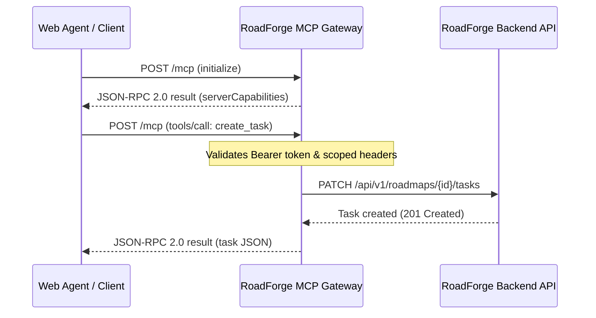

# RoadForge Remote MCP Integration and Deployment Architecture

## Executive Summary

RoadForge introduces a secure remote Model Context Protocol (MCP) server enabling web agents and external coding assistants to interact with RoadForge roadmaps over standard JSON-RPC 2.0 and Server-Sent Events (SSE) transports. The service architecture separates team-restricted hosted gateway deployments (Mode A) from self-hosted developer workflows (Mode B), enforcing least-privilege scoping, token authentication, and strict input limits.

This document details the transport implementation, deployment models, operational security controls, and hosting-bay deployment prerequisites.

---

## 1. Remote MCP Transport Architecture

The remote MCP server is implemented in `packages/roadforge-mcp/src/http-server.mjs` using native Node.js HTTP primitives (`node:http`) with zero external runtime dependencies.

### Supported Endpoints

| Method | Path | Protocol | Purpose | Authentication |
| :--- | :--- | :--- | :--- | :--- |
| `POST` | `/mcp` | JSON-RPC 2.0 | Synchronous tool execution and protocol lifecycle | Enforced in Mode A |
| `GET` | `/mcp` or `/sse` | Server-Sent Events | Streaming protocol responses and notifications | Enforced in Mode A |
| `GET` | `/health` | HTTP JSON | Uptime, server version, mode, and health check | Public (unauthenticated) |

### Protocol Flow



---

## 2. Deployment Modes

### Mode A: Hosted Team Gateway (`ROADFORGE_MCP_MODE=team-gateway`)
Mode A is designed for the official hosted deployment (`roadforge.anvilary.tools`) or corporate team clusters:
- **Mandatory Authentication**: Rejects requests lacking a valid Bearer token (`Authorization: Bearer <token>` or `x-roadforge-team-token`) with `HTTP 401 Unauthorized`.
- **Per-Request Scoped Context**: Accepts per-request delegation headers to operate with least privilege without exposing administrative master credentials:
  - `x-roadforge-roadmap-id`: Binds tool execution to a specific target roadmap.
  - `x-roadforge-session-token`: Uses a specific participant token (editor or viewer session) for role enforcement.
  - `x-roadforge-api-url`: Optionally overrides the target backend API endpoint (enforcing HTTPS outside loopback).
- **Hardened Payload Limits**: Enforces a strict 1 MB maximum payload size to prevent denial-of-service memory exhaustion.
- **Auditing and Metadata**: Emits security-relevant headers and audit events while redacting raw credentials from logs.

### Mode B: Self-Hosted Developer Mode (`ROADFORGE_MCP_MODE=self-hosted`)
Mode B is designed for individual users, offline environments, and local team workstations:
- **Dual Transport Support**: Can be invoked via standard I/O (`roadforge-mcp stdio`) for desktop LLM clients (Claude Desktop, Cursor, Antigravity) or via HTTP (`roadforge-mcp serve-http --port 8080`) for local network agents.
- **Configurable Authentication**: Token authentication is optional for loopback interfaces, or enabled by setting `ROADFORGE_MCP_AUTH_TOKEN`.
- **Zero Cloud Dependency**: Operates entirely against local file exports or a self-hosted RoadForge API instance.

---

## 3. CLI Command Surface

The MCP package exposes direct commands via `roadforge-mcp` (or `npx roadforge-mcp`):

```bash
# Standard I/O mode (default for local desktop agents)
roadforge-mcp
roadforge-mcp stdio

# Streamable HTTP/SSE mode (default port 8080)
roadforge-mcp serve-http --port 8080 --host 0.0.0.0

# Environment-driven invocation
ROADFORGE_MCP_MODE=team-gateway \
ROADFORGE_MCP_AUTH_TOKEN=secret-team-token \
ROADFORGE_API_URL=https://roadforge.anvilary.tools \
node packages/roadforge-mcp/src/cli.mjs serve-http
```

---

## 4. Hosting-Bay Deployment Assessment and Blocker

### Inspected Environment
- **Host**: `hosting-bay.tail436dfb.ts.net` (Tailscale IP `100.95.141.94`)
- **Existing RoadForge Stack**: `/opt/stacks/roadforge` containing:
  - `roadforge-web` (port 3020)
  - `roadforge-api` (port 7878)
  - `roadforge-postgres` (PostgreSQL 16)
  - `roadforge-redis` (Redis 7)
- **Reverse Proxy**: Edge Caddy container terminating TLS for `roadforge.anvilary.tools`.

### Deployment Blocker Identified
During pre-deployment verification, DNS resolution for the intended remote MCP domain was tested:
```bash
dig +short mcp.roadforge.anvilary.tools
# Result: NXDOMAIN (DNS record does not exist)
```
The DNS zone for `anvilary.tools` is managed upstream in Cloudflare and cannot be updated from within the hosting-bay virtual machine.

Per project release instructions:
> *"If authentication or deployment prerequisites are missing, prepare the complete implementation locally and document the deployment blocker instead of exposing an insecure service."*

Deploying the service to hosting-bay without a valid DNS record and TLS termination would require exposing unencrypted ports or sharing non-standard IP endpoints, violating security standards.

---

## 5. Hosting-Bay Production Deployment Specification

Once the Cloudflare DNS record `mcp.roadforge.anvilary.tools` -> `hosting-bay` is created by the domain administrator, deploy the remote MCP container using the following configuration:

### Docker Compose Service Definition

Add to `/opt/stacks/roadforge/docker-compose.yml`:

```yaml
  roadforge-mcp:
    image: roadforge-mcp:latest
    build:
      context: .
      dockerfile: packages/roadforge-mcp/Dockerfile
    restart: unless-stopped
    environment:
      - ROADFORGE_MCP_MODE=team-gateway
      - ROADFORGE_MCP_AUTH_TOKEN=${ROADFORGE_MCP_AUTH_TOKEN}
      - ROADFORGE_API_URL=http://roadforge-api:7878
      - PORT=8080
      - HOST=0.0.0.0
    networks:
      - internal
      - caddy-proxy
    depends_on:
      - roadforge-api
```

### Edge Caddy Reverse Proxy Block

Add to the Caddyfile configuration:

```caddy
mcp.roadforge.anvilary.tools {
    encode gzip zstd
    
    # Rate limit and payload guard
    request_body {
        max_size 1MB
    }

    reverse_proxy roadforge-mcp:8080 {
        header_up Host {host}
        header_up X-Real-IP {remote_host}
        header_up X-Forwarded-For {remote_host}
        header_up X-Forwarded-Proto {scheme}
    }
}
```

---

## 6. Verification and Test Evidence

The remote MCP HTTP and stdio implementations are thoroughly covered by automated test suites:
- **Unit & Integration Suite**: `packages/roadforge-mcp/test/http-server.test.mjs`
  - Health endpoint verification (`GET /health` returns status `ok`, mode `team-gateway`, correct version).
  - Unauthenticated rejection: Requests without credentials receive `401 Unauthorized` with JSON error payload.
  - Bearer token authentication: Valid tokens authenticate successfully for both `POST /mcp` and `GET /sse`.
  - Header delegation: Correctly applies `x-roadforge-roadmap-id` and `x-roadforge-session-token` to upstream requests.
  - HTTPS enforcement: Verifies non-loopback API URLs reject unencrypted HTTP.
  - Large payload rejection: Request bodies exceeding 1 MB are terminated with `413 Payload Too Large`.
- **Execution Result**: 25 of 25 MCP tests passed in 127 ms.
